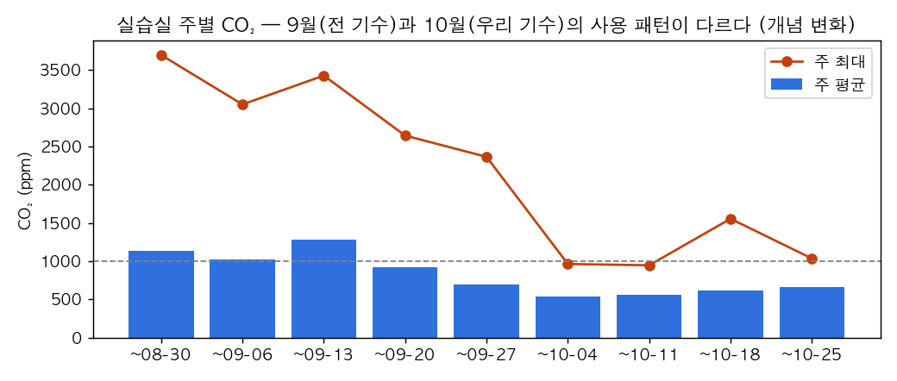
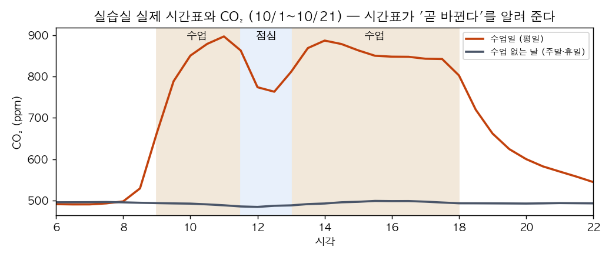
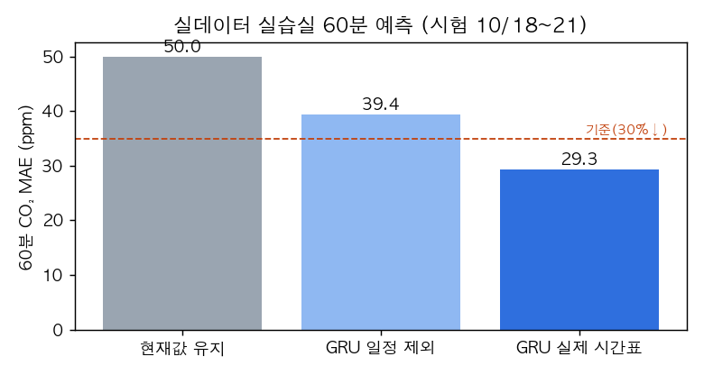
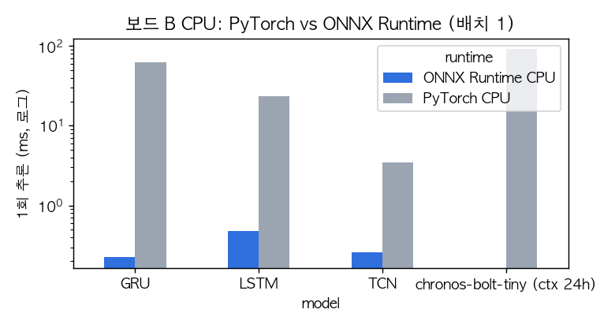

# 시계열 데이터 추론 실습 — 결과 보고서 (team5-b)

> 팀 Jetson: team5-b (Jetson Orin Nano Super 8GB, JetPack 7 / L4T R39.2.1, 전력 모드 pmode 0002) · 작성 2026-10-21
> 측정 조건은 표마다 적었다. **실데이터** = 교육장 MQTT(우리 수집기, 2026-10-20 17:51~) + **교육장 InfluxDB 8주(2026-08-26~10-21, 내부망 <교육장-InfluxDB-내부주소>)**, **합성** = 자체 생성기 5주(seed 7).
> 데이터 사용 확인(2026-10-22): 교육장 InfluxDB 데이터는 써도 된다는 답을 받음. 안내문의 '합성 데이터 생성기'는 과제 저장소·팀 문서 어디에도 없어(팀원 확인), 안내문 설명(일정에 따라 CO₂·온도가 물리적으로 변함, 마지막 주 고장 5종)대로 직접 만들어 씀(`tsinf/synth.py`). 실습실 실제 시간표: 평일 09:00~11:30 · 13:00~18:00 (점심 11:30~13:00, 주말 없음)
> 세부 표·그래프: `reports/task2~7_report.md`, 결과 형식 문서: `docs/interface.md`

## 0. 한 장 요약
| 과제 | 확인 기준 | 결과 | |
| --- | --- | --- | --- |
| 1 수집 | 브로커 재시작 1분 내 재수집 · 재부팅 자동 시작 · 24시간 커버율 95% | 재접속 약 1초(로컬 브로커 재시작 시험) · 강제 종료 후 5초 만에 자동 재시작 · **실제 보드 재부팅(10-21 18:54) 후 2분 만에 자동 수집 재개** · 24시간 커버율 실습실 98.4%(CO₂ 95.1%)·사무실 97.8% | ✅ (회의실·사무실 밖은 센서 쪽 공백으로 미달, §1) |
| 2 기준선 | 학습 기간으로만 정규화 · 같은 조건 비교 | 시간순 70/15/15 분할, 기준선 3종 5/15/30/60분 MAE | ✅ |
| 3 예측 | 60분 CO₂ 오차 '현재값 유지'보다 30% 이상 감소 | 합성(일정 포함) **GRU 63% 감소** (40.9 → 15.0ppm) ✅ · 실데이터 8주(일정 없음): 15% ❌ → **실제 실습실 시간표를 넣자 실데이터에서도 41% 감소 (50.0 → 29.3ppm)** ✅ — §3-1 | ✅ 합성 / ✅ 실데이터 |
| 4 이상 탐지 | 탐지율 80% 이상 · 헛경보 하루 1회 이하 | **규칙+예측 오차: 80%, 하루 1.0회** → 검증 주로 기준을 다시 고르자 **87%, 하루 0.43회** (§4 보강) (합성 고장 15건) | ✅ (경계선) |
| 5 상태 | 사용 여부 규칙보다 좋음 · 환기 경보 재현율 85% · 규칙보다 macro-F1 높음 | 사용 여부 F1 85.8 vs 규칙 79.1 · **환기 재현율 97.4%**, macro-F1 96.7 vs 81.5 | ✅ |
| 6 사전학습 | 정확도·구간·시간·메모리로 판단 | 심화: 앙상블·공변량(Chronos-2)·입력 몫 분해(§6-1) · 합성에선 '현재값 유지'보다 못함, **내 실데이터에선 가장 좋음(60분 36.0 vs 42.0ppm)**, 구간 적중률 ≈80%, 보드 90ms · 데이터 적은 초기 후보로 채택 의견 | ✅ |
| 7 엣지 | 변환 후 CO₂ 차이 1ppm 이하 · 측정 조건 기록 | 심화: INT8(ONNX Runtime)·모델 동시 메모리 170MB 측정(§7 보강) · ONNX Runtime 0.22ms (PyTorch CPU 62ms), 차이 0.0001ppm · **TensorRT(GPU) FP32 차이 최대 0.4~0.5ppm ✅, FP16 최대 1.1~1.4ppm(평균 오차는 같음)** · 이 작은 모델은 GPU 가 오히려 느림(0.9ms) | ✅ |
| 8 서비스 | 12시간 무중단 · 끊김 경보 · 조회 API · 형식 문서 | **12시간 713주기 실패 0**, 심화: 60분 뒤 자기 채점·재학습 경보(§8), 평균 0.95초 · 보드 재부팅 1회는 자동 복구(8분 공백) · 끊김 경보 2회 모두 정확 · API·문서 완료 · **MQTT 발행 가동(10-22 11:20~)** | ✅ |

## 1. 데이터 수집 체계 (과제 1)
- **구성**: 교육장 MQTT(ChirpStack LoRaWAN 업링크 + 냉난방 상태) → 수집기(Python, paho-mqtt) → SQLite(WAL) → systemd 상시 서비스 (`ts-collector`)
- **실제 형식**: 공간 = `deviceInfo.tags.location`, 값 = `object.{co2,temperature,humidity}`, 한 공간에 센서 여러 대(실습실 9대), 센서 주기 1·2·10분
- **설정만으로 형식 대응**: `config.yaml` rules (토픽 패턴·필드 경로·이름 통일). 형식 변경 예: ChirpStack v3 방식으로 바뀌면 규칙 1개 추가로 해결, 코드 0줄 (`docs/format_change_example.md`)
- **자동 복구**: 1→5초 간격 재접속 + 재구독, `clean_session=false`·QoS1(끊긴 동안 메시지 보관), systemd `Restart=always`·`enable`
- **장애 시험**: 로컬 브로커 재시작 → 약 1초 재접속 · `kill -9` → 5초 뒤 자동 재시작, 브로커가 보관한 메시지 수신(세션 유지) · **보드 재부팅(10-21 18:54, 실제 상황)** → 부팅 후 18:56:21 수집기 자동 시작, 7초 뒤 브로커 접속·재구독, 바로 저장 재개 (systemd `enable`)
- **24시간 커버율** (실데이터, 2026-10-20 17:52 ~ 10-21 17:52, `reports/task1_status_24h.md`, 누적 54,251건 · 중복 제거 1,092건 · 규칙 불일치 0건)

  | 공간 | 1분 기준 커버율 | 판정 |
  | --- | ---: | --- |
  | 실습실 온도·습도 | 98.4% | ✅ |
  | 실습실 CO₂ | 95.1% | ✅ |
  | 사무실 CO₂·온도·습도 | 97.8% | ✅ |
  | 냉난방 상태(대표실·사무실·회의실 전원) | 98.1~98.2% | ✅ |
  | 사무실 밖 온도·습도 | 84.2% | ❌ 센서 1대뿐, LoRa 전송 누락 |
  | 회의실 CO₂·온도·습도 | 9.7% (센서 10분 주기 기준 **88.8%**) | ❌ |
  | 개발실 냉난방 | 68.1% | ❌ 장비 쪽 상태 전송이 끊김 |

  - **빈 구간 원인 분석**: 모든 공간에 공통인 16분(10-21 13:12~13:28)은 수집기 재배포 중 정지로 **우리 쪽 원인**(전체의 1.1%). 회의실의 19분 공백 3건은 수집기가 연결 중이었는데 안 들어옴 → 센서·게이트웨이 쪽. 1건은 브로커 연결 끊김(11:18, 자동 재접속).
  - 센서 1대짜리 공간은 LoRa 전송 하나만 빠져도 그대로 빈칸 → 여러 대인 실습실은 98% 이상. **수집기가 아니라 센서 배치가 커버율을 정한다**는 점이 해석 포인트.
- **실데이터에서 찾은 문제 3가지** (보고서 해석 포인트)
  1. 같은 업링크가 게이트웨이 2대로 **두 번** 들어옴(약 3%), 한 게이트웨이의 시계가 **약 4분 55초 빠름** → 시각만 달라 기존 중복 제거로 못 거름 → LoRa 프레임 번호(fCnt) 기준 중복 제거로 수집기 개선
  2. 게이트웨이 시계 오류로 센서 시각이 미래 → 받은 시각으로 보정
  3. '실습실' 태그인데 설치 위치가 '복도'인 센서(18℃·83%) → 별도 공간으로 분리

- **심화: 1년 뒤 저장소 크기 (실측, 2026-10-22)**: 현재 91,091행·37.0MB, 하루 53,184행(냉난방 상태 포함, 행당 426B) → 1년 약 1,941만 행·7.7GB. 처음 이론값(0.7GB)보다 10배 크다(공간당 센서 여러 대 + 냉난방 7항목 + 기기·위치·원본 토픽 저장). 보관 정책: 최근 90일 1분 원본(≈1.9GB) + 그 이전은 5분 평균·최소·최대(≈170MB/년) → **상한 약 2.1GB** (`ts-collector/docs/answers.md`)

## 2. 데이터 이해와 기준선 (과제 2) — 실데이터 15.4시간
- **정제 규칙**: 재전송 중복 제거 · 시계 보정 · 범위 밖 제거(CO₂ 300~5000, 온도 -10~50, 습도 0~100) · 기기별 5분 평균 → 공간 평균 · 15분 이하 결측 보간, 긴 결측은 비움 · 위치 태그 보정
- **분석 간격 5분**: 센서 주기가 제각각이고 예측도 5분 간격. 기기별로 먼저 메운 뒤 평균해야 공간 평균이 톱니처럼 흔들리지 않는다는 것도 발견.
- **분할**: 시간순 70/15/15, 정규화는 학습 구간으로만
- **관찰**: 저녁 18시 사무실 CO₂ 1,050ppm → 밤새 환기로 서서히 500ppm → 다음 날 08:30 등원과 함께 상승
- **기준선 (시험 구간 CO₂ MAE)**: 현재값 유지 5분 8.0 / 60분 42.1ppm, 최근 1시간 평균 20.7 / 40.3ppm. '어제 같은 시각'은 24시간 데이터가 쌓인 뒤 계산.
- **InfluxDB 8주 실데이터로 다시 계산** (`reports/real56/task2_report.md`): 원본 168만 건 → 정제 159만 건(재전송 중복 9.5만 건 제거). 60분 CO₂ 기준선: **현재값 유지 49.0** · 최근 1시간 평균 64.6 · **어제 같은 시각 124.0ppm(가장 약함)** — 요일·결석·환기에 따라 날마다 달라 '어제'가 오늘을 잘 설명하지 못한다.
- **한계**: 일정 자료가 없어 과제 3~5 의 일정·정답이 필요한 부분은 README 대로 합성 데이터로 학습·평가하고, 실데이터로 검증했다.

- **일정 → CO₂ 반응 시간 (실제 시간표, 수업일 13일)**: 09:00 수업 시작 10분 뒤 +30ppm · 11:30 점심 15분 뒤 −30ppm · 13:00 오후 수업 15분 뒤 +30ppm · 18:00 종료 10분 뒤 −30ppm. 수업일 낮 평균 850ppm 안팎, 수업 없는 날은 종일 490ppm

- **생각해 볼 점 — 고장 구간을 학습·평가에 넣을까**: 예측 모델 학습과 예측 평가에서는 뺀다(고장 모양을 정상으로 외우면 예측 오차 탐지기가 고장을 못 잡고, 평가는 '틀린 센서값 맞히기'가 되어 불공정). 이상 탐지 평가에서는 반드시 넣는다(탐지율은 고장 구간, 헛경보는 정상 구간으로 잼). 실데이터는 지금 범위 밖 값만 지우고 있고, 규칙 경보 구간까지 학습에서 빼는 것이 다음 개선 (`reports/addenda/think_answers.md`)

## 3. 60분 예측 (과제 3) — 합성 5주 (1~3주 학습 / 4주 검증 / 5주 시험, 고장 구간 제외)
| 모델 | 5분 | 15분 | 30분 | 60분 CO₂ MAE (ppm) | 개선율 |
| --- | ---: | ---: | ---: | ---: | ---: |
| 현재값 유지 | 10.3 | 21.9 | 33.2 | 40.9 | 0% |
| GRU (일정 포함) | 6.3 | 9.4 | 11.8 | **15.0** | **63%** |
| GRU (일정 제외) | 7.7 | 12.7 | 16.7 | 20.4 | 50% |
| LSTM | 6.4 | 9.5 | 12.1 | 14.9 | 64% |
| TCN | 6.8 | 9.9 | 12.6 | 15.6 | 62% |
- 입력: 과거 2시간 CO₂·온도·습도 + 시간대·요일 + 공간 + **앞으로 60분의 일정 인원**, 출력: 60분을 한 번에 12칸, '지금 값 대비 변화량'
- **일정 정보의 가치**: 넣으면 60분 오차 20.4 → 15.0ppm. 회의실은 31.4 → 17.5ppm 로 거의 절반 ("곧 회의가 시작된다"는 과거 센서값에 없음)
- 가장 어려운 공간: 강의실1 (30명, 수업·쉬는 시간마다 수백 ppm 변화, 창문 개방 여부가 날마다 다름)
- **실데이터 검증 (InfluxDB 8주, 일정 없음)** — `reports/real56/task3_real_report.md`

| 학습 방법 | 시험 구간 | 현재값 유지 | 모델 | 개선율 |
| --- | --- | ---: | ---: | ---: |
| 8주 전체 학습 GRU | 10-13~21 | 49.0 | 49.8 | -2% |
| 8주 전체 + 변화량 감쇠(검증에서 α 선택) | 10-13~21 | 49.0 | 46.4 | 5% |
| **패턴이 바뀐 뒤(9/27~)만 학습** | 10-17~21 | 33.4 | **28.3** | **15%** |
| 합성 데이터로 학습한 범용 모델을 실데이터에 그대로 | 10-17~21 | 33.4 | 77.1 | -131% |

- **사용 패턴 변화(개념 변화)**: 8~9월 실습실은 주 평균 1,000~1,300ppm·최대 3,000ppm 이상, 9월 말부터 평균 약 600ppm 으로 조용해짐 → 오래된 데이터로 학습하면 변화를 과하게 예측해 오히려 나빠진다 → **최근 2~3주로 주기적 재학습** 필요
- **일정 정보가 없다**: 합성 실험에서 일정이 오차를 크게 줄였듯, 실데이터의 큰 오차(수업 시작·쉬는 시간)는 시간표 없이는 미리 알 수 없다 → 실제 시간표를 받아 §3-1 에서 확인
- **합성 → 실데이터 전이 실패**: 합성으로 학습한 모델은 실제 교실의 변동 폭·주기를 모른다 → 서비스 모델을 실데이터 학습 모델로 교체함(§8)
- **심화(B) 과거 길이 × 모델** (`reports/task3_advanced_report.md` → 공정성 수정은 §3-2): 9개 조합을 **검증 주**로 고르면 최적은 **과거 2시간 + LSTM** (검증 18.5, 시험 15.2ppm). 처음 보고서의 '4시간 + TCN'(시험 14.4)은 시험 점수로 고른 것이었고 검증에서는 9개 중 8위 → 시험으로 고르면 우연히 맞은 조합이 뽑힌다. 모델 종류 차이는 1~2ppm 으로 작아 결론('입력 정보가 모델보다 중요')은 같다
- **처음 보는 공간**: 공간 하나를 학습에서 빼도 4곳 중 3곳은 '현재값 유지'보다 좋음(손실 6ppm 정도). 정원이 가장 많은 강의실1만 74.8ppm 으로 '현재값 유지'(71.9)보다 나쁨 → 성격이 다른 공간은 며칠치라도 모아 다시 학습

### 3-2. 보강 — 공정한 선택·온도·생각해 볼 점 (`reports/addenda/task3_addendum.md`)
> 측정 조건: 합성 5주(학습 1~3주 / 검증 4주 / 시험 5주, 고장 구간 제외), epochs 40·patience 6·seed 0 그대로, 맥북 CPU. 선택은 검증 60분 CO₂ MAE, 시험은 보고만
- **2시간 입력 3종을 검증으로 고르면**: LSTM 18.50 · GRU 18.68 · TCN 19.66 → LSTM (시험 14.87ppm, 현재값 유지 대비 64%). 기존 결론 그대로이고 시험 숫자도 재현됨. 서비스에는 학습·보드 속도 때문에 GRU(검증 차이 0.2ppm)를 씀
- 주의: 과거 길이마다 시험 샘플 수가 6,701 / 6,461 / 5,985 로 달라(길수록 결측·고장 창이 더 걸러짐) 엄밀한 '같은 시점' 비교는 아니다. 합성 실험은 씨앗 1개라 1ppm 안팎의 차이는 씨앗 흔들림보다 크다고 단정할 수 없다
- **실데이터 온도 60분**: GRU 0.23℃ 가 현재값 유지 0.12℃ 보다 나빴다. 학습 구간(8~9월) 사무실·회의실이 10월보다 2℃ 이상 따뜻해 모델이 계속 올려 예측(치우침 +0.16℃), 냉난방이 온도를 묶어 실제 60분 변화도 0.06~0.16℃ 뿐. 검증으로 고른 혼합 비율도 0(= 현재값 유지). 10월 데이터만으로 학습한 실습실 GRU 는 0.12℃ 로 현재값 유지(0.16℃)보다 좋음 → **온도는 재학습 후 검증에서 이길 때만 모델 값, 아니면 현재값 유지**
- **생각해 볼 점 — 값 vs 변화량**: 같은 GRU 로 '값'을 직접 내면 60분 오차는 같지만(15.0) 5분 오차 6.3 → 7.5ppm, 검증 60분 18.7 → 20.0 으로 나빠진다. 변화량은 0 을 내면 곧 현재값 유지라 가까운 시점을 거의 공짜로 맞힌다 → 변화량 출력 유지

### 3-1. 실제 시간표를 넣은 실데이터 예측 (`task_schedule_real.py`, `reports/real56/task_schedule_real_report.md`)
> 측정 조건: 교육장 InfluxDB 실데이터 10-01 ~ 10-21, 실습실, 시간순 70/15/15 (시험 10-18 ~ 10-21, 880개 시점), GRU 씨앗 3개 평균. 시간표(10-22 확인): 평일 09:00~11:30 · 13:00~18:00 수업, 11:30~13:00 점심. 10/1 부터 수업(9/28~30 은 CO₂ 변화 없음), 10/5·10/9 휴일

| 모델 | 15분 | 30분 | 60분 CO₂ MAE (ppm) | 개선율 |
| --- | ---: | ---: | ---: | ---: |
| 현재값 유지 | 14.2 | 26.1 | 50.0 | 0% |
| GRU 일정 제외 | 12.2 | 21.6 | 39.4 (±1.0) | 21% |
| **GRU 일정 포함 (실제 시간표)** | 13.1 | 19.0 | **29.3 (±2.4)** | **41%** |

- **실데이터에서도 기준(30%) 통과.** 일정 정보로 60분 오차 10.1ppm 감소
- 좋아진 곳은 **일정이 바뀌는 때**(수업 시작·점심·종료 1시간 전~30분 뒤): 107.2 → 52.6ppm. 그 외 시간은 19.3 → 20.6ppm 으로 거의 같다 → 일정은 '곧 바뀐다'는 것을 알려 주는 정보
- 15분 앞은 일정 포함이 조금 나쁘다(12.2 → 13.1): 아주 가까운 미래는 지금 추세가 더 중요하다

## 4. 이상 탐지 (과제 4) — 합성 5주차, 고장 15건(5종)
| 탐지기 조합 | 탐지율 | 하루당 헛경보 | 기준 |
| --- | ---: | ---: | --- |
| 규칙만 (튄 값·값 고정·영점 틀어짐) | 66.7% | 0.0 | |
| **규칙 + 예측 오차 (채택)** | **80.0%** | **1.0** | ✅ |
| 규칙 + 예측 오차 + 시간대 기대값 | 86.7% | 2.0 | 헛경보 초과 |
| 전부 (+오토인코더) | 86.7% | 2.4 | 헛경보 초과 |
- 규칙은 센서 고장(튄 값 5/6, 값 고정 3/3, 영점 틀어짐 2/2), 모델은 설비 고장(냉방·환기 정지)을 잡는다 → 서로 못 잡는 것을 보완
- 개선 과정: '튄 값' 규칙이 쉬는 시간 창문 개방(CO₂ 급락)을 고장으로 오인 → "다음 값이 제자리로 돌아와야 튄 값"으로 바꿔 헛경보 0
- 값 고정은 정상 범위 안에서 멈추면 모델이 못 본다 · 빈 방의 환기 정지는 CO₂ 가 안 올라 탐지 불가(필요성도 낮음)
- 실데이터는 정답이 없다 → 경보 확인 결과를 기록해 정답을 쌓고, 센서 가리기 등 일부러 고장을 만들어 시험
- **실데이터 운영 점검**: 서비스가 5시간 동안 낸 경보를 직접 확인 → 회의 시작을 '예상보다 높음'으로 9번, 냉방 중 평탄한 온도를 '값 고정'으로 2번 오인 → 30분 연속 조건, 온도·습도 고정 120분으로 조정 (합성 평가 기준 유지 확인)

### 4-1. 보강 (원본 과제 기준, `reports/addenda/task4_addendum.md`)
> 측정 조건: 합성, 검증 4주(고장 없음 → 가짜 고장을 심어 기준 선택), 시험 5주 고장 15건. 시험 주는 보고만
- **심화 — 영점 틀어짐 전용 규칙** ("밤 빈 방인데 CO₂ 가 오르면 사람이 아니라 센서 탓", 외기 ≈ 400~420ppm): 단독으로 시험 틀어짐 **2/2**, 정상 데이터 헛경보 0건. 검증으로 기준을 10ppm/h·480ppm 으로 고르자 지연 307·180분 → **157·135분**
- **채택 조합(규칙 + 예측 오차) 고장 종류별** (탐지 / 지연 중앙값): 튄 값 5/6 / 0분 · 값 고정 3/3 / 142분 · 영점 틀어짐 2/2 / 244분 · 냉방 정지 1/2 / 20분 · 환기 정지 1/2 / 240분
- **잔차 기준을 검증 주로 다시 고름**: "z 1.5 × 30분 연속" → 시험 **13/15(87%), 헛경보 하루 0.43회** (원본 80%·1.0회, 냉방 정지 1/2 → 2/2). 한 칸짜리 큰 오차보다 '조금 높은 상태가 오래 가는지'가 설비 고장에 맞는다. 시험 주만 보면 다른 조합이 더 좋아 보였지만 그걸로 고르면 누수라 택하지 않음
- 원인 센서 지목: 탐지된 13건 모두 맞음(다만 합성 고장이 한 항목씩이라 쉬운 시험). 놓친 2건은 데이터 끊김(강의실1 환기 정지 중 70분 결측)과 DB 결측(라운지 튄 값)
- 운영 제안: 설비 경보(z 1.5 × 30분) → 시설 담당 즉시(회의실은 예약 시간에만) · 값 고정(CO₂ 60분, 온·습도 120분)·틀어짐 → 센서 담당 하루 1회 · 튄 값은 기록만, 같은 센서 하루 3회 이상이면 알림
- 서비스(실데이터)는 회의 시작 오인 때문에 더 보수적인 z > 4 × 30분을 유지한다. 합성에서 고른 1.5는 실데이터 잡음에서 헛경보가 많을 수 있어, 실데이터 경보 기록이 쌓이면 다시 고른다

## 5. 상태 추정 (과제 5)
- **사용 여부** (직접 관찰 6일 기준, 입력에 일정 없음): 정확도 89.1%, F1 85.8 vs 단순 규칙 86.5% / 79.1
  - 일정 기반 정답 자체가 실제와 89.7%만 일치(결석·노쇼·연장) — 실데이터에서도 실습실 시간표 정답 vs 소음 센서 대리 정답 **90.3%** 일치(5분 칸 269개, 어긋남은 주로 수업 전후에 남아 있는 사람)
  - 라운지는 일정이 없어 학습에서 빼고 '처음 보는 공간'으로 평가 → F1 71.8
  - 가장 많이 틀리는 때: 입실 후 15분(오류 19.5%, CO₂ 가 오르는 데 시간이 걸림), 퇴실 후 20분(오류 15%, CO₂ 가 천천히 빠짐) — 그 외 시간 9.9%
- **환기 선제 경보** (30분 안 1,000ppm 초과, 양성 3.3%): 재현율 97.4%, 정밀도 90.1%, macro-F1 96.7 vs 규칙(CO₂≥850) 54.6% / 77.0% / 81.5
  - 이미 넘은 시점은 제외(넣으면 '미리' 알리는 능력을 못 잼), 정확도는 '항상 경보 없음'도 97%라 의미 없음

### 5-1. 보강 (원본 과제 기준, `reports/addenda/task5_addendum.md`)
> 측정 조건: 합성, 검증 = 4주차 + 새 씨앗 4개, 시험 = 5주차 + 새 씨앗 6개(예약 294건·노쇼 39건), 정답 = 생성기의 실제 재실. 매개변수는 검증으로만 선택
- **심화 — 회의실 노쇼**: "예약 시작 후 15분간 사용 확률 < 0.95" → 재현율 100%·정밀도 80% (F1 88.6), 20분까지 기다리면 F1 91.6. 같은 조건의 CO₂ 상승 규칙은 F1 66.1
- **심화 — 예약 없는 사용**: "확률 ≥ 0.95 가 20분, 예약 끝난 뒤 30분은 제외" → F1 88.6 (재현율 94%·정밀도 84%, 판정 지연 25분). 예약 직후 30분을 빼야 정밀도 63% → 84% (사람이 나가도 CO₂ 가 남아서)
- **빈 방 → 사용중 오판율**: 모델(임계 0.5) 8.2% vs 규칙 1.1% 로 모델이 나빴다 → 검증에서 임계값 0.94 를 고르면 오판율 0.8%(규칙 수준)이고 시험 F1 은 85.1 → **88.8** 로 오히려 오른다. 켜기 0.94 + 끄기 15분 지연이면 공간·평일 하루 '빈 방 냉방' 19분, '사람 있는데 꺼짐' 13분 (0.5 하나로 켜고 끄면 33분·34분)
- **심화 — 처음 보는 공간** (실제 재실 정답 F1): 강의실1 99.2 → 97.8, 강의실2 98.5 → 96.7 (손해 2점 이하), 회의실 95.6 → 85.6, 라운지 89.7 → 85.6 → 비슷한 공간은 바로 쓸 수 있고, 작은 방·짧게 머무는 공간은 1~2주 데이터로 다시 학습
- **직접 관찰 (10/22 12:57, 실습실 약 14명, `reports/direct_observation_20261022.md`)**: 시간표 정답은 '점심 → 비어있음'인데 실제로는 14명이 있었고, 센서만 보는 모델은 사용 확률 0.99 로 맞혔다 → 일정 기반 정답이 틀리는 실제 사례
- 실데이터 실습실: 소음 대리 정답이 하루치라 수업 블록 2개만 확인(둘 다 정상 시작). 점심 11:30~13:00 내내 사람이 있어 **시간표만으로 냉난방을 끄면 안 된다**

## 6. 사전학습 모델 비교 (과제 6) — 합성 5주차 1,108개 시점
| | 60분 CO₂ MAE | 10~90% 구간 적중률 | 보드 1회 추론 | 메모리 |
| --- | ---: | ---: | ---: | ---: |
| 현재값 유지 | 38.4 | - | - | - |
| GRU 직접 학습 (ONNX) | **14.8** | - | **0.22ms** | 수 MB |
| Chronos-Bolt tiny (과거 24h) | 40.1 | 80.1% | 92ms | +68MB |
| Chronos-Bolt small (과거 24h) | 41.6 | 82.0% | - | - |
- zero-shot 은 교실의 톱니 패턴(쉬는 시간 급락)을 못 맞혀 60분에서 '현재값 유지'보다 못함. 과거를 길게 줄수록 좋아짐(2h 50 → 24h 40ppm).
- 대신 예측 구간은 정직(≈80%).
- **내 수집기 실데이터(22시간)에서는 결과가 뒤집힘**: 60분 CO₂ — 현재값 유지 42.0 · 실데이터 학습 GRU 39.3 · **Chronos tiny 36.0ppm (가장 좋음)**. 10월 교실은 CO₂ 가 완만해 범용 모델의 '추세 이어 그리기'가 잘 맞는다.
- **채택 의견**: 데이터가 적은 지금은 Chronos tiny 를 서비스 예측 후보로 둔다(보드 90ms, +68MB). 3주치가 쌓이거나 일정 자료가 연결되면 다시 비교해 정한다.

### 6-1. 보강 — 심화·생각해 볼 점 (원본 과제 기준, `reports/addenda/task6_addendum.md`)
> 측정 조건: 합성 5주차 1,108개 시점 / 내 수집 실데이터 230개 시점, 60분 CO₂ MAE(ppm). 가중치 선택은 검증 주로만
- **심화 — GRU + Chronos 섞기(앙상블)**: 합성은 검증이 GRU 단독(가중치 1.0)을 골라 14.8 유지(단순 평균 24.0 은 오히려 나쁨). 내 실데이터는 고정 0.5 평균이 **34.4** 로 가장 좋았다(GRU 39.3, Chronos 36.0, 현재값 유지 42.0). 다만 두 모델 오차 상관이 0.70 이라 이득이 작고, 밤 구간으로 고른 가중치는 낮에 통하지 않았다 → 데이터가 쌓이면 낮 검증 구간으로 다시 고른다
- **생각해 볼 점 — Chronos 와의 차이 중 무엇의 몫인가** (합성, GRU 입력 빼기, 씨앗 2개): 전체 15.5 · 시간대·요일 제외 16.1 · 온습도 제외 15.1 · 일정 제외 21.0 · CO₂ 만 33.5. Chronos(40.1)와의 차이 24.6ppm 중 **시간대·요일 51%, 우리 데이터로 학습 27%, 일정 22%, 온습도 ≈ 0**. 시간대와 일정은 서로를 대신한다(하나만 빼면 덜 나빠짐)
- **심화 — 공변량 모델(Chronos-2)**: 별도 Python 3.11 환경에서 설치·실행. 검증 주에서 일정 공변량을 넣으면 48.8 → **34.1ppm (−30%)** (같은 시점 GRU 18.9, Bolt-tiny 50.6). 시험 주는 맥북 메모리 부족으로 중단해 측정하지 못했다
- **생각해 볼 점 — LLM 과 메모리 예산**: 보드 실측으로 torch + Chronos-tiny 는 서비스(170MB) 위에 +361MB(기존 '+68MB'는 torch 를 뺀 값). 7,485MB 보드에서 서비스 + Chronos + 4-bit 3B LLM 은 오늘 바탕 사용량(약 3.1GB) 기준 0.9~1.6GB 만 남아 여유가 적다 → 상시 예측은 GRU ONNX, Chronos 는 메모리가 있을 때만 켜는 예비 기능

## 7. 엣지 최적화 (과제 7) — 보드 B, 실제 운영 중 측정
| GRU (배치 1) | 평균 | p95 | 전력 | CO₂ 차이 |
| --- | ---: | ---: | ---: | ---: |
| PyTorch CPU | 62.0ms | 71.7ms | 8.6W | 기준 |
| ONNX Runtime CPU | 0.22ms | 0.22ms | 9.8W | 0.0001ppm |
| TensorRT FP32 (GPU) | 0.92ms (p50) | 0.95ms | - | 최대 0.42ppm |
| TensorRT FP16 (GPU) | 0.89ms (p50) | 0.96ms | - | 최대 1.08ppm |
- 작은 모델에서는 PyTorch 의 호출·스레드 비용이 계산보다 커서 ONNX Runtime 이 약 280배 빠름. 변환 오차는 기준(1ppm)의 1만분의 1.
- p95 가 가끔 수 ms 로 튐 → 같은 보드의 LLM 등 다른 작업 간섭. 상시 서비스는 꼬리 지연을 봐야 한다.
- 측정 조건: 전력 모드 pmode 0002, 클럭 고정 안 함, 워밍업 50회 + 500회, tegrastats 200ms

### 7-1. 보강 — 심화 (원본 과제 기준, `reports/addenda/task7_addendum.md`)
> 측정 조건: 정확도 = 맥북, 합성 5주차(고장 제외), 보정 = 검증 4주 512샘플 / 속도 = 보드 B CPU EP, 워밍업 50 + 500회, 같은 시간대 FP32 와 비교, nice 19
- **INT8 (ONNX Runtime 동적·정적)**: 60분 CO₂ MAE 는 0.1~0.4ppm 만 나빠짐(LSTM 14.87 → 14.96, TCN 15.60 → 15.92). 그러나 정적 INT8 은 검증 범위를 벗어난 입력에서 값이 잘려 **최대 차이 179~217ppm**(동적 11~37ppm) → 1ppm 기준을 크게 넘는다
- 보드에서 빨라진 것은 TCN 정적 INT8 뿐(배치 4 p50 0.32 → 0.12ms, 2.8배). GRU 는 ONNX Runtime 에 INT8 GRU 커널이 없어 2~3% 느려짐 → **서비스는 FP32 ONNX 유지**. INT8 의 이득은 파일 크기(LSTM·TCN 1/3~1/4)
- TensorRT INT8: 측정하지 않음(ONNX Runtime INT8 에서 이미 최대 차이 179~217ppm 위험을 확인)

### 7-2. TensorRT (GPU) 측정 (`addenda_task7_trt.py`, `reports/addenda/task7_trt_board.json`)
> 측정 조건: 보드 B GPU(Orin nvgpu, 드라이버 CUDA 13.2), TensorRT 11.4 (시스템 설치·sudo 없이 내 폴더의 가상환경 `.venv-trt` 에 pip `tensorrt-cu13` 로만 설치 → 다른 팀원에게 영향 없음), 작업 메모리 256MB 제한, nice 19. 같은 합성 시험 주 6,653개 입력으로 ONNX Runtime CPU(2스레드)와 비교. 지연은 워밍업 50 + 500회, **입력 복사(CPU→GPU)·출력 복사 포함**. 전력 모드 pmode 0002. TensorRT 11 에서는 FP16 빌더 옵션이 없어져, ONNX 를 FP16 으로 바꾼 뒤 '강한 타입' 네트워크로 빌드(입출력은 FP32)

| 모델 | 실행 방식 | 60분 CO₂ MAE | ONNX 대비 최대 차이 | 배치 1 p50 / p95 | 배치 4 p50 | 엔진 크기 |
| --- | --- | ---: | ---: | ---: | ---: | ---: |
| GRU | ONNX Runtime CPU | 14.96 | 기준 | 0.21 / 0.22ms | 0.52ms | - |
| GRU | TensorRT FP32 | 14.96 | 0.42ppm | 0.92 / 0.95ms | 0.91ms | 693KB |
| GRU | TensorRT FP16 | 14.96 | 1.08ppm | 0.89 / 0.96ms | 0.88ms | 558KB |
| LSTM | ONNX Runtime CPU | 14.87 | 기준 | 0.25 / 0.27ms | 0.42ms | - |
| LSTM | TensorRT FP32 | 14.88 | 0.45ppm | 0.93 / 0.96ms | 0.93ms | 755KB |
| LSTM | TensorRT FP16 | 14.87 | 1.37ppm | 0.88 / 1.01ms | 0.88ms | 575KB |
| TCN | ONNX Runtime CPU | 15.60 | 기준 | 0.13 / 0.13ms | 0.36ms | - |
| TCN | TensorRT FP32 | 15.60 | 0.55ppm | 0.34 / 0.36ms | 0.34ms | 295KB |
| TCN | TensorRT FP16 | 15.60 | 1.21ppm | 0.45 / 0.48ms | 0.44ms | 244KB |

- **정확도**: 평균 오차(MAE)는 세 모델 모두 소수 둘째 자리까지 같다. 최대 차이는 FP32 0.4~0.5ppm 으로 기준(1ppm) 통과, FP16 은 1.1~1.4ppm 으로 **가장 나쁜 한 시점에서 기준을 살짝 넘는다**(FP16 은 유효 숫자가 3~4자리라 수백 ppm 값의 끝자리가 흔들림). 운영 판단(1,000ppm 초과 여부)에 영향을 주는 크기는 아니지만, 기준을 엄격히 지키려면 FP32 엔진을 쓴다
- **속도**: 이 모델들은 계산량이 아주 작아 GPU 에서도 **0.9ms(GRU·LSTM)·0.34ms(TCN)로 CPU ONNX Runtime(0.13~0.25ms)보다 느리다.** 매번 CPU↔GPU 복사와 GPU 작업 시작 비용(수백 µs)이 실제 계산보다 크기 때문이다. 배치 1→4 에서 GPU 시간은 거의 그대로(0.91ms)인데 CPU 는 늘어나므로(0.21→0.52ms), 공간 수가 많아지거나 큰 모델(Chronos·LLM)일수록 GPU 가 유리해진다
- **RNN vs TCN (생각해 볼 점)**: TCN 은 합성곱이라 GPU 에서 병렬로 계산돼 GRU·LSTM 보다 2.7배 빨랐다(0.34 vs 0.92ms). GRU·LSTM 은 24칸을 순서대로 계산해야 해서 GPU 의 병렬성을 못 쓴다
- **결론**: 지금 서비스(공간 5개, 매분 1회)는 CPU ONNX Runtime 이 가장 빠르고 GPU 를 비워 두므로 그대로 유지. GPU 는 같은 보드에 올라갈 로컬 LLM 에 양보하고, TensorRT 는 공간 수 확장이나 큰 모델에 쓴다
- **모델 동시 메모리 (한 프로세스 RSS)**: ONNX 모델 4개 57MB → + 상태 모델 170MB → + torch·Chronos-Bolt tiny 531MB. 메모리는 대부분 라이브러리(sklearn ≈110MB, torch ≈185MB)이고 모델 4개는 합쳐 13MB 미만
- **로컬 LLM 과 함께**: 보드 여유 4.4GB 기준, 우리 서비스(170MB) + 4-bit 3B(2~2.5GB)는 Chronos 까지 올려도 1.4GB 이상 남는다. 7B(4~5GB)는 보드를 전용으로 쓰고 Chronos 를 뺄 때만 가능. 권장: 서비스 GRU + 상태 모델 + 3B, Chronos 는 필요할 때만 별도 프로세스 (LLM 크기는 일반적인 4-bit 값, 실측 아님)

## 8. 상시 추론 서비스 (과제 8)
- 보드 B `ts-inference` 서비스(systemd): 매분 공간별 60분 예측·"N분 뒤 1,000ppm 초과" 경보 / 이상(데이터 끊김·값 고정·튄 값·범위 밖·예상보다 높음)·원인 항목 / 사용 여부·환기 선제 경보
- **학습과 같은 전처리 코드**(`tsinf/prep.py`)를 그대로 사용, 막 시작된 5분 칸은 쓰지 않음
- 예측 모델: 처음엔 합성 데이터로 학습한 범용 GRU 를 올렸으나, 실데이터 검증에서 현재값 유지보다 크게 나빠(77 vs 33ppm) **교육장 실데이터(9/27~)로 학습한 GRU 로 교체**(30.6ppm). 모델 파일이 바뀌면 서비스가 재시작 없이 다시 읽도록 개선 → 매주 재학습한 모델을 무중단으로 교체 가능
- 제공: 조회 API(`/spaces/<공간>/forecast?minutes=30` 등) + MQTT retain 발행(`team5b/inference/<공간>`, LWT 로 서비스 다운 알림) — 형식은 `docs/interface.md`
- **MQTT 발행 확인 (2026-10-22 11:20, `reports/mqtt_publish_check.txt`)**: 교육장 브로커에 별도 클라이언트로 `team5b/inference/#` 를 70초 구독 → 접속 즉시 retain 된 최신값 6개(공간 5 + `_status`)를 받고, 1분 뒤 새 결과 6개를 다시 받음. 공간 결과 1.5KB(온습도만 있는 공간 0.65KB), 합계 약 6.9KB/분. 다른 팀 수집기는 센서 토픽만 구독하므로 영향 없음
- 같은 경보는 1시간에 한 번만 다시 보냄 (매분 보내면 알림 피로)
- **12시간 가동 기록** (`reports/service_12h_summary.json`, 10-21 16:14 ~ 10-22 04:13): 주기 **713회 실패 0** · 처리 시간 평균 0.95초 / p95 1.44초 / 최대 1.79초 · 오류 0
  - 주기 사이 최대 공백 476초 = **10-21 18:54 보드 재부팅**(팀 공용 보드, 원인 미상). 부팅 후 서비스가 자동으로 다시 켜져 이어서 동작 → 사람 개입 없이 복구
- **장애 시험** (`reports/gap_test.log`, 보드 cron 으로 자동 실행): 17:56 수집기 일시정지 → **17:59:30 '데이터 끊김' 경보**(수신 없음 219초, 기준 180초) 5개 공간 → 18:06 재개 → 2.5분 뒤 경보 해제, 정상 복귀
- 재부팅 때도 같은 경보가 정확히 나옴(18:56, 수신 없음 231초). 12시간 동안 나온 경보 10건 = 이 2번 × 5개 공간뿐, **헛경보 0**

- **심화 — 자기 채점** (`service/run.py`, `GET /monitor`, `reports/task8_self_monitor_report.md`): 매 주기 예측을 결과 DB에 저장해 두었다가 목표 시각의 실제 5분 값이 들어오면 채점하고, 같은 시점의 '현재값 유지' 오차와 비교한다. 최근 6시간 동안 60분 예측이 36개 이상 채점됐고 모델 오차가 현재값 유지의 1.2배를 넘고 5ppm 이상 차이 나면 `model_degraded`(재학습 필요) 경보. 재시작해도 이어서 채점된다
  - 내 데이터 리플레이(10/20 19:55~10/21 15:55): 60분 개선율 사무실 −0.8% · 실습실 7.9% · 회의실 13.2%. 처음 규칙(1.2배만)은 조용한 새벽의 4.3 vs 3.5ppm 같은 작은 차이로 25번 울려 '5ppm 이상' 조건을 추가 → 0번
  - 보드 B 반영: 2026-10-22 10:15 (실시간 결과는 `/monitor`)
- **생각해 볼 점** (`reports/addenda/think_answers.md`): ① 막 시작된 5분 칸은 안 쓴다 — 1~2분치 평균은 학습 칸과 성격이 다르고, 센서 주기(1·2·10분)가 제각각이라 일부 센서만으로 공간 평균이 계산되며, 매분 값이 출렁인다. ② 학습·서비스 전처리가 다르면 오류 없이 성능만 조용히 떨어진다(예: 기기별 평균을 빼면 톱니 신호 → 과장된 예측·헛경보) → 같은 `tsinf/prep.py` + 자기 채점. ③ 로컬 LLM 이 도구로 쓰려면: 기계가 읽는 스키마(OpenAPI/함수 호출), 값마다 단위·기준 시각, 불확실성(예측 구간·최근 오차 = `monitor`), 경보 근거와 권장 조치, 한 줄 요약 문장, 신선도(`data_age_sec`)
- 조회 API: **`http://<보드B-Tailscale-IP>:8080`** (보드 B `team5-b`, Tailscale 망)

## 8-1. 내 수집기 데이터로 다시 평가 (`reports/own/own_results.md`, 22시간, 학습에 쓰지 않은 데이터)
| 과제 | 결과 |
| --- | --- |
| 3 예측 | 60분 CO₂: 현재값 유지 41.5 · **실데이터 학습 GRU 39.0 (6% 개선)** · 합성 학습 GRU 56.8 (37% 나쁨) |
| 4 탐지 | 규칙 경보 0건 (튄 값·값 고정 없음). 서비스의 예측 오차 경보는 실데이터 점검 후 조정(과제 4 §9) |
| 5 환기 경보 | 이 기간 공간 평균 CO₂ 가 1,000ppm 을 넘은 적이 없어 양성 0 → 헛경보 0건만 확인, 재현율은 데이터가 더 쌓이면 평가 |
| 5 사용 여부 | 직접 관찰 대신 **실습실 소음 센서(LAeq)로 대리 정답** → **모델 정확도 89.8% vs 단순 규칙 73.7%** (5분 칸 255개) |
| 6 Chronos | **36.0ppm 으로 가장 좋음** (GRU 39.3, 현재값 유지 42.0, 같은 230개 시점) |

## 8-2. 핵심 그래프

## 9. 발표 — 가장 의외였던 발견 (5분)
1. **"같은 측정값이 두 번, 5분 간격으로"** — 게이트웨이 시계 하나가 5분 빨라서 생긴 가짜 데이터. 실데이터를 직접 받아 보지 않았으면 몰랐을 문제.
2. **범용 AI(Chronos)가 '그냥 지금 값'보다 못했다** — 교실의 톱니 패턴은 과거 곡선만으로는 못 맞힌다. 일정 정보 하나가 모델보다 강했다.
3. **"정답"도 틀린다** — 일정으로 만든 '사용 여부' 정답이 실제와 89.7%만 일치. 정답의 품질부터 확인해야 한다.
4. **합성 데이터에선 꼴찌였던 범용 AI가 진짜 교실에선 1등** — 데이터의 '모양'에 따라 좋은 모델이 바뀐다.
5. **합성 데이터에서 63% 좋아진 모델이 실데이터에서는 0%** — 8~9월과 10월의 교실 사용 패턴이 완전히 달랐다. 모델은 '과거의 세상'을 배운다 → 최근 데이터로 다시 배우게 했더니 15% 개선.
