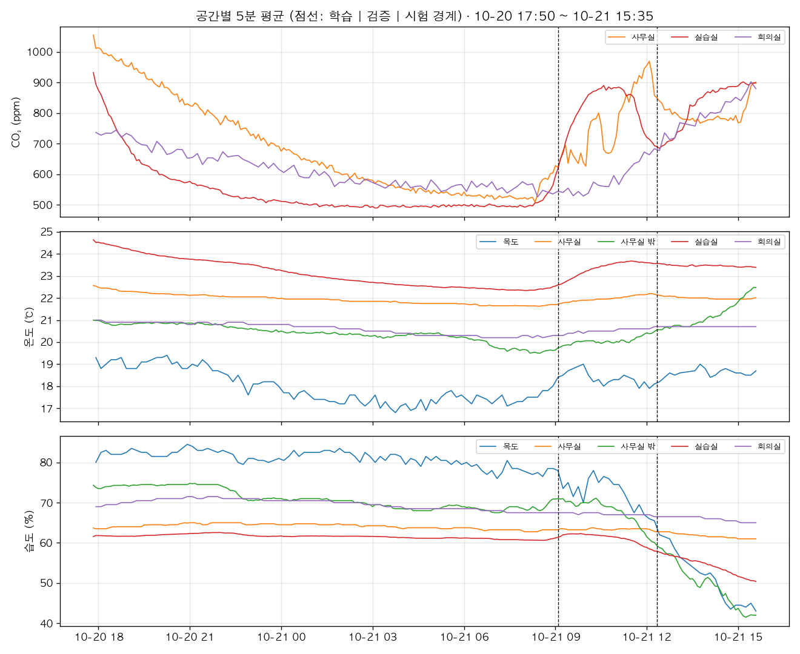
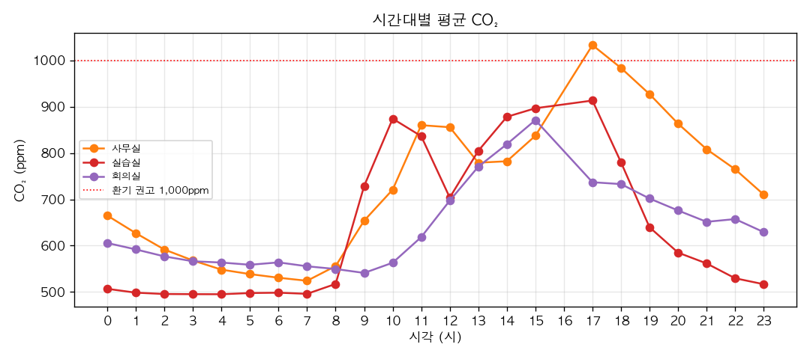

# 과제 2. 데이터 이해와 기준선

> 측정 조건: 실데이터 (교육장 MQTT, 보드 B 수집기) · 기간 2026-10-20 17:50 ~ 2026-10-21 15:35 (21.8시간) · 분석 간격 5분 · 생성 2026-10-21 15:49

## 1. 정제 규칙
| 상황 | 처리 | 이유 | 이번 데이터 |
| --- | --- | --- | ---: |
| 같은 업링크가 두 번 (게이트웨이 2대) | 5초 안 같은 기기·항목·값은 버림 | 같은 측정이 5분 간격 두 값처럼 보이는 가짜 데이터 | 578건 제거 |
| 게이트웨이 시계가 약 5분 빠름 | 센서 시각이 미래면 받은 시각 사용 | 시각이 틀리면 순서·간격이 무너짐 | 11,391건 보정 |
| 물리적으로 불가능한 값 (0ppm, 60℃ 등) | 제거 (CO₂ 300~5000, 온도 -10~50, 습도 0~100) | 센서·통신 오류, 학습을 망침 | CO₂ 0 · 온도 0 · 습도 0건 |
| 센서마다 다른 기록 주기 (1·2·10분) | 기기별 5분 평균 → 공간 내 기기 평균 | 공통 시간축 필요, 예측도 5분 간격 | - |
| 짧은 결측 (≤15분) | 선형 보간 | CO₂·온도는 15분 안에 크게 안 변함 | - |
| 긴 결측 (>15분) | 비워 둠, 학습·평가 창에서 제외 | 긴 구간을 지어내면 가짜 패턴 학습 | - |
| 위치 태그 오류 (실습실 태그인데 설치 위치 '복도') | 공간을 '복도'로 분리 | 복도 공기(18℃·83%)가 실습실 평균을 왜곡 | 센서 1대 |

원본 25,812건 → 정제 후 25,234건

## 2. 분석 간격: 5분
- 센서 보고 주기가 기기마다 1분·2분·10분으로 달라 1분 칸은 빈칸이 많다 (회의실 센서는 10분 주기).
- 과제 3 예측이 '60분 앞까지 5분 간격'이므로 같은 간격이 자연스럽다.
- 5분 평균은 LoRa 수신 지터와 측정 잡음을 줄인다. 대신 5분보다 짧은 급변(튄 값)은 평균에 묻히므로 과제 4 이상 탐지는 원본(1분)도 함께 본다.

### 기기별 보고 주기
|                                           |   주기(분) |
|:------------------------------------------|--------:|
| ('복도', '복도', '24e124136d151523')          |      10 |
| ('사무실', '사무공간 스위치 옆', '24e124785c389010') |       1 |
| ('사무실', '업무 공간 안쪽', '24e124725d081175')   |       1 |
| ('사무실 밖', '입구 오른쪽', '24e124136d151836')   |       1 |
| ('실습실', '', '24e124785c389818')           |       1 |
| ('실습실', '전방 우측', '24e124128c140101')      |      10 |
| ('실습실', '전방 좌측', '24e124126d152590')      |       2 |
| ('실습실', '중앙 우측', '24e124136d151547')      |       1 |
| ('실습실', '중앙 좌측', '24e124136d151606')      |       1 |
| ('실습실', '후면 오른쪽', '24e124128c067999')     |       1 |
| ('실습실', '후방 오른쪽', '24e124126d152862')     |       2 |
| ('회의실', '', '24e124725d089152')           |      10 |

## 3. 학습·검증·시험 분할
| 구간 | 시작 | 끝 | 칸 수 |
| --- | --- | --- | ---: |
| train | 10-20 17:50 | 10-21 09:00 | 183 |
| val | 10-21 09:05 | 10-21 12:15 | 39 |
| test | 10-21 12:20 | 10-21 15:35 | 40 |

- **시간순**으로 70/15/15 분할. 무작위로 섞으면 바로 옆 5분 값이 학습과 시험에 동시에 들어가 '미래를 보고 맞히는' 누수가 생겨 성능이 실제보다 좋게 나온다.
- 정규화 평균·표준편차는 **학습 구간으로만** 계산 (아래 표).

|                          |   mean |   std |
|:-------------------------|-------:|------:|
| ('복도', 'humidity')       |   81   |   1.9 |
| ('복도', 'temperature')    |   17.9 |   0.8 |
| ('사무실', 'co2')           |  684   | 153.9 |
| ('사무실', 'humidity')      |   64.1 |   0.6 |
| ('사무실', 'temperature')   |   21.9 |   0.2 |
| ('사무실 밖', 'humidity')    |   71   |   2.4 |
| ('사무실 밖', 'temperature') |   20.4 |   0.4 |
| ('실습실', 'co2')           |  545.1 |  86.4 |
| ('실습실', 'humidity')      |   61.6 |   0.5 |
| ('실습실', 'temperature')   |   23.1 |   0.7 |
| ('회의실', 'co2')           |  612.3 |  59.1 |
| ('회의실', 'humidity')      |   69.6 |   1.3 |
| ('회의실', 'temperature')   |   20.6 |   0.3 |

## 4. 데이터 진단
|                          |   원본 건수 |   기기 수 |   결측률(보간 전) |   결측률(보간 후) |    평균 |    최소 |     최대 |
|:-------------------------|--------:|-------:|------------:|------------:|------:|------:|-------:|
| ('복도', 'humidity')       |     128 |      1 |        51.1 |         0.4 |  75.2 |  43   |   84.5 |
| ('복도', 'temperature')    |     128 |      1 |        51.1 |         0.4 |  18.1 |  16.8 |   19.4 |
| ('사무실', 'co2')           |    1280 |      1 |         0.8 |         0   | 714   | 509   | 1055   |
| ('사무실', 'humidity')      |    2563 |      2 |         0.8 |         0   |  63.6 |  61   |   65   |
| ('사무실', 'temperature')   |    2563 |      2 |         0.8 |         0   |  22   |  21.6 |   22.6 |
| ('사무실 밖', 'humidity')    |    1284 |      1 |         0.8 |         0   |  67.3 |  41.5 |   74.8 |
| ('사무실 밖', 'temperature') |    1284 |      1 |         0.8 |         0   |  20.5 |  19.5 |   22.5 |
| ('실습실', 'co2')           |    2664 |      4 |         0.8 |         0   | 626.9 | 489.9 |  932.9 |
| ('실습실', 'humidity')      |    6481 |      7 |         0.8 |         0   |  60.4 |  50.4 |   62.6 |
| ('실습실', 'temperature')   |    6481 |      7 |         0.8 |         0   |  23.2 |  22.3 |   24.6 |
| ('회의실', 'co2')           |     126 |      1 |        51.9 |         0.4 | 635.9 | 526   |  903   |
| ('회의실', 'humidity')      |     126 |      1 |        51.9 |         0.4 |  68.7 |  65   |   71.5 |
| ('회의실', 'temperature')   |     126 |      1 |        51.9 |         0.4 |  20.6 |  20.2 |   21   |

## 5. 기준선 성능 (시험 구간 MAE)
같은 시점·같은 조건: 세 기준선 모두 시험 구간의 같은 시점에서, 정답이 있는 칸만 비교.

### 전체 평균
|                              | 5분   | 15분   | 30분   | 60분   |
|:-----------------------------|:-----|:------|:------|:------|
| ('co2', '어제 같은 시각')          | -    | -     | -     | -     |
| ('co2', '최근 1시간 평균')         | 35.6 | 44.6  | 56.8  | 82.3  |
| ('co2', '현재값 유지')            | 8.8  | 18.8  | 31.3  | 55.6  |
| ('temperature', '어제 같은 시각')  | -    | -     | -     | -     |
| ('temperature', '최근 1시간 평균') | 0.1  | 0.1   | 0.2   | 0.2   |
| ('temperature', '현재값 유지')    | 0.0  | 0.1   | 0.1   | 0.2   |

### 공간별
|                                       |   5분 |   15분 |   30분 |   60분 |
|:--------------------------------------|-----:|------:|------:|------:|
| ('co2', '사무실', '최근 1시간 평균')           | 34.8 |  40.9 |  47.3 |  58.5 |
| ('co2', '사무실', '현재값 유지')              |  9.4 |  18.7 |  27   |  33.4 |
| ('co2', '실습실', '최근 1시간 평균')           | 37.6 |  47.9 |  64.2 | 101.8 |
| ('co2', '실습실', '현재값 유지')              |  7.2 |  17.6 |  35.5 |  75.7 |
| ('co2', '회의실', '최근 1시간 평균')           | 34.3 |  45   |  58.9 |  86.4 |
| ('co2', '회의실', '현재값 유지')              |  9.8 |  20   |  31.4 |  57.8 |
| ('temperature', '복도', '최근 1시간 평균')    |  0.2 |   0.2 |   0.2 |   0.3 |
| ('temperature', '복도', '현재값 유지')       |  0.1 |   0.2 |   0.2 |   0.2 |
| ('temperature', '사무실', '최근 1시간 평균')   |  0   |   0   |   0.1 |   0.1 |
| ('temperature', '사무실', '현재값 유지')      |  0   |   0   |   0   |   0.1 |
| ('temperature', '사무실 밖', '최근 1시간 평균') |  0.3 |   0.4 |   0.5 |   0.7 |
| ('temperature', '사무실 밖', '현재값 유지')    |  0.1 |   0.2 |   0.3 |   0.6 |
| ('temperature', '실습실', '최근 1시간 평균')   |  0   |   0   |   0.1 |   0.1 |
| ('temperature', '실습실', '현재값 유지')      |  0   |   0   |   0   |   0   |
| ('temperature', '회의실', '최근 1시간 평균')   |  0   |   0   |   0   |   0   |
| ('temperature', '회의실', '현재값 유지')      |  0   |   0   |   0   |   0   |

> ⚠️ 현재 데이터가 21.8시간뿐이라 **'어제 같은 시각'** 기준선은 계산할 수 없다 (24시간 이전 값이 필요). 데이터가 하루 이상 쌓이면 이 스크립트를 다시 돌리면 자동으로 채워진다.

## 6. 해석 (초안)
- **가장 강한 기준선은 '현재값 유지'**일 가능성이 높다. CO₂·온도는 5~60분 사이에 천천히 변하므로 '지금 값'이 가장 좋은 추정이다. 예측 시점이 길어질수록(60분) 오차가 커지는데, 수업 시작·쉬는 시간처럼 사람 수가 바뀌는 순간을 못 따라가기 때문이다.
- **'최근 1시간 평균'**은 변화에 한 박자 늦게 따라가 상승·하강 구간에서 오차가 커진다.
- **'어제 같은 시각'**은 수업 시간표가 매일 같다면 강하겠지만, 요일·결석·환기 여부에 따라 날마다 달라 가장 약할 것으로 예상한다. 매일 같은 일정으로 쓰이는 공간(예: 고정 수업 강의실)이라면 이 방법이 강해질 수 있다.
- **과제 3 목표**: 60분 뒤 CO₂ 오차를 '현재값 유지'보다 30% 이상 줄이기.
- **데이터 한계**: 일정(수업·예약) 정보가 없어 '일정 변화 후 CO₂ 반응 시간' 분석은 제공 키트 또는 강사님 일정 자료가 필요하다.
