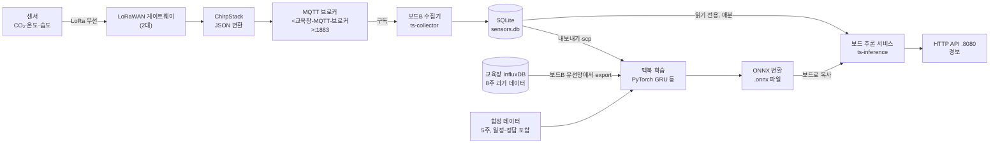

# 🗺️ 0. 큰 그림: 이 과제는 무엇이고, 무엇으로 만들었나

이 페이지는 과제 1~8 전체를 한 장으로 묶은 지도입니다. 세부 과제 페이지를 읽기 전에 "데이터가 어디서 와서 어디로 가는지", "어떤 장비가 무슨 일을 하는지", "결과가 어땠는지"를 먼저 머리에 넣어 두기 위한 페이지입니다.

> 📖 읽는 순서: 1부 1~3장(요약·비유·용어) → 4장 파이프라인 그림 → 5장 장비 → 6장 과제별 결과표 → 7장 데이터 3종류 → 2부 폴더 지도와 명령어 → 예상 질문

# 1부. 처음 보는 사람을 위한 설명

## 1. 한 문장으로 요약하면

> 교육장 방마다 붙은 센서(CO₂·온도·습도)가 1분마다 보내는 값을 MQTT로 받아 내 Jetson 보드(team5-b)에 쌓고, 맥북에서 그 데이터로 "60분 뒤 CO₂·온도 예측", "고장·이상 탐지", "방을 쓰는 중인지 추정" 모델을 학습한 뒤, 그 모델을 ONNX 파일로 바꿔 보드에서 매분 자동으로 돌리고 결과를 API와 경보로 내보내는 과제입니다.

## 2. 식당 주방에 비유해 보기

| 비유 | 이 과제에서는 | 정식 이름 |
| --- | --- | --- |
| 각 테이블에서 주문서를 쓰는 손님 | 방마다 붙은 CO₂·온도·습도 센서 | LoRaWAN 센서 (AM103, AM107, EM500-CO2 등) |
| 주문서를 걷어 가는 웨이터 | 센서의 무선 신호를 받는 안테나 상자 | LoRaWAN 게이트웨이 |
| 주문서를 정리해 표준 양식으로 바꾸는 계산대 | 무선 신호를 JSON 메시지로 바꾸는 서버 | ChirpStack (네트워크 서버) |
| 주방 앞 주문 게시판 | 메시지를 받아 원하는 사람에게 나눠 주는 우체국 | MQTT 브로커 (`<교육장-MQTT-브로커>:1883`) |
| 게시판을 계속 지켜보다 주문을 장부에 옮겨 적는 직원 | 보드 B에서 24시간 도는 수집 프로그램 | 수집기 `ts-collector` (systemd 서비스) |
| 주문 장부 | 보드 안의 데이터 파일 | SQLite DB (`data/sensors.db`) |
| 본사 연구소에서 레시피 개발 | 맥북에서 모델 학습 | PyTorch 학습 (GRU·LSTM·TCN) |
| 레시피를 어느 주방에서나 쓰는 표준 카드로 옮겨 적기 | 학습한 모델을 보드에서 돌릴 수 있는 형식으로 변환 | ONNX 변환 |
| 매장 주방장이 표준 카드대로 매분 요리 | 보드에서 매분 예측·이상·상태 계산 | 추론 서비스 `ts-inference` |
| 배달 앱의 "조리 중 / 곧 도착" 알림 | 다른 프로그램이 결과를 물어보는 창구와 경보 | HTTP API(8080 포트), 경보 |
| 매장과 본사를 잇는 전용 전화선 | 맥북에서 집 밖에서도 보드에 접속하는 길 | Tailscale VPN (`<보드B-Tailscale-IP>`) |
| 연습용 모형 음식 | 실제처럼 만든 가짜 데이터 | 합성 데이터 (자체 생성기 5주) |
| 지난 두 달 치 영수증 묶음 | 교육장 서버에 쌓여 있던 과거 기록 | InfluxDB 8주 데이터 |

## 3. 용어 사전

| 용어 | 쉬운 뜻 | 이 과제에서는 |
| --- | --- | --- |
| 센서 | 주변 값을 재서 숫자로 보내는 장치 | CO₂(ppm), 온도(℃), 습도(%)를 1·2·10분마다 보냄 |
| 시계열 (time series) | 시간 순서대로 찍힌 값들의 줄 | "09:00 612ppm, 09:01 618ppm, …" |
| 추론 (inference) | 이미 학습한 모델에 새 입력을 넣어 답을 받는 것 | 보드가 매분 "60분 뒤 CO₂는 ○○ppm" 을 계산 |
| 학습 (training) | 과거 데이터로 모델의 숫자(가중치)를 맞추는 것 | 맥북에서 PyTorch로 함 |
| 모델 | 입력을 받아 답을 내는 계산식 덩어리 | GRU(예측), 규칙+예측 오차(이상), 분류 모델(상태) |
| MQTT | 작은 메시지를 주고받는 가벼운 통신 약속 | 센서 값이 이걸로 들어옴 (1장 페이지에서 자세히) |
| 브로커 (broker) | MQTT 메시지를 받아 나눠 주는 중간 서버 | `<교육장-MQTT-브로커>:1883` |
| LoRaWAN | 멀리, 적은 전기로 보내는 무선 방식 | 센서 → 게이트웨이 구간 |
| ChirpStack | LoRaWAN 신호를 JSON으로 바꿔 주는 서버 프로그램 | 메시지 안 `deviceInfo`, `object`, `fCnt` 필드를 만듦 |
| SQLite | 파일 하나로 된 작은 데이터베이스 | 수집기가 `sensors.db` 에 저장 |
| systemd | 리눅스에서 프로그램을 자동으로 켜고 다시 살려 주는 관리자 | `ts-collector`, `ts-inference` 두 서비스 |
| Jetson | NVIDIA가 만든 손바닥만 한 AI용 컴퓨터 | Jetson Orin Nano Super 8GB (team5-b) |
| ONNX | 모델을 어느 프로그램에서나 돌릴 수 있게 저장하는 공용 파일 형식 | 맥북 PyTorch 모델 → `.onnx` → 보드 ONNX Runtime |
| 기준선 (baseline) | "이것보다는 잘해야 한다"는 아주 단순한 방법 | 현재값 유지, 최근 1시간 평균, 어제 같은 시각 |
| MAE | 예측과 실제의 차이(절댓값)를 평균한 것. 작을수록 좋음 | "60분 CO₂ MAE 15.0ppm" |
| 커버율 | 1분 칸 중 데이터가 1건이라도 있는 칸의 비율 | 24시간 실습실 98.4% |
| 합성 데이터 | 규칙(물리식)으로 만든 가짜 데이터 | 일정·정답이 있어서 과제 3~5 학습·평가에 사용 |
| API | 다른 프로그램이 결과를 물어보는 정해진 주소 | `GET /spaces/실습실/forecast?minutes=30` |
| Tailscale | 내 기기들끼리만 연결되는 사설망(VPN) | 맥북 ↔ 보드 B 접속 주소 `<보드B-Tailscale-IP>` |

## 4. 데이터는 어디서 와서 어디로 가나 (전체 흐름)

### 4-1. 왜 이런 흐름이 필요한가
교육장 운영진의 문제는 "CO₂가 1,500ppm을 넘고 나서야 환기한다", "센서가 고장 나도 며칠 동안 모른다", "방을 실제로 쓰는지 모른다"였습니다. 이 문제를 풀려면 ① 값을 끊김 없이 모으고, ② 모은 값으로 모델을 만들고, ③ 그 모델을 교육장 안 작은 보드에서 계속 돌려 다른 서비스가 가져다 쓰게 해야 합니다. 그래서 흐름이 "모으기 → 배우기 → 돌리기" 세 덩어리로 나뉩니다.

### 4-2. 한 줄씩 따라가기
1. **센서**: 방에 붙은 센서가 CO₂·온도·습도를 재서 무선(LoRa)으로 보냅니다. 한 방에 여러 대가 있습니다(실습실은 9대).
2. **LoRaWAN 게이트웨이**: 무선 신호를 받습니다. 게이트웨이가 2대라 같은 신호를 두 번 받기도 하고, 그중 한 대는 시계가 약 4분 55초 빠릅니다.
3. **ChirpStack**: 신호를 JSON 메시지로 바꿉니다. 방 이름(`deviceInfo.tags.location`), 측정값(`object`), 일련번호(`fCnt`), 시각(`time`)이 들어갑니다.
4. **MQTT 브로커** (`<교육장-MQTT-브로커>:1883`): 메시지를 토픽 `application/<앱ID>/device/<기기EUI>/event/up` 으로 내보냅니다.
5. **보드 B 수집기** (`ts-collector`): 이 토픽을 구독해서 메시지를 받고, `config.yaml` 규칙대로 "공간·항목·기기·시각·값"으로 풀어냅니다. (과제 1)
6. **SQLite** (`~/ts-collector/data/sensors.db`): 받은 값을 저장합니다. 같은 메시지가 두 번 와도 한 번만 저장합니다.
7. **맥북 학습**: 보드에서 데이터를 내보내 `scp` 로 맥북에 가져온 뒤, 정제·5분 평균(과제 2) → 예측 모델(과제 3), 이상 탐지(과제 4), 상태 분류(과제 5)를 학습합니다. Chronos(사전학습 모델, 과제 6)와도 비교합니다.
8. **ONNX 변환** (과제 7): PyTorch 모델을 `.onnx` 파일로 바꿉니다. 보드에서 PyTorch 62.0ms → ONNX Runtime 0.22ms로 빨라졌고 값 차이는 0.0001ppm입니다.
9. **보드 추론 서비스** (`ts-inference`, 과제 8): 매분 수집기 DB를 읽기 전용으로 열어, 학습 때와 **같은 전처리 코드**(`tsinf/prep.py`)를 거쳐 ONNX 모델로 공간별 60분 예측·이상·사용 여부를 계산합니다.
10. **API / 경보**: 결과를 HTTP 8080 포트로 제공하고("회의실 30분 뒤 CO₂는?"), "N분 뒤 1,000ppm 초과", "데이터 끊김" 같은 경보를 냅니다. MQTT 발행(retain, LWT)은 만들어 두었지만 팀 확인 전이라 꺼 두었습니다(`mqtt.enabled: false`).



> 🎤 **Q. 이 과제 전체를 30초로 설명해 보세요.**
> 센서 값을 MQTT로 받아 보드에 24시간 쌓는 수집기를 만들었습니다(24시간 커버율 실습실 98.4%). 그 데이터와 합성·InfluxDB 데이터로 맥북에서 60분 예측·이상 탐지·사용 여부 모델을 학습했고, 합성 데이터에서는 60분 CO₂ 오차를 '현재값 유지'보다 63% 줄였습니다. 모델을 ONNX로 바꿔 보드에서 0.22ms에 돌렸고, 매분 결과를 내는 상시 서비스를 12시간 713주기 실패 0으로 운영했습니다.

## 5. 장비: 무엇이 무슨 일을 하나

### 5-1. 왜 장비를 나눴나
보드(Jetson)는 메모리가 8GB뿐이고 이 8GB를 CPU와 GPU가 나눠 씁니다. 같은 보드에 팀원 수집기와 나중에 로컬 LLM까지 올라갈 예정이라 메모리를 아껴야 합니다. 그래서 **무거운 학습은 맥북**, **24시간 켜져 있어야 하는 일은 보드**에 둡니다. 반대로 맥북에서 수집기를 돌리면 노트북을 덮는 순간 끊겨 24시간 커버율을 맞출 수 없습니다.

### 5-2. 장비별 역할

| 장비 | 정체 | 하는 일 |
| --- | --- | --- |
| 보드 B (`team5-b`) | Jetson Orin Nano Super 8GB, JetPack 7 (L4T R39.2.1), ARM64, Ubuntu 24.04 | 수집기 `ts-collector` 24시간 실행, 추론 서비스 `ts-inference`(HTTP 8080), InfluxDB 데이터 내보내기, 속도·메모리 측정 |
| 맥북 | 내 노트북 | 코드 작성, 데이터 분석(과제 2), 학습(과제 3·4·5), Chronos 정확도 비교(과제 6), ONNX 변환(과제 7) |
| Tailscale | 팀 기기끼리만 이어 주는 VPN | 맥북에서 `ssh suyeon@<보드B-Tailscale-IP>` 으로 보드 B에 접속, 브라우저로 `http://<보드B-Tailscale-IP>:8080` 조회 |
| MQTT 브로커 | 교육장 서버 `<교육장-MQTT-브로커>:1883` | 센서 메시지 전달 (보드 B는 와이파이로 접속) |
| 교육장 InfluxDB | `<교육장-InfluxDB-내부주소>:8086`, 내부망 | 2025-08-08부터 쌓인 과거 센서 값. 보드 B의 유선망에서만 닿음 |

- 보드 B 계정: `suyeon`. 수집기 폴더 `~/ts-collector`, 추론 서비스 폴더 `~/ts-inference`.
- 비밀번호·토큰은 각 폴더의 `.env` 에 둡니다. 저장소에는 `.env.example` (빈 칸 예시)만 올라갑니다.
- 보드 전력 모드는 측정 시 `pmode 0002` 로 기록했습니다.

### 5-3. 보드 A / 보드 B 팀 공용 규칙

| 규칙 | 이유 |
| --- | --- |
| 보드 A = 운영(제출용 상시 서비스), 보드 B = 실험(학습·벤치마크·장애 연습) | 운영 보드가 실험 때문에 멈추면 안 됨 |
| 보드 A에서는 실험, 무거운 학습, 임의 재부팅을 하지 않음 | 팀 전체 서비스가 같이 멈춤 |
| 내 계정, 내 폴더에서만 작업 | 홈 폴더는 계정마다 따로이고, 남의 서비스를 덮어쓰지 않기 위해 |
| 무거운 모델을 돌릴 때 단톡방에 알림 | 메모리 8GB를 팀원이 같이 씀 |
| MQTT `client_id` 에 보드·계정 이름을 넣음 | 공용 계정이라 `client_id` 가 겹치면 브로커가 서로를 끊음 |
| `sudo apt autoremove` 금지, 전원은 `sudo poweroff` 후 분리 | 부팅 관련 패키지 삭제·디스크 손상 방지 |
| 비밀번호·토큰은 `.env` 에만, `.gitignore` 에 넣음 | 저장소 유출 방지 |
| 데이터·DB·모델 파일(`.pt` `.onnx` `.engine`)은 GitHub에 올리지 않음 | 용량이 크고 다시 만들 수 있음 |

> 🎤 **Q. 왜 학습을 보드에서 하지 않고 맥북에서 했나요?**
> 보드는 8GB 메모리를 CPU·GPU·팀원이 함께 쓰고, 수집기와 추론 서비스가 24시간 돌아야 합니다. 학습처럼 메모리를 크게 쓰는 일을 보드에서 하면 수집기가 밀려 데이터를 놓칠 수 있습니다. 그래서 학습은 맥북에서 하고, 결과 모델을 ONNX 파일로 바꿔 보드에 옮겼습니다. 보드에서는 ONNX Runtime으로 1회 0.22ms라 가볍게 돌아갑니다.

## 6. 과제 1~8 한 줄 요약과 내 결과

출처: `inference/reports/final_report.md` §0 한 장 요약

| 과제 | 한 줄로 무엇을 | 확인 기준 | 내 결과 | 판정 |
| --- | --- | --- | --- | --- |
| 1 수집 | MQTT 센서 값을 끊김 없이 보드에 쌓기 | 브로커 재시작 1분 내 재수집, 재부팅 자동 시작, 24시간 커버율 95% | 재접속 약 1초(로컬 브로커 재시작 시험), 강제 종료 후 5초 만에 자동 재시작, 실제 보드 재부팅(10-21 18:54) 후 2분 만에 자동 수집 재개, 24시간 커버율 실습실 98.4%(CO₂ 95.1%)·사무실 97.8% | ✅ (회의실·사무실 밖은 센서 쪽 공백으로 미달) |
| 2 기준선 | 데이터를 정제하고 "넘어야 할 선" 재기 | 학습 기간으로만 정규화, 같은 조건 비교 | 시간순 70/15/15 분할, 기준선 3종 5/15/30/60분 MAE | ✅ |
| 3 예측 | 60분 뒤 CO₂·온도 예측 | 60분 CO₂ 오차가 '현재값 유지'보다 30% 이상 작음 | 합성(일정 포함) GRU 63% 감소(40.9 → 15.0ppm). 실데이터 8주(일정 없음)는 최근 패턴으로 재학습 시 15% 감소 | ✅ 합성 / △ 실데이터 |
| 4 이상 탐지 | 센서·설비 고장 찾기 | 탐지율 80% 이상, 헛경보 하루 1회 이하 | 규칙+예측 오차: 80%, 하루 1.0회 (합성 고장 15건) | ✅ (경계선) |
| 5 상태 | 센서만으로 방 사용 여부·환기 필요 미리 알기 | 규칙보다 좋음, 환기 경보 재현율 85% | 사용 여부 F1 85.8 vs 규칙 79.1, 환기 재현율 97.4%, macro-F1 96.7 vs 81.5 | ✅ |
| 6 사전학습 | 학습 없이 쓰는 범용 모델(Chronos) 비교 | 정확도·구간·시간·메모리로 판단 | 합성에선 '현재값 유지'보다 못함, 내 실데이터에선 가장 좋음(60분 36.0 vs 42.0ppm), 구간 적중률 ≈80%, 보드 90ms. 데이터 적은 초기 후보로 채택 의견 | ✅ |
| 7 엣지 | 보드에서 빠르고 정확하게 | 변환 후 CO₂ 차이 1ppm 이하 | ONNX Runtime 0.22ms (PyTorch CPU 62ms), 차이 0.0001ppm. TensorRT는 설치 후 | ⏳ TensorRT |
| 8 서비스 | 매분 결과를 내는 상시 서비스 | 12시간 무중단, 끊김 경보, 조회 API, 형식 문서 | 12시간 713주기 실패 0, 평균 0.95초, 보드 재부팅 1회는 자동 복구(8분 공백), 끊김 경보 2회 모두 정확, API·문서 완료. MQTT 발행은 팀 확인 후 | ✅ |

### 6-1. 결과를 내 말로 해석하면
1. **수집(과제 1)은 기준을 넘었습니다.** 빈 곳은 대부분 센서가 1대뿐인 공간(회의실·사무실 밖)이었고, "수집기가 아니라 센서 배치가 커버율을 정한다"가 핵심 해석입니다.
2. **예측(과제 3)은 합성에서는 크게 성공, 실데이터에서는 어려웠습니다.** 합성 데이터에는 "곧 수업이 시작된다"는 일정 정보가 있지만 실데이터에는 없고, 8~9월과 10월의 교실 사용 패턴도 달랐습니다. 최근 데이터(9/27~)로만 다시 학습하니 15% 좋아졌습니다.
3. **이상 탐지(과제 4)는 규칙과 모델이 서로를 보완합니다.** 규칙은 센서 고장(튄 값·값 고정·영점 틀어짐), 모델은 설비 고장(냉방·환기 정지)을 잡습니다.
4. **범용 모델(과제 6)은 데이터 모양에 따라 순위가 뒤집혔습니다.** 톱니 모양이 많은 합성 교실에선 꼴찌, 완만한 10월 실제 교실에선 1등이었습니다.
5. **보드 운영(과제 7·8)은 가볍고 안정적이었습니다.** ONNX로 약 280배 빨라졌고, 12시간 동안 주기 실패 0, 헛경보 0이었습니다.

## 7. 데이터 세 종류: 합성 · 실데이터 · InfluxDB

### 7-1. 왜 세 가지나 썼나
과제마다 필요한 것이 다릅니다. 예측을 평가하려면 **긴 기간**이, 일정의 가치를 재려면 **일정 자료**가, 고장 탐지를 채점하려면 **정답(언제 어떤 고장이 났는지)**이 필요합니다. 그런데 한 종류의 데이터가 이 셋을 다 갖고 있지 않았습니다. 과제 안내도 "실데이터가 3주 이상 쌓이기 전에는 합성 데이터 생성기를 쓴다"고 정해 두었습니다.

| | 합성 데이터 | 실데이터 (내 수집기) | InfluxDB 8주 |
| --- | --- | --- | --- |
| 무엇 | 물리식으로 만든 가짜 교육장 데이터 | 내 수집기가 MQTT로 받은 진짜 값 | 교육장 서버에 쌓여 있던 진짜 과거 값 |
| 기간 | 5주 (seed 7) | 2026-10-20 17:51~ (평가에 쓴 분량 약 22시간) | 2026-08-26 ~ 10-21 |
| 어디서 | `inference/tsinf/synth.py` | 보드 B `~/ts-collector/data/sensors.db` | `<교육장-InfluxDB-내부주소>:8086` (보드 B 유선망에서 `tools/export_influx.py`) |
| 일정 자료 | 있음 (수업 시간표·회의 예약) | 없음 | 없음 |
| 정답 | 있음 (고장 5종 15건, 실제 재실 인원, 직접 관찰 6일) | 없음 | 없음 |
| 공간 | 강의실1·강의실2·회의실·라운지 (과제 안내 기준) | 실습실·사무실·회의실·사무실 밖 등 | 실습실 등 (같은 센서) |
| 주로 쓴 곳 | 과제 3~6 학습·평가 (일정·정답이 필요한 부분) | 과제 1 수집 현황, 과제 2 진단, 8-1 재평가, 과제 8 서비스 입력 | 과제 2·3 실데이터 검증, 서비스 모델 재학습 |
| 한계 | 진짜 교실의 변동 폭·주기를 모름 (합성 학습 모델을 실데이터에 쓰면 77.1 vs 33.4ppm으로 크게 나쁨) | 기간이 짧음 | 일정·정답이 없음, 8~9월과 10월 사용 패턴이 다름 |

### 7-2. 각각 무엇을 알려 줬나
1. **합성 데이터**: 일정 정보를 넣으면 60분 오차가 20.4 → 15.0ppm으로 줄어든다는 것(회의실은 39.8 → 18.9ppm). 고장 15건으로 탐지율 80%, 하루 헛경보 1.0회를 잴 수 있었습니다.
2. **InfluxDB 8주**: 원본 168만 건 → 정제 159만 건(재전송 중복 9.5만 건 제거). 60분 CO₂ 기준선은 현재값 유지 49.0, 최근 1시간 평균 64.6, 어제 같은 시각 124.0ppm. 8주 전체로 학습하면 오히려 -2%, 패턴이 바뀐 뒤(9/27~)만 학습하면 15% 개선이라는 "개념 변화"를 보여 줬습니다.
3. **내 수집기 실데이터**: 실서비스에 들어갈 진짜 입력입니다. 22시간 재평가에서 실데이터 학습 GRU 39.0 vs 현재값 유지 41.5ppm(6% 개선)이었고, 같은 230개 시점 비교에서는 Chronos tiny 36.0ppm이 가장 좋았습니다(GRU 39.3, 현재값 유지 42.0). 게이트웨이 시계가 5분 빠른 문제, 같은 메시지 두 번 도착 문제도 여기서 찾았습니다.

> 🎤 **Q. 진짜 데이터가 있는데 왜 가짜(합성) 데이터를 썼나요?**
> 진짜 데이터에는 수업 시간표 같은 일정 자료와 "언제 고장이 났는지" 같은 정답이 없습니다. 정답이 없으면 탐지율이나 재현율을 계산할 수 없습니다. 그래서 과제 안내대로 일정·정답이 있는 합성 5주로 학습·평가하고, InfluxDB 8주와 내 수집기 데이터로 실제에서도 통하는지 검증했습니다. 실제로 합성으로 학습한 모델은 실데이터에서 77.1ppm으로 '현재값 유지'(33.4ppm)보다 나빠서, 서비스 모델은 실데이터로 학습한 GRU(30.6ppm)로 바꿨습니다.

---

# 2부. 실제 코드와 설정

## 1. 저장소 폴더 지도

저장소: `suyeon-timeseries-inference` (GitHub 개인 저장소). 보드 B에는 `collector/` 가 `~/ts-collector`, `inference/` 가 `~/ts-inference` 로 들어가 있습니다.

```
suyeon-timeseries-inference/
├── README.md                    # ← 전체 안내 (폴더 표, 따라 하기 명령)
├── collector/                   # ← 과제 1: MQTT 수집기 (보드 ~/ts-collector)
│   ├── config.yaml              # ← ★ 토픽·형식 규칙. 형식이 바뀌면 여기만 고침
│   ├── .env.example             # ← 비밀값 빈 칸 예시 (.env 로 복사해서 채움)
│   ├── collector/               # ← 수집기 본체
│   │   ├── main.py              # ← MQTT 접속·구독·재접속
│   │   ├── config.py            # ← config.yaml 과 .env 읽기
│   │   ├── parser.py            # ← 메시지 → (공간, 항목, 값, 시각)
│   │   └── store.py             # ← SQLite 저장, 중복 제거, 시계 보정
│   ├── tools/                   # ← discover(형식 살펴보기), status(수집 현황), estimate_size, retention
│   ├── deploy/                  # ← ts-collector.service + install.sh (systemd 등록)
│   ├── docs/                    # ← 생각해 볼 점 답변, 형식 변경 대응 기록
│   └── tests/                   # ← 파서 단위 테스트, 브로커 재시작 통합 테스트
└── inference/                   # ← 과제 2~8 (맥북 학습 + 보드 ~/ts-inference)
    ├── tsinf/                   # ← 공용 라이브러리
    │   ├── prep.py              # ← 정제 규칙 (학습과 서비스가 똑같이 사용)
    │   ├── synth.py             # ← 합성 데이터 생성기
    │   ├── forecast.py          # ← 예측 모델(GRU·LSTM·TCN)
    │   └── anomaly.py           # ← 이상 탐지
    ├── task2_baseline.py ~ task8_control.py   # ← 과제별 실행 파일
    ├── task3_real.py            # ← InfluxDB 실데이터 검증
    ├── task_own.py              # ← 내 수집기 데이터로 재평가 (8-1)
    ├── train_service_model.py   # ← 서비스용 모델 학습
    ├── tools/                   # ← export_influx(InfluxDB 내보내기), export_onnx, bench(속도 측정), gap_test.sh
    ├── service/                 # ← 과제 8 상시 추론 서비스 (run.py, infer.py, config.yaml)
    ├── deploy/                  # ← ts-inference.service + install_service.sh
    ├── models/                  # ← 모델 설명 파일(.json)만. .onnx/.pt 는 올리지 않음
    ├── docs/interface.md        # ← 서비스 결과 형식 문서 (API·MQTT·JSON)
    └── reports/                 # ← 결과 보고서
        ├── final_report.md      # ← ★ 최종 보고서
        ├── task1_status_24h.md  # ← 24시간 수집 현황
        ├── task2~7_report.md, task3_advanced_report.md, task8_control_report.md
        ├── gap_test.log, service_12h_summary.json, service_12h_alarms.json
        ├── real56/              # ← InfluxDB 8주 실데이터 결과
        └── own/                 # ← 내 수집기 데이터 결과
```

## 2. 올리지 않는 파일 (`.gitignore`)

`inference/.gitignore` 일부:

```
# 모델·DB 파일은 올리지 않는다 (보드 /srv/team5 또는 각자 로컬)
*.pt          # ← PyTorch 모델 파일
*.onnx        # ← 변환한 모델 파일
*.engine      # ← TensorRT 엔진 (보드에서 직접 만듦)
*.pkl         # ← 저장한 분류 모델 등
*.db          # ← SQLite 데이터 파일
*.db-wal      # ← WAL 모드가 만드는 보조 파일
*.db-shm
.venv/        # ← 파이썬 가상환경
data/         # ← CSV·DB 데이터 폴더
.env          # ← 비밀번호·토큰
```

## 3. 두 개의 상시 서비스 (systemd)

`inference/deploy/ts-inference.service` 일부:

```ini
[Unit]
Description=Timeseries inference service (assignment 8)
Wants=network-online.target ts-collector.service     # ← 네트워크와 수집기가 있어야 의미가 있음
After=network-online.target ts-collector.service     # ← 수집기가 켜진 다음에 켜짐

[Service]
ExecStart=__DIR__/.venv/bin/python -m service.run --config service/config.yaml   # ← 실행 명령 (__DIR__ 은 설치 스크립트가 채움)
Restart=always          # ← 죽으면 항상 다시 켬
RestartSec=5            # ← 5초 기다렸다가
StartLimitIntervalSec=0 # ← 몇 번을 죽어도 계속 재시작

[Install]
WantedBy=multi-user.target   # ← 부팅할 때 자동으로 켬 (enable 했을 때)
```

`inference/service/config.yaml` 일부:

```yaml
collector_db: ../ts-collector/data/sensors.db     # ← 수집기 DB 를 읽기 전용으로 엶
results_db: data/service/results.db               # ← 서비스 결과·경보 기록
env_file: ../ts-collector/.env                    # ← 비밀값은 수집기와 같은 .env
interval_sec: 60                                  # ← 매분 한 번 계산
http_port: 8080                                   # ← 조회 API 포트

mqtt:
  enabled: false                 # ← 공용 브로커 발행은 팀 확인 후 켬 (지금은 꺼 둠)
  prefix: team5b/inference       # ← 발행할 토픽 앞부분
```

## 4. 자주 쓰는 명령 (한 줄씩 풀이)

```bash
ssh suyeon@<보드B-Tailscale-IP>                       # ← 맥북에서 Tailscale 주소로 보드 B 에 접속
systemctl status ts-collector                   # ← 수집기가 켜져 있는지(active (running)) 확인
systemctl status ts-inference                   # ← 추론 서비스가 켜져 있는지 확인
journalctl -u ts-collector -f                   # ← 수집기 로그를 실시간으로 봄 (Ctrl+C 로 나감)
cd ~/ts-collector && .venv/bin/python tools/status.py --hours 24 --markdown   # ← 24시간 수집 현황 표
curl localhost:8080/health                      # ← (보드 안에서) 추론 서비스 상태
curl "localhost:8080/spaces/실습실/forecast?minutes=30"   # ← 실습실 30분 뒤 예측값
curl "localhost:8080/alarms?hours=12"           # ← 최근 12시간 경보 목록
scp suyeon@<보드B-Tailscale-IP>:<경로> .              # ← (맥북에서) 보드 파일을 맥북으로 가져옴
```

맥북 학습 순서 (README 기준):

```bash
cd inference && python3 -m venv .venv && .venv/bin/pip install -r requirements.txt   # ← 가상환경 만들고 패키지 설치
.venv/bin/python task2_baseline.py      # ← 과제 2 기준선부터 차례로 (task3_forecast.py … task8_control.py)
.venv/bin/python train_service_model.py && .venv/bin/python tools/export_onnx.py     # ← 서비스 모델 학습 후 ONNX 로 변환
bash deploy/install_service.sh          # ← (보드에서) 추론 서비스 systemd 등록
```

## 자주 하는 실수

| 실수 | 일어나는 일 | 막는 법 |
| --- | --- | --- |
| 수집기를 맥북에서 돌림 | 노트북을 덮으면 수집이 끊겨 24시간 커버율 실패 | 수집기는 보드 B systemd 서비스로만 실행 |
| 보드에서 무거운 학습을 돌림 | 8GB 메모리를 다 써서 수집기·팀원 서비스가 밀림 | 학습은 맥북, 보드는 ONNX 추론만 |
| 합성 데이터로 학습한 모델을 그대로 실서비스에 올림 | 실데이터에서 77.1ppm, '현재값 유지'(33.4ppm)보다 크게 나쁨 | 실데이터 검증 후 실데이터(9/27~) 학습 GRU 로 교체 |
| 학습과 서비스의 전처리를 따로 만듦 | 모델이 학습 때와 다른 입력을 받아 조용히 틀림 | 둘 다 `tsinf/prep.py` 같은 파일을 사용 |
| 비밀번호를 `config.yaml` 이나 코드에 씀 | GitHub 에 올라가 유출 | `.env` 에만 쓰고 `.gitignore` 에 넣음 |
| `.onnx`·`.db` 를 커밋 | 저장소가 무거워지고 데이터가 공개됨 | `.gitignore` 에 `*.onnx`, `*.db` |
| 설치용 USB 를 꽂은 채 재부팅 | 설치 화면으로 켜져 원격 접속·서비스가 모두 멈춤 (10-21 보드 B) | 설치 후 USB 를 뽑음 |
| InfluxDB 를 와이파이로 접속 시도 | 내부망이라 연결 안 됨 | 보드 B 유선(`<교육장-내부망>/16` 경로)으로 접속 |

## 예상 질문 모음

**Q. 시계열 추론이 정확히 뭔가요?**
시계열은 시간 순서대로 찍힌 값의 줄이고, 추론은 이미 학습한 모델에 새 값을 넣어 답을 받는 일입니다. 이 과제에서는 보드가 매분 최근 센서 값을 모델에 넣어 "60분 뒤 CO₂·온도", "지금 값이 이상한가", "방을 쓰는 중인가"라는 세 가지 답을 냅니다.

**Q. 데이터 흐름을 순서대로 말해 보세요.**
센서 → LoRaWAN 게이트웨이 → ChirpStack(JSON 변환) → MQTT 브로커(`<교육장-MQTT-브로커>:1883`) → 보드 B 수집기 → SQLite입니다. 학습은 이 데이터를 맥북으로 가져가서 하고, ONNX로 바꾼 모델을 보드 추론 서비스가 매분 돌려 HTTP API(8080)와 경보로 내보냅니다.

**Q. 보드 A와 B는 뭐가 다른가요? 왜 B에서 했나요?**
A는 운영(제출용 상시 서비스), B는 실험(학습·벤치마크·장애 연습)용입니다. A에서는 실험·재부팅을 하지 않는다는 팀 규칙이 있어 제 작업은 모두 B(team5-b)에서 했습니다. 최종 서비스는 팀원들이 각자 해 본 것 중 가장 잘 된 것을 골라 A에 올리기로 되어 있습니다.

**Q. ONNX는 왜 쓰나요?**
맥북 PyTorch로 학습한 모델을 보드에서 가볍게 돌리기 위해서입니다. 보드에서 PyTorch CPU는 1회 62.0ms, ONNX Runtime은 0.22ms로 약 280배 빨랐고, 두 결과의 CO₂ 차이는 0.0001ppm으로 기준(1ppm)보다 훨씬 작았습니다.

**Q. Tailscale은 왜 필요했나요?**
보드는 교육장 망에 있어서 밖에서 바로 접속할 수 없습니다. Tailscale은 팀 기기끼리만 연결되는 VPN이라, 맥북에서 `<보드B-Tailscale-IP>` 주소로 SSH 접속하고 API를 조회할 수 있습니다. 인터넷(GitHub, pip) 트래픽은 Tailscale을 거치지 않고 교육장 망으로 바로 나갑니다.

**Q. 과제 3 기준(30% 개선)은 통과했나요?**
합성 데이터(일정 포함)에서는 GRU가 60분 CO₂ 오차를 40.9 → 15.0ppm, 63% 줄여 통과했습니다. 실데이터(InfluxDB 8주, 일정 없음)에서는 최근 패턴(9/27~)으로 재학습했을 때 15%로 기준에 못 미쳤습니다. 원인은 일정 자료가 없고, 8~9월과 10월의 교실 사용 패턴이 달랐기 때문이라 최근 2~3주로 주기적 재학습이 필요하다고 결론 냈습니다.

**Q. InfluxDB가 있는데 왜 수집기를 따로 만들었나요?**
과제 1이 "끊기지 않는 수집 체계를 직접 만들고 운영하라"는 과제이기 때문입니다. 또 InfluxDB는 교육장 내부망에만 있어서 보드 B 유선으로만 닿습니다. InfluxDB는 과거 8주를 한 번에 가져오는 용도로 썼고, 실시간 입력은 내 수집기가 맡습니다.

**Q. 가장 의외였던 발견은?**
게이트웨이 하나의 시계가 약 5분 빨라서 같은 측정값이 5분 간격으로 두 번 저장되던 문제입니다. 실데이터를 직접 받아 보지 않았으면 몰랐을 문제였고, LoRa 일련번호(fCnt)로 중복을 거르도록 수집기를 고쳤습니다. 또 합성에서 63% 좋아진 모델이 실데이터에서는 거의 0%였다는 점도 "모델은 과거의 세상을 배운다"는 교훈이었습니다.
