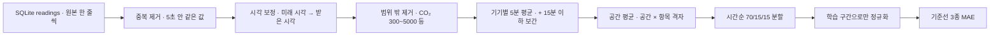

# 🧹 2. 과제 2 데이터 정제와 기준선

수집기가 모은 센서 값은 그대로 쓰면 중복·시계 오류·빈칸 때문에 모델이 엉뚱한 것을 배웁니다. 이 페이지는 그 값을 "5분 간격의 깨끗한 표"로 만드는 정제 과정과, 모델이 넘어야 할 최소 기준인 **기준선(baseline)** 을 설명합니다.

> 📖 읽는 순서: 1부 1~3장(요약·비유·용어) → 4~9장(정제 → 분할 → 정규화 → 기준선 → 우리 숫자) → 2부 코드(`tsinf/prep.py`, `task2_baseline.py`) → 자주 하는 실수 → 예상 질문

# 1부. 처음 보는 사람을 위한 설명

## 1. 한 문장으로 요약하면

> 센서마다 제각각 들어온 CO₂·온도·습도 기록에서 **두 번 들어온 값, 시각이 틀린 값, 말이 안 되는 값을 걸러 내고**, 공간마다 **5분 간격 한 줄짜리 표**로 맞춘 뒤, **시간 순서대로** 학습·검증·시험 구간으로 나누고, "아무 머리도 안 쓴 예측"(기준선) 3가지의 오차를 재서 과제 3 모델이 이겨야 할 목표선을 정했습니다.

## 2. 가계부 정리에 비유해 보기

| 비유 | 이 과제에서는 | 정식 이름 |
| --- | --- | --- |
| 영수증이 매일 뒤죽박죽으로 쌓인 상자 | 수집기 SQLite 의 `readings` 표 (센서 한 번 보고 = 한 줄) | 원본 데이터 (raw data) |
| 같은 영수증이 복사본으로 두 장 들어옴 | 게이트웨이 2대가 같은 업링크를 각각 전달 | 중복 (duplicate) |
| 날짜가 미래로 찍힌 영수증 | 게이트웨이 시계가 약 4분 55초 빠름 | 시각 오류, 시계 보정 |
| "커피 0원", "커피 500만 원" 같은 영수증 | CO₂ 0ppm, 온도 60℃ | 범위 밖 값 (이상값) |
| 하루 단위로 지출을 합쳐 적기 | 5분 칸마다 평균 내기 | 재표본화 (resampling) |
| 하루 영수증을 잃어버려 앞뒤 날을 보고 짐작해 채우기 | 15분 이하 빈칸을 앞뒤 값으로 직선 연결 | 선형 보간 (interpolation) |
| 일주일 넘게 기록이 없으면 지어내지 않고 비워 둠 | 15분 넘는 빈칸은 그대로 비움 | 긴 결측 처리 |
| 가족 4명의 지출을 먼저 각자 정리한 뒤 합치기 | 기기별 5분 평균 → 공간 평균 | 계층적 집계 |
| 1~9월 기록으로 공부하고 10~12월로 시험 | 앞 70% 학습, 다음 15% 검증, 마지막 15% 시험 | 시간순 분할 (time split) |
| 시험 문제를 미리 보고 공부하기 | 시험 구간 정보가 학습에 섞임 | 데이터 누수 (data leakage) |
| "다음 달도 이번 달만큼 쓰겠지" | 60분 뒤 CO₂ = 지금 CO₂ | 현재값 유지 기준선 (persistence) |
| 평균적으로 얼마나 틀렸나 | 예측과 실제의 차이(절댓값)의 평균 | MAE |

## 3. 용어 사전

| 용어 | 쉬운 뜻 | 이 과제에서는 |
| --- | --- | --- |
| 시계열 (time series) | 시간 순서대로 이어진 값들의 줄 | 실습실 CO₂ 를 5분마다 적은 줄 |
| 샘플링 간격 | 값을 몇 분마다 하나씩 재는지 | 센서마다 1분·2분·10분으로 제각각 |
| 재표본화 (resampling) | 간격을 새로 정해 그 칸 안의 값을 평균 등으로 묶기 | 모두 5분 칸으로 통일 (`resample("5min").mean()`) |
| 격자 (grid) | 행 = 시각, 열 = (공간, 항목)인 표 | `to_grid()` 가 만드는 표 |
| 결측 (missing) | 그 칸에 값이 없음 | LoRa 전송 누락, 10분 주기 센서의 빈 칸 |
| 보간 (interpolation) | 앞뒤 값을 보고 사이를 채우기 | 15분(3칸)까지만 직선으로 채움 |
| 업링크 (uplink) | 센서 → 서버 방향으로 보낸 메시지 한 건 | LoRaWAN 센서 보고 1회 |
| 게이트웨이 (gateway) | 센서 전파를 받아 인터넷으로 넘기는 중계기 | 교육장에 2대 → 같은 업링크가 2번 옴 |
| fCnt | LoRa 센서가 메시지마다 붙이는 일련번호 | 같은 번호면 같은 측정 → 수집기에서 중복 제거 |
| 정규화 (normalization) | 값에서 평균을 빼고 표준편차로 나눠 크기를 비슷하게 맞추기 | CO₂(수백)와 온도(수십)를 비슷한 크기로 |
| 평균 (mean)·표준편차 (std) | 보통 값, 값이 퍼진 정도 | 학습 구간에서만 계산 |
| 학습/검증/시험 (train/val/test) | 공부용 / 모의고사 / 진짜 시험 | 70% / 15% / 15% |
| 데이터 누수 (data leakage) | 몰라야 할 미래 정보가 학습에 섞이는 실수 | 무작위 분할, 전체 기간 정규화 |
| 기준선 (baseline) | 머리를 거의 안 쓴 단순 예측. 모델은 이것보다 좋아야 의미가 있음 | 현재값 유지, 최근 1시간 평균, 어제 같은 시각 |
| 예측 시점 (horizon) | 몇 분 뒤를 맞히는지 | 5·15·30·60분 (5분 칸 1·3·6·12칸 뒤) |
| MAE (평균 절대 오차) | (예측 − 실제)의 크기(절댓값)를 평균한 것. 단위가 원래 값과 같음 | "60분 CO₂ MAE 42.1ppm" = 평균 42ppm 틀림 |
| ppm | 공기 100만 개 중 CO₂ 개수. 1,000ppm 넘으면 환기 권고 | 실습실 평균 약 550ppm |

## 4. 왜 정제가 필요한가

모델은 받은 데이터를 "진짜 세상"이라고 믿고 배웁니다. 데이터에 가짜 패턴이 섞이면 모델은 그 가짜 패턴을 열심히 외웁니다.

1. **같은 측정이 두 번 들어오면**: 게이트웨이 2대 중 한 대의 시계가 약 4분 55초 빠르기 때문에, 같은 값이 "약 5분 간격의 두 측정"처럼 보입니다. 모델은 "CO₂ 가 5분 동안 그대로였다"는 가짜 정보를 배웁니다.
2. **시각이 틀리면**: 센서 시각이 받은 시각보다 미래면 순서와 간격이 뒤틀립니다.
3. **불가능한 값이 섞이면**: 0ppm 같은 값 하나가 평균과 표준편차를 크게 흔들어 학습을 망칩니다.
4. **간격이 제각각이면**: 1분 센서와 10분 센서를 같은 표에 놓을 수 없습니다. 공통 시간축이 필요합니다.

## 5. 정제 규칙 7가지 (어떻게 동작하나)

우리 정제는 `inference/tsinf/prep.py` 한 파일에 있고, 학습(과제 3~5)과 보드의 상시 서비스(과제 8)가 **같은 파일을 그대로** 씁니다. 학습할 때와 서비스할 때 정제 방식이 다르면 모델이 처음 보는 모양의 데이터를 받게 되기 때문입니다.

1. **중복 제거**: 같은 기기·같은 항목·같은 값이 5초 안에 다시 받아지면 재전송으로 보고 버립니다. (2026-10-21 수집기 버전부터는 fCnt 로 저장 단계에서 이미 거르지만, 그 전 데이터용으로 남겨 둠)
2. **시각 보정**: 센서 시각이 받은 시각보다 30초 넘게 미래면 받은 시각(`recv_ts`)을 씁니다.
3. **범위 밖 값 제거**: CO₂ 300~5000ppm, 온도 -10~50℃, 습도 0~100% 밖은 버립니다.
4. **5분 격자**: 기기별로 5분 평균을 내고, 같은 공간의 기기들을 평균해 공간 대표값을 만듭니다.
5. **결측 처리**: 15분(3칸) 이하 빈칸은 선형 보간, 그보다 긴 빈칸은 비워 둡니다(학습 창에서 제외).
6. **1970년 시각**: 보드 재부팅 직후 시계가 맞춰지기 전(약 1분)에 받은 행은 1970년으로 찍혀 있어 센서 시각으로 바꿉니다.
7. **위치 보정**: '실습실' 태그인데 설치 위치가 '복도'인 센서(18℃·83%)는 복도 공기를 재므로 실습실에서 빼고 '복도'라는 별도 공간으로 둡니다.



### 5-1. 왜 5분인가

- 센서 보고 주기가 기기마다 1분·2분·10분으로 달라 1분 칸은 빈칸이 많습니다(회의실 센서는 10분 주기).
- 과제 3 예측이 "60분 앞까지 5분 간격"이라 같은 간격이 자연스럽습니다.
- 5분 평균은 LoRa 수신 지터(도착 시각 흔들림)와 측정 잡음을 줄여 줍니다.
- 대신 5분보다 짧게 튀는 값은 평균에 묻히므로, 과제 4 이상 탐지는 원본 1분 데이터도 함께 봅니다.

### 5-2. 왜 "기기별 평균 먼저, 공간 평균 나중"인가

실습실에는 센서가 여러 대 있고 주기가 다릅니다. 그냥 공간 전체를 한 번에 5분 평균하면, 어떤 칸에는 1분 센서만, 어떤 칸에는 10분 센서까지 들어와서 칸마다 "어떤 기기가 섞였는지"가 바뀝니다. 기기마다 조금씩 치우침이 있기 때문에 공간 평균이 **톱니처럼 오르내립니다.** 그래서 기기별로 먼저 5분 평균을 내고 짧은 빈칸을 메운 뒤에 공간 평균을 냅니다. 이건 데이터를 직접 그려 보다가 발견한 점입니다.

### 5-3. 결측: 왜 15분까지만 채우나

- CO₂·온도는 15분 안에 크게 바뀌지 않으므로 앞뒤를 직선으로 이어도 실제와 거의 같습니다.
- 그보다 긴 빈칸을 채우면 "지어낸 값"으로 가짜 패턴을 배웁니다. 그래서 비워 두고, 과제 3에서 그 빈칸이 들어간 학습 창은 통째로 건너뜁니다.
- 10분 주기 센서는 5분 칸 두 개 중 하나가 항상 비므로, 기기 단위 보간이 이 빈칸을 메워 줍니다. 실제로 회의실은 보간 전 결측률 51.1% → 보간 후 0.5% 가 되었습니다.

> 🎤 **Q. 빈칸을 그냥 0으로 채우면 안 되나요?**
> 안 됩니다. CO₂ 0ppm 은 물리적으로 불가능한 값이라 모델이 "갑자기 공기가 사라졌다"고 배웁니다. 그래서 15분 이하 짧은 빈칸만 앞뒤 값을 직선으로 이어 채우고, 긴 빈칸은 비워 둔 뒤 학습에서 뺐습니다. 회의실은 10분 주기 센서라 보간 전 결측률이 51.1% 였는데, 이 방법으로 0.5% 까지 줄었습니다.

## 6. 시간순 70/15/15 분할 — 왜 무작위로 섞으면 안 되나

1. 데이터를 시간 순서대로 놓고 앞 70% = 학습, 다음 15% = 검증, 마지막 15% = 시험으로 자릅니다.
2. **무작위로 섞으면** 10:00 값은 학습에, 10:05 값은 시험에 들어갈 수 있습니다. 바로 옆 5분 값은 거의 같으므로 모델은 "옆 칸을 외워서" 시험을 맞힙니다. 실제로는 미래를 볼 수 없으니, 이렇게 잰 성능은 실제보다 좋게 나오는 **거짓 성적**입니다.
3. 시간순으로 자르면 "과거로 공부해서 처음 보는 미래를 맞히는" 실제 사용 상황과 같아집니다.
4. 검증 구간은 "언제 학습을 멈출지, 어떤 설정을 쓸지" 고르는 데 쓰고, 시험 구간은 마지막에 한 번만 봅니다.

우리 분할 (실데이터 15.4시간):

| 구간 | 시작 | 끝 | 칸 수 |
| --- | --- | --- | ---: |
| train | 10-20 17:50 | 10-21 04:35 | 130 |
| val | 10-21 04:40 | 10-21 06:55 | 28 |
| test | 10-21 07:00 | 10-21 09:15 | 28 |

InfluxDB 8주 데이터 분할:

| 구간 | 시작 | 끝 | 칸 수 |
| --- | --- | --- | ---: |
| train | 08-26 15:10 | 10-04 19:55 | 11290 |
| val | 10-04 20:00 | 10-13 05:30 | 2419 |
| test | 10-13 05:35 | 10-21 15:10 | 2420 |

## 7. 정규화는 학습 구간으로만 — 데이터 누수 막기

1. 정규화 = (값 − 평균) ÷ 표준편차. CO₂(수백 ppm)와 온도(20℃ 안팎)를 비슷한 크기로 맞춰 모델이 한쪽만 보지 않게 합니다.
2. 이때 평균·표준편차를 **전체 기간**으로 계산하면, 시험 구간의 값(미래)이 평균에 섞여 들어갑니다. 이것도 데이터 누수입니다.
3. 그래서 `norm_stats(grid, train_idx)` 는 학습 구간만 잘라서 평균·표준편차를 계산하고, 그 값을 검증·시험에도 똑같이 씁니다.
4. 예: 15.4시간 데이터에서 실습실 CO₂ 학습 구간 평균 562.2, 표준편차 96.9 / 사무실 CO₂ 평균 743.0, 표준편차 145.3.
5. 표준편차가 0이면(값이 한 번도 안 변하면) 0으로 나누게 되므로 1로 바꿔 둡니다.

> 🎤 **Q. 데이터 누수가 정확히 뭔가요?**
> 예측하는 순간에는 알 수 없는 미래 정보가 학습에 섞이는 실수입니다. 시험 문제를 미리 보고 공부하는 것과 같아서 점수가 실제보다 좋게 나옵니다. 우리는 두 가지를 막았습니다. 첫째 무작위가 아니라 시간순으로 70/15/15 를 나눴고, 둘째 정규화 평균·표준편차를 학습 구간으로만 계산했습니다.

## 8. 기준선 3가지와 MAE

기준선은 "이 정도는 머리 안 써도 맞힌다"는 최소선입니다. 모델이 기준선보다 못하면 쓸 이유가 없습니다.

| 기준선 | 규칙 | 코드 한 줄 | 강점·약점 |
| --- | --- | --- | --- |
| 현재값 유지 | 60분 뒤 = 지금 값 | `series` | CO₂·온도가 천천히 변해서 생각보다 매우 강함. 수업 시작처럼 급변하는 순간은 못 따라감 |
| 최근 1시간 평균 | 60분 뒤 = 최근 12칸 평균 | `series.rolling(12, min_periods=6).mean()` | 한 박자 늦게 따라가 오르내리는 구간에서 오차 큼 |
| 어제 같은 시각 | 60분 뒤 = 24시간 전 같은 시각 값 | `series.shift(288 - h)` | 매일 일정이 같다면 강하지만, 요일·결석·환기에 따라 날마다 달라 약함. 24시간 이상 데이터가 있어야 계산 가능 |

- 5분 칸 288개 = 24시간. `shift(288 - h)` 는 "맞히려는 시각(t+h)의 정확히 하루 전 값"을 가져오는 뜻입니다.
- **같은 시점·같은 조건 비교**: 세 기준선이 모두 값을 가진 시험 구간 시점에서만 비교합니다. 어떤 기준선은 쉬운 시점만 골라서 재고, 어떤 기준선은 어려운 시점까지 재면 공정하지 않기 때문입니다.
- **MAE 읽는 법**: "60분 CO₂ MAE 42.1ppm" = 60분 뒤를 맞힐 때 평균 42.1ppm 틀렸다는 뜻입니다. 단위가 ppm 그대로라 이해하기 쉽고, 큰 오차 하나에 지나치게 휘둘리지 않습니다.
- **개선율** = (1 − 모델 MAE ÷ 현재값 유지 MAE) × 100. 과제 3 목표는 60분 CO₂ 에서 이 값이 30% 이상.

## 9. 우리 결과 숫자와 해석

### 9-1. 내 수집기 데이터 (보드 B, 2026-10-20 17:50 ~ 10-21 09:15, 15.4시간)

정제 결과: 원본 18,831건 → 정제 후 18,256건

| 상황 | 이번 데이터 |
| --- | ---: |
| 같은 업링크가 두 번 (게이트웨이 2대) | 575건 제거 |
| 게이트웨이 시계가 약 5분 빠름 → 받은 시각 사용 | 8,333건 보정 |
| 범위 밖 값 | CO₂ 0 · 온도 0 · 습도 0건 |
| 위치 태그 오류 ('복도' 센서 분리) | 센서 1대 |

시험 구간 기준선 MAE (전체 공간 평균):

| 기준선 | CO₂ 5분 | 15분 | 30분 | 60분 | 온도 60분 |
| --- | ---: | ---: | ---: | ---: | ---: |
| 현재값 유지 | 8.0 | 16.1 | 26.9 | 42.1 | 0.2 |
| 최근 1시간 평균 | 20.7 | 25.3 | 30.6 | 40.3 | 0.2 |
| 어제 같은 시각 | - | - | - | - | - |

- 데이터가 15.4시간뿐이라 "어제 같은 시각"은 계산할 수 없었습니다(24시간 전 값이 필요).
- 짧은 시점(5분)에서는 현재값 유지가 압도적으로 좋습니다(8.0 vs 20.7).
- 60분에서는 최근 1시간 평균(40.3)이 현재값 유지(42.1)와 비슷해졌습니다. 시험 구간(아침 07:00~09:15)이 등원으로 CO₂ 가 오르는 시간이라 둘 다 많이 틀렸습니다.
- 관찰: 저녁 18시 사무실 CO₂ 1,050ppm → 밤새 환기로 서서히 500ppm → 다음 날 08:30 등원과 함께 상승.
- 같은 스크립트를 21.8시간 데이터로 다시 돌린 결과(`reports/own/task2_report.md`): 원본 25,812건 → 25,234건, 60분 CO₂ 현재값 유지 55.6 · 최근 1시간 평균 82.3ppm.

### 9-2. 교육장 InfluxDB 8주 (2026-08-26 ~ 10-21, 1,344시간)

정제 결과: 원본 1,681,465건 → 정제 후 1,586,446건 (재전송 중복 95,019건 제거, 시계 보정 0건, 범위 밖 0건)

| 기준선 | CO₂ 5분 | 15분 | 30분 | 60분 | 온도 60분 |
| --- | ---: | ---: | ---: | ---: | ---: |
| 현재값 유지 | 8.2 | 17.0 | 28.1 | **49.0** | 0.2 |
| 최근 1시간 평균 | 27.8 | 35.0 | 45.4 | 64.6 | 0.3 |
| 어제 같은 시각 | 123.7 | 123.8 | 123.9 | **124.0** | 0.9 |

해석:

1. **가장 강한 기준선은 현재값 유지**입니다. CO₂·온도는 5~60분 사이에 천천히 변하므로 "지금 값"이 가장 좋은 추정입니다.
2. 예측 시점이 길어질수록(5분 8.2 → 60분 49.0) 오차가 커집니다. 수업 시작·쉬는 시간처럼 사람 수가 바뀌는 순간을 못 따라가기 때문입니다.
3. **어제 같은 시각이 가장 약합니다**(124.0ppm). 요일·결석·환기 여부에 따라 날마다 달라 "어제"가 "오늘"을 잘 설명하지 못합니다. 주말 다음 월요일이면 "어제"는 빈 교실입니다.
4. 이 결과로 과제 3 목표가 정해졌습니다: **60분 뒤 CO₂ 오차를 현재값 유지보다 30% 이상 줄이기.**
5. 한계: 일정(수업 시간표·예약) 자료가 없어 "일정 변화 후 CO₂ 반응 시간" 분석은 할 수 없었습니다. 그래서 과제 3~5 의 일정·정답이 필요한 부분은 합성 데이터로 학습·평가하고 실데이터로 검증했습니다.

> 🎤 **Q. 왜 "어제 같은 시각"이 가장 약한가요?**
> 우리 교육장은 매일 같은 시간표로 쓰이지 않기 때문입니다. 요일, 결석, 창문 환기 여부가 날마다 달라서 24시간 전 값이 오늘을 잘 설명하지 못합니다. InfluxDB 8주 데이터에서 60분 CO₂ 오차가 현재값 유지 49.0ppm, 어제 같은 시각 124.0ppm 으로 두 배 넘게 나빴습니다. 매일 고정 수업이 있는 강의실이라면 이 방법이 더 강해질 수 있습니다.

---

# 2부. 실제 코드와 설정

## 1. 정제 상수 — `inference/tsinf/prep.py`

```python
METRICS = ("co2", "temperature", "humidity")   # ← 다루는 항목 3가지
VALID_RANGE = {"co2": (300.0, 5000.0), "temperature": (-10.0, 50.0), "humidity": (0.0, 100.0)}   # ← 이 범위 밖은 불가능한 값으로 보고 버림
FREQ = "5min"                # ← 분석 간격 5분
SHORT_GAP_STEPS = 3          # 15분   # ← 보간으로 채울 최대 빈칸 수 (5분 × 3칸)
DUP_WINDOW_SEC = 5.0         # ← 5초 안에 같은 값이 또 오면 중복
MAX_FUTURE_SEC = 30.0        # ← 센서 시각이 30초 넘게 미래면 시계 오류
TZ = "Asia/Seoul"            # ← 한국 시각으로 표시
POINT_TO_SPACE = {"복도": "복도"}   # 설치 위치가 이 이름이면 공간을 바꿔 기록   # ← 복도 센서를 실습실에서 분리
```

## 2. 정제 함수 `clean()` — `inference/tsinf/prep.py`

```python
def clean(df: pd.DataFrame) -> Tuple[pd.DataFrame, CleanStats]:
    raw = len(df)                                                      # ← 원본 건수 기록 (보고서용)
    df = df.sort_values(["device", "metric", "recv_ts"]).copy()        # ← 기기·항목별로 받은 시각 순서로 정렬
    for point, space in POINT_TO_SPACE.items():
        df.loc[df["point"] == point, "space"] = space                  # ← 설치 위치가 '복도'면 공간을 '복도'로 바꿈

    # 1) 재전송 중복
    prev_val = df.groupby(["device", "metric"])["value"].shift()       # ← 같은 기기·항목의 바로 앞 값
    prev_recv = df.groupby(["device", "metric"])["recv_ts"].shift()    # ← 바로 앞 값을 받은 시각
    dup = (df["value"] == prev_val) & ((df["recv_ts"] - prev_recv) < DUP_WINDOW_SEC)   # ← 값이 같고 5초 안이면 중복
    n_dup = int(dup.sum())                                             # ← 몇 건 지웠는지 셈
    df = df[~dup]                                                      # ← 중복 아닌 것만 남김

    # 2) 시계 보정
    future = df["sensor_ts"].notna() & ((df["sensor_ts"] - df["recv_ts"]) > MAX_FUTURE_SEC)   # ← 센서 시각이 30초 넘게 미래인 행
    df.loc[future, "ts"] = df.loc[future, "recv_ts"]                   # ← 그 행은 받은 시각을 대신 씀
    n_clock = int(future.sum())

    # 3) 범위 밖 값
    oor: Dict[str, int] = {}
    keep = pd.Series(True, index=df.index)
    for m, (lo, hi) in VALID_RANGE.items():
        bad = (df["metric"] == m) & ((df["value"] < lo) | (df["value"] > hi))   # ← 항목별 범위를 벗어난 행
        oor[m] = int(bad.sum())
        keep &= ~bad
    df = df[keep]                                                      # ← 정상 범위 값만 남김

    # 재부팅 직후 보드 시계가 1970년으로 찍힌 행은 받은 시각을 쓸 수 없다 → 센서 시각으로 대체, 그것도 없으면 버림
    bad_clock = df["ts"] < 1_577_836_800                               # ← 2020-01-01 이전 시각 = 시계가 안 맞은 것
    df.loc[bad_clock & df["sensor_ts"].notna(), "ts"] = df.loc[bad_clock & df["sensor_ts"].notna(), "sensor_ts"]
    df = df[df["ts"] >= 1_577_836_800]
    df["time"] = pd.to_datetime(df["ts"], unit="s", utc=True).dt.tz_convert(TZ)   # ← 숫자 시각을 한국 날짜·시각으로
    return df, CleanStats(raw=raw, duplicates=n_dup, clock_fixed=n_clock, out_of_range=oor, kept=len(df))
```

## 3. 5분 격자 `to_grid()` — `inference/tsinf/prep.py`

```python
def to_grid(df: pd.DataFrame, interpolate: bool = True) -> pd.DataFrame:
    dev = (df.set_index("time")
             .groupby(["space", "device", "metric"])["value"]          # ← 공간·기기·항목별로 묶기
             .resample(FREQ).mean()                                    # ← 5분 칸마다 평균 (재표본화)
             .unstack(["space", "device", "metric"])                   # ← 열 = (공간, 기기, 항목)
             .sort_index())
    full = pd.date_range(dev.index.min().floor(FREQ), dev.index.max().floor(FREQ), freq=FREQ, tz=TZ)   # ← 빈칸 없는 5분 시간축
    dev = dev.reindex(full)                                            # ← 값 없는 칸도 NaN 으로 줄을 만들어 둠
    if interpolate:
        # 10분 주기 센서도 메워지도록 기기 단위는 15분(3칸)까지
        dev = dev.interpolate(method="time", limit=SHORT_GAP_STEPS, limit_area="inside")   # ← 기기별로 먼저 짧은 빈칸 채움
    sp = dev.T.groupby(level=["space", "metric"]).mean().T             # ← 같은 공간의 기기들을 평균 → 공간 대표값
    if interpolate:
        sp = sp.interpolate(method="time", limit=SHORT_GAP_STEPS, limit_area="inside")    # ← 공간 단위에서도 한 번 더
    sp.index.name = "time"
    return sp.sort_index(axis=1)
```

- `limit=3`: 연속 빈칸이 3칸(15분)을 넘으면 넘는 부분은 채우지 않습니다.
- `limit_area="inside"`: 앞뒤에 실제 값이 있는 "안쪽" 빈칸만 채웁니다. 맨 앞·맨 뒤는 짐작하지 않습니다.

## 4. 분할과 정규화 — `inference/tsinf/prep.py`

```python
def split_time(index: pd.DatetimeIndex, train=0.7, val=0.15) -> Dict[str, pd.DatetimeIndex]:
    """시간순으로 자른다 (무작위로 섞으면 미래 정보가 학습에 새어 들어감)."""
    n = len(index)
    a, b = int(n * train), int(n * (train + val))                     # ← 70% 지점, 85% 지점
    return {"train": index[:a], "val": index[a:b], "test": index[b:]} # ← 섞지 않고 앞에서부터 자름


def norm_stats(grid: pd.DataFrame, train_idx: pd.DatetimeIndex) -> pd.DataFrame:
    """정규화 평균·표준편차는 **학습 기간 데이터로만** 계산한다."""
    tr = grid.loc[train_idx]                                           # ← 학습 구간만 꺼냄
    return pd.DataFrame({"mean": tr.mean(), "std": tr.std().replace(0, 1.0)})   # ← 표준편차 0이면 1로 (0으로 나누기 방지)
```

## 5. 기준선과 평가 — `inference/task2_baseline.py`

```python
HORIZONS = {"5분": 1, "15분": 3, "30분": 6, "60분": 12}   # 5분 칸 기준 몇 칸 뒤   # ← 60분 = 12칸 뒤

def baselines(series: pd.Series, h: int) -> dict:
    """각 시점 t 에서 t+h 를 예측. 반환: {이름: 예측 Series(타깃 시점 기준 정렬)}"""
    target = series.shift(-h)                                          # ← 정답: h칸 뒤 실제 값을 지금 줄로 당겨 옴
    return {
        "target": target,
        "현재값 유지": series,                                        # y(t+h) = y(t)   # ← 지금 값 그대로
        "최근 1시간 평균": series.rolling(12, min_periods=6).mean(),     # 최근 12칸 평균   # ← 최소 6칸은 있어야 계산
        "어제 같은 시각": series.shift(288 - h),                         # y(t+h) = y(t+h-24h)   # ← 288칸 = 24시간
    }


def evaluate(grid: pd.DataFrame, test_idx: pd.DatetimeIndex) -> pd.DataFrame:
    ...
        for hname, h in HORIZONS.items():
            b = baselines(s, h)
            tgt = b.pop("target").loc[test_idx]                        # ← 시험 구간의 정답만
            # 같은 시점·같은 조건: 세 기준선 모두 값이 있는 시점만 비교 (어제 값이 없으면 그 기준선은 따로 표시)
            common = tgt.notna() & b["현재값 유지"].loc[test_idx].notna() & b["최근 1시간 평균"].loc[test_idx].notna()
            for name, pred in b.items():
                p = pred.loc[test_idx]
                mask = common & p.notna()                              # ← 정답·예측이 모두 있는 칸만
                mae = float((p[mask] - tgt[mask]).abs().mean()) if mask.sum() else np.nan   # ← MAE = |예측-정답| 평균
                ...
```

## 6. 실행 순서 — `inference/task2_baseline.py` 의 `main()`

```python
    raw = prep.load_readings(args.db)                  # ← SQLite 에서 co2·온도·습도 행을 읽기 전용으로 꺼냄
    df, st = prep.clean(raw)                           # ← 정제 (st 에 지운 건수 기록)
    grid_raw = prep.to_grid(df, interpolate=False)     # ← 보간 전 격자 (결측률 비교용)
    grid = prep.to_grid(df, interpolate=True)          # ← 보간 후 격자 (실제로 쓰는 것)
    idx = grid.index
    splits = prep.split_time(idx)                      # ← 시간순 70/15/15
    stats = prep.norm_stats(grid, splits["train"])     # ← 학습 구간으로만 평균·표준편차
    ...
    res = evaluate(grid, splits["test"])               # ← 시험 구간에서 기준선 MAE
```

## 7. 실행 명령

```bash
cd ~/projects/suyeon-timeseries-inference/inference
.venv/bin/python task2_baseline.py --db data/sensors_boardB.db
```

- `cd ...inference`: 과제 2~8 코드가 있는 폴더로 이동합니다.
- `.venv/bin/python`: 이 프로젝트 전용 파이썬(필요한 라이브러리가 설치된 가상환경)으로 실행합니다.
- `task2_baseline.py`: 정제 → 격자 → 분할 → 정규화 → 기준선 평가 → 보고서 작성을 한 번에 합니다.
- `--db data/sensors_boardB.db`: 보드 B 수집기가 쌓은 SQLite 파일을 입력으로 씁니다. InfluxDB 8주 데이터로 돌릴 때는 이 경로만 바꿉니다(`--out reports/real56`).
- 산출물: `reports/task2_report.md`, `reports/fig_timeseries.png`(공간별 5분 평균 그래프, 점선 = 분할 경계), `reports/fig_hourly_co2.png`(시간대별 평균 CO₂, 빨간 점선 = 환기 권고 1,000ppm).

## 자주 하는 실수

| 실수 | 일어나는 일 | 막는 법 |
| --- | --- | --- |
| 시각만 다르고 값이 같은 재전송을 그대로 둠 | 게이트웨이 시계가 4분 55초 빨라 "5분 간격 두 측정"처럼 보임 → 가짜 정체 구간 학습 | 5초 안 같은 값 제거 + 수집기에서 fCnt 기준 중복 제거 (8주 데이터에서 95,019건 제거) |
| 센서가 보낸 시각을 무조건 믿음 | 미래 시각이 찍혀 순서가 뒤틀림 | 30초 넘게 미래면 받은 시각 사용 (15.4시간 데이터에서 8,333건 보정) |
| 공간 전체를 한 번에 5분 평균 | 칸마다 섞이는 기기가 달라 평균이 톱니처럼 흔들림 | 기기별 평균·보간 먼저, 공간 평균 나중 |
| 긴 빈칸까지 보간 | 지어낸 직선을 진짜로 학습 | 15분(3칸)까지만 보간, 긴 빈칸이 걸친 창은 제외 |
| 무작위로 학습·시험 분할 | 옆 칸을 외워 맞혀 성능이 부풀려짐 | `split_time()` 으로 시간순 70/15/15 |
| 전체 기간으로 정규화 | 시험 구간 정보가 평균에 섞이는 누수 | `norm_stats(grid, splits["train"])` |
| 태그만 보고 공간을 정함 | 복도 센서(18℃·83%)가 실습실 평균을 왜곡 | 설치 위치(point)가 '복도'면 별도 공간으로 |
| 데이터가 하루도 안 되는데 "어제 같은 시각" 계산 | 값이 없어 비교 불가 | 24시간 넘게 쌓인 뒤 다시 실행 (8주 데이터로 계산: 124.0ppm) |
| 기준선마다 다른 시점에서 MAE 계산 | 쉬운 시점만 잰 쪽이 유리 → 불공정 | 세 기준선 모두 값이 있는 시점만 비교 |

## 예상 질문 모음

**Q. 시계열 데이터가 일반 표 데이터와 뭐가 다른가요?**
시계열은 값들 사이에 시간 순서가 있고, 바로 옆 시각의 값끼리 매우 비슷합니다. 그래서 순서를 섞으면 안 되고, 학습·시험도 시간순으로 나눠야 합니다. 우리 데이터는 CO₂·온도·습도를 공간마다 5분 간격으로 정리한 시계열입니다.

**Q. 분석 간격을 왜 5분으로 정했나요?**
센서 주기가 1분·2분·10분으로 제각각이라 1분 칸은 빈칸이 많았습니다. 과제 3 예측도 60분을 5분 간격 12칸으로 내므로 같은 간격이 자연스럽습니다. 5분 평균은 수신 지터와 잡음도 줄여 줍니다. 대신 짧게 튀는 값은 묻히므로 이상 탐지는 1분 원본도 봅니다.

**Q. 중복 데이터는 왜 생겼고 얼마나 지웠나요?**
교육장에 게이트웨이가 2대라 같은 센서 메시지를 두 번 받았습니다. 한 게이트웨이 시계가 약 4분 55초 빨라서 시각만 다른 두 줄로 저장됐습니다. 5초 안 같은 값을 지우는 규칙으로 15.4시간 데이터에서 575건, 8주 데이터에서 95,019건을 지웠고, 수집기도 fCnt(메시지 번호) 기준으로 거르게 고쳤습니다.

**Q. 왜 무작위로 섞어서 나누지 않았나요?**
무작위로 섞으면 10:00 은 학습에, 10:05 는 시험에 들어가 모델이 거의 같은 옆 값을 외워 맞힙니다. 실제로는 미래를 볼 수 없으니 이 점수는 거짓입니다. 그래서 앞 70% 로 학습, 다음 15% 로 검증, 마지막 15% 로 시험했습니다.

**Q. 정규화를 학습 구간으로만 계산한 이유는요?**
전체 기간으로 평균·표준편차를 내면 시험 구간(미래) 값이 섞여 들어가는 데이터 누수가 됩니다. 실제 서비스에서도 미래 값은 모르기 때문에, 학습 구간 통계를 고정해 두고 검증·시험·서비스에 똑같이 씁니다.

**Q. 기준선이 왜 필요하나요?**
모델이 잘했는지 판단할 비교 대상이 필요하기 때문입니다. "60분 오차 30ppm" 만으로는 좋은지 모릅니다. 현재값 유지가 49.0ppm 이면 좋은 것이고, 20ppm 이면 나쁜 것입니다. 그래서 과제 3 목표를 "현재값 유지보다 30% 이상 줄이기"로 정했습니다.

**Q. MAE 42.1ppm 은 무슨 뜻인가요?**
60분 뒤 CO₂ 를 현재값 유지로 맞히면 시험 구간에서 평균 42.1ppm 틀렸다는 뜻입니다. 예측과 실제 차이의 절댓값을 평균한 것이라 단위가 ppm 그대로이고, 환기 권고선 1,000ppm 과 바로 비교해 볼 수 있습니다.

**Q. 세 기준선 중 어느 것이 가장 강했나요?**
현재값 유지입니다. 8주 데이터 60분 CO₂ 기준으로 현재값 유지 49.0, 최근 1시간 평균 64.6, 어제 같은 시각 124.0ppm 이었습니다. CO₂ 는 천천히 변해서 지금 값이 가장 좋은 추정이고, 최근 1시간 평균은 한 박자 늦고, 어제는 날마다 사용 패턴이 달라 맞지 않습니다.

**Q. 복도 센서는 왜 따로 뺐나요?**
태그는 '실습실'인데 설치 위치가 '복도'로 되어 있었고, 값도 18℃·83% 로 실습실과 전혀 달랐습니다. 그대로 평균하면 실습실 온도·습도가 왜곡되므로 '복도'라는 별도 공간으로 분리했습니다.
