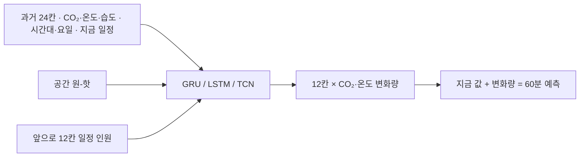

# 🔮 3. 과제 3 60분 예측: GRU · LSTM · TCN

> 🔄 10/22 정정: 10장 심화의 '최적 = 4시간 + TCN'은 시험 점수로 고른 값이다. 검증 점수로 다시 고르면 **2시간 + LSTM**(검증 18.50, 시험 15.20ppm)이고 '4시간 + TCN'은 9개 중 8위였다 (`inference/reports/addenda/task3_addendum.md`). 실데이터도 실제 시간표를 넣으면 41%로 통과(맨 아래 추가 실험).

과제 2에서 만든 5분 간격 표를 보고 "앞으로 60분 동안 CO₂·온도가 어떻게 될지"를 맞히는 신경망을 만들었습니다. 합성 데이터에서는 목표(현재값 유지보다 30% 개선)를 넘었고, 실데이터에서는 왜 못 넘었는지까지 원인을 찾았습니다.

> 📖 읽는 순서: 1부 1~3장(요약·비유·용어) → 4장 문제 바꾸기 → 5장 입력·출력 → 6장 신경망 3종 → 7장 학습 → 8장 합성 결과 → 9장 실데이터 → 10장 심화 → 2부 코드 → 자주 하는 실수 → 예상 질문

# 1부. 처음 보는 사람을 위한 설명

## 1. 한 문장으로 요약하면

> 공간 하나의 **과거 2시간(24칸)** CO₂·온도·습도와 시간대·요일, 그리고 **앞으로 60분의 수업·예약 일정**을 넣으면, **60분 뒤까지 5분 간격 12칸**의 CO₂·온도를 한 번에 내놓는 GRU·LSTM·TCN 모델을 만들었고, 합성 데이터에서 GRU 가 60분 CO₂ 오차를 **40.9 → 15.0ppm (63% 감소)** 로 줄였으며, 일정이 없고 사용 패턴이 바뀐 실데이터에서는 최근 데이터로 다시 학습해야 **15% 감소**에 그쳤습니다.

## 2. 일기예보에 비유해 보기

| 비유 | 이 과제에서는 | 정식 이름 |
| --- | --- | --- |
| 지난 이틀 날씨 기록을 보고 내일을 맞히기 | 과거 2시간 센서 값을 보고 60분 뒤 맞히기 | 지도 학습 (supervised learning) 으로 바꾸기 |
| 예보관이 보는 자료 | 과거 24칸 CO₂·온도·습도 + 시간대·요일 + 공간 | 입력 특징 (feature) |
| 이미 알려진 행사 일정 (내일 마라톤 대회) | 앞으로 60분의 수업 시간표·회의 예약 인원 | 미래에 미리 아는 입력 (known future input) |
| "내일은 오늘보다 2도 높음" 처럼 말하기 | 지금 값 대비 변화량을 맞히기 | 델타 타깃 (delta target) |
| 시간별 예보를 한 장에 다 적기 | 12칸을 한 번에 출력 | 다중 출력 (multi-horizon) |
| 기록을 한 줄씩 읽으며 메모장을 고쳐 쓰는 예보관 | 시간 순서대로 읽으며 기억을 갱신 | RNN (GRU·LSTM) |
| 여러 길이의 돋보기를 겹쳐 대 보기 | 가까운 칸·먼 칸을 동시에 훑는 필터 | TCN (합성곱) |
| 기출문제 풀이 반복 | 학습 데이터를 여러 바퀴 돌며 오차를 줄임 | 학습 (epoch) |
| 모의고사 점수가 안 오르면 공부 그만 | 검증 오차가 6번 연속 안 좋아지면 멈춤 | 조기 종료 (early stopping) |
| 여름 날씨로 배운 예보관이 겨울에 틀림 | 9월 시끄럽던 실습실로 배운 모델이 10월 조용한 실습실에서 틀림 | 개념 변화 (concept drift) |
| 시뮬레이터로만 운전 연습 | 합성 데이터로 학습한 모델을 실제 교실에 적용 | 합성 → 실데이터 전이 |
| 처음 가 보는 도시의 날씨 맞히기 | 학습에 없던 공간에서 시험 | 일반화 (generalization) |

## 3. 용어 사전

| 용어 | 쉬운 뜻 | 이 과제에서는 |
| --- | --- | --- |
| 모델 | 입력을 받아 답을 내는 계산식. 안에 조정 가능한 숫자(가중치)가 많음 | GRU·LSTM·TCN |
| 신경망 | 곱하기·더하기·꺾기(ReLU)를 여러 층 쌓은 모델 | PyTorch 로 만듦 |
| 가중치 (weight) | 모델 안의 조정 손잡이 숫자 | 학습이 이 값을 바꿈 |
| 지도 학습 | 문제와 정답 쌍을 많이 보여 주고 배우게 함 | 문제 = 과거 2시간, 정답 = 다음 60분 |
| 샘플 (sample) | 문제·정답 한 쌍 | 합성 시험 샘플 6,653개 |
| 과거 길이 (lookback) | 입력으로 보여 주는 과거 칸 수 | 24칸 = 2시간 (심화에서 1·2·4시간 비교) |
| horizon | 몇 칸 앞까지 맞히는지 | 12칸 = 60분 |
| 델타 (delta) | 지금 값과의 차이 | "10분 뒤 +30ppm" |
| 원-핫 (one-hot) | 여러 칸 중 해당하는 칸만 1, 나머지 0 | 어느 공간인지 표시 |
| sin/cos 시간 표현 | 23시와 0시가 가깝다는 걸 알려 주려 시각을 원 위의 점으로 바꿈 | `hour_sin`, `hour_cos` |
| RNN | 시간 순서대로 하나씩 읽으며 기억(은닉 상태)을 넘기는 신경망 | GRU·LSTM 의 공통 뼈대 |
| GRU | 기억을 "얼마나 지우고 얼마나 새로 쓸지" 문 2개로 조절하는 RNN | 기본 모델 |
| LSTM | 문 3개 + 별도 장기 기억 칸을 가진 RNN. GRU 보다 조금 무거움 | 비교 모델 |
| TCN | 시간 방향으로 미끄러지는 필터(합성곱)를 간격을 넓혀 가며 쌓은 모델 | 비교 모델 |
| 손실 (loss) | 학습 중 "얼마나 틀렸나"를 재는 점수. 낮출수록 좋음 | smooth L1 손실 |
| epoch | 학습 데이터를 한 바퀴 다 보는 것 | 최대 40바퀴 |
| 조기 종료 | 검증 성적이 더 안 좋아지면 일찍 멈추고 가장 좋았던 때로 되돌림 | patience 6 |
| 과적합 (overfitting) | 학습 데이터만 외워서 새 데이터에 약해짐 | 조기 종료로 막음 |
| 개념 변화 (concept drift) | 시간이 지나며 데이터의 성격 자체가 바뀜 | 9월 실습실 주 평균 1,281 → 10월 560ppm |
| 합성 데이터 | 규칙으로 만들어 낸 가짜 데이터. 정답(일정·고장)을 다 앎 | 자체 생성기 5주 (seed 7) |

## 4. 예측 문제를 "문제-정답 쌍"으로 바꾸기 (지도 학습)

시계열 예측은 그대로는 "긴 줄 하나"입니다. 모델에게 가르치려면 문제와 정답 쌍을 많이 만들어야 합니다.

1. 기준 시각 t 를 하나 고릅니다 (예: 10:00).
2. **문제** = t 를 포함한 과거 24칸 (08:05 ~ 10:00, 2시간).
3. **정답** = t 다음 12칸 (10:05 ~ 11:00, 60분).
4. t 를 5분씩 옮기며 반복하면 샘플이 수만 개 생깁니다 (합성 학습 23,636 / 검증 7,364 / 시험 6,653개).
5. 문제나 정답 구간 안에 빈칸(과제 2에서 비워 둔 긴 결측)이 하나라도 있으면 그 샘플은 건너뜁니다.
6. 합성 데이터 시험 주에는 일부러 고장이 심어져 있어, 예측 성능은 고장 구간을 뺀 정상 구간에서만 잽니다(고장 탐지는 과제 4).



## 5. 입력과 출력 설계 — 왜 이렇게 했나

### 5-1. 입력

- **과거 24칸**: CO₂·온도·습도(과제 2처럼 학습 구간 평균·표준편차로 정규화) + 시간대·요일(sin/cos) + 주말 여부 + 그 시점 일정 인원.
- **공간 원-핫**: 강의실1인지 회의실인지 알려 줍니다. 공간마다 크기·인원이 달라 반응이 다르기 때문입니다.
- **미래 일정 (앞으로 60분의 계획 인원 ÷ 정원, 0~1)**: 수업 시간표·회의실 예약은 미래인데도 미리 아는 정보입니다. "곧 30명이 들어온다"는 사실은 과거 센서 값에는 없기 때문에 이것이 가장 큰 차이를 만듭니다.

### 5-2. 출력: 12칸을 한 번에, "변화량"으로

1. **한 번에 12칸**: 한 칸 예측 → 그 예측을 다시 입력 → 다음 칸... 식으로 반복하면 틀린 값 위에 또 예측해서 오차가 쌓입니다. 그래서 60분 12칸을 한 번에 냅니다.
2. **변화량 (델타 타깃)**: 모델은 "지금보다 몇 ppm 오를까"를 맞히고, 마지막에 지금 값에 더해 원래 단위로 되돌립니다. 모델이 아무것도 못 배워도 출력이 0이면 곧 "현재값 유지"가 되므로, 기준선보다 크게 나빠지기 어렵고 학습이 안정적입니다.
3. 맞히는 항목은 CO₂·온도 2개 (습도는 입력으로만 씁니다).

> 🎤 **Q. 왜 값 자체가 아니라 변화량을 맞히게 했나요?**
> 변화량을 맞히게 하면 모델 출력이 0일 때가 곧 "현재값 유지"라서, 가장 강한 기준선에서 출발해 거기서 더 나아지는 법만 배우면 됩니다. CO₂ 는 수백 ppm 수준인데 5분 사이 변화는 수 ppm 이라, 값 자체를 맞히면 작은 변화가 묻힙니다. 그래서 학습이 안정적이었습니다. 합성 데이터에서 GRU 는 60분 오차 15.0ppm 으로 현재값 유지 40.9ppm 보다 63% 좋았습니다.

## 6. 신경망 3종을 쉬운 말로

세 모델 모두 "과거 24칸을 읽어 하나의 요약(64개 숫자)을 만드는 부분" + "그 요약에 공간·미래 일정을 붙여 12칸 × 2항목을 내는 부분(Head)"으로 되어 있습니다. 다른 건 **요약하는 방식**뿐입니다.

1. **RNN 의 기본 생각**: 칸을 시간 순서대로 하나씩 읽으며 "지금까지의 기억"을 고쳐 씁니다. 마지막 칸까지 읽은 뒤의 기억이 요약입니다. 단순 RNN 은 오래된 내용을 금방 잊는 문제가 있습니다.
2. **GRU**: 문(gate) 2개를 둡니다. "옛 기억을 얼마나 남길까", "새 내용을 얼마나 반영할까"를 칸마다 스스로 정합니다. 가볍고 빠릅니다. 우리 설정: 은닉 64, 2층.
3. **LSTM**: 문 3개(잊기·넣기·내보내기)와 따로 보관하는 장기 기억 칸이 있습니다. GRU 보다 계산이 조금 많지만 아주 긴 흐름에 강하다고 알려져 있습니다. 우리 데이터에서는 GRU 와 거의 같았습니다.
4. **TCN**: 칸을 하나씩 읽지 않고, 3칸짜리 필터를 시간 방향으로 미끄러뜨립니다. 층마다 필터 간격을 1·2·4·8칸으로 넓혀(팽창 합성곱) 4층만 쌓아도 먼 과거까지 봅니다. 앞쪽에만 0을 채워(인과 패딩) 미래 칸을 절대 보지 않게 합니다.

## 7. 학습은 어떻게 했나 (검증과 조기 종료)

1. 학습 데이터(합성 1~3주)를 256개씩 묶어(배치) 모델에 넣고, 예측과 정답의 차이(smooth L1 손실)를 계산합니다.
2. Adam 이라는 방법으로 가중치를 조금씩 고칩니다(학습률 0.001).
3. 한 바퀴(epoch)가 끝날 때마다 **검증 구간(4주)** 에서 CO₂ MAE 를 잽니다.
4. 검증 MAE 가 가장 좋았을 때의 가중치를 따로 저장해 둡니다.
5. 검증 MAE 가 6번 연속 좋아지지 않으면 멈추고(조기 종료), 저장해 둔 최고 가중치로 되돌립니다. 학습 데이터만 외우는 과적합을 막기 위해서입니다.
6. **시험 구간(5주)** 은 마지막 성적표로 한 번만 봅니다.
7. 실제 로그 예 (`reports/task3_train.log`): GRU 검증 CO₂ MAE 가 1바퀴 24.86 → 10바퀴 17.03 → 38바퀴 14.01ppm 으로 내려갔습니다.
8. 학습 시간 (맥북 CPU): GRU 75초, GRU(일정 제외) 71초, LSTM 91초, TCN 277초.

## 8. 합성 데이터 결과 (일정 포함)

측정 조건: 합성 5주(seed 7) · 학습 1~3주 / 검증 4주 / 시험 5주(고장 구간 제외) · 과거 120분 · 시험 샘플 6,653개

| 모델 | CO₂ 5분 | 15분 | 30분 | 60분 | 60분 개선율 |
| --- | ---: | ---: | ---: | ---: | ---: |
| 현재값 유지 | 10.3 | 21.9 | 33.2 | 40.9 | 0% |
| 최근 1시간 평균 | 28.6 | 34.0 | 41.4 | 54.5 | -33% |
| 어제 같은 시각 | 80.6 | 80.8 | 80.9 | 80.8 | -98% |
| **GRU (일정 포함)** | 6.3 | 9.4 | 11.8 | **15.0** | **63%** |
| GRU (일정 제외) | 7.7 | 12.7 | 16.7 | 20.4 | 50% |
| LSTM | 6.4 | 9.5 | 12.1 | 14.9 | 64% |
| TCN | 6.8 | 9.9 | 12.6 | 15.6 | 62% |

해석:

1. **목표 30% 달성**: 세 모델 모두 60분 CO₂ 오차를 60% 넘게 줄였습니다. 보고서에 쓴 대표 숫자는 GRU 63% (40.9 → 15.0ppm) 이고, 숫자로는 LSTM 이 14.9ppm 으로 아주 조금 더 좋았습니다.
2. **일정 정보의 가치**: 일정을 빼면 60분 오차가 20.4ppm, 넣으면 15.0ppm (5.4ppm 감소). 특히 **회의실은 31.4 → 17.5ppm** 으로 거의 절반입니다. "곧 회의가 시작된다"는 과거 센서 값에 없기 때문입니다.
3. **가장 어려운 공간은 강의실1** (정원 30명, GRU 60분 19.6ppm). 수업 시작·쉬는 시간마다 CO₂ 가 수백 ppm 씩 오르내리고, 쉬는 시간 창문 개방 여부가 날마다 다릅니다.
4. 오차가 큰 순간은 수업 시작·쉬는 시간·회의 시작처럼 사람 수가 급변할 때입니다. 일정은 "계획"만 알려 주므로 지각·결석·연장은 여전히 못 맞힙니다.
5. 온도는 냉방이 설정 온도로 묶어 두어 모두 오차가 작습니다 (GRU 60분 0.08℃, 현재값 유지 0.34℃).

> 🎤 **Q. GRU, LSTM, TCN 중 무엇이 가장 좋았나요?**
> 합성 데이터 60분 CO₂ 오차가 LSTM 14.9, GRU 15.0, TCN 15.6ppm 으로 차이가 1ppm 이내였습니다. 반면 일정을 빼면 GRU 가 20.4ppm 으로 5ppm 넘게 나빠졌습니다. 그래서 결론은 "모델 종류보다 입력 정보(일정)가 더 중요하다"입니다. 학습 시간과 보드 속도를 생각해 서비스에는 가벼운 GRU 를 썼습니다.

## 9. 실데이터 검증 — 왜 30%를 못 넘었나

측정 조건: 교육장 InfluxDB 8주(2026-08-26 ~ 10-21), 공간 사무실·실습실·회의실 · 시간순 70/15/15 (시험 10-13 ~ 10-21) · **일정 정보 없음** · 시험 샘플 7,223개

### 9-1. 8주 전체로 학습한 결과

| 모델 | CO₂ 5분 | 15분 | 30분 | 60분 | 60분 개선율 |
| --- | ---: | ---: | ---: | ---: | ---: |
| 현재값 유지 | 8.24 | 16.99 | 28.09 | 48.97 | 0% |
| 최근 1시간 평균 | 27.79 | 35.08 | 45.47 | 64.64 | -32% |
| 어제 같은 시각 | 123.52 | 123.61 | 123.75 | 124.04 | -153% |
| GRU | 11.13 | 19.22 | 31.89 | 49.84 | -2% |
| LSTM | 10.17 | 17.61 | 31.64 | 51.66 | -6% |
| TCN | 8.90 | 19.68 | 33.36 | 51.58 | -5% |

세 모델 모두 현재값 유지보다 조금 나빴습니다.

### 9-2. 원인 1: 사용 패턴이 바뀌었다 (개념 변화)

주별 실습실 CO₂ (5분 평균, ppm):

| 주 시작 | 실습실 평균 | 실습실 최대 |
| --- | ---: | ---: |
| 08-30 | 1,134 | 3,699 |
| 09-06 | 1,020 | 3,052 |
| 09-13 | **1,281** | 3,430 |
| 09-20 | 923 | 2,644 |
| 09-27 | 699 | 2,366 |
| 10-04 | 539 | 964 |
| 10-11 | **560** | 947 |
| 10-18 | 612 | 1,556 |

1. 8~9월 실습실은 주 평균 1,000ppm 이상, 최대 3,000ppm 이상이었습니다(사람이 훨씬 많던 다른 과정으로 추정).
2. 9월 말부터 평균 600ppm 안팎으로 조용해졌습니다.
3. 모델은 학습 구간(8~9월)의 "크게 출렁이는" 패턴을 배웠습니다. 그 시기에는 현재값 유지보다 좋았지만(60분 68.9 vs 89.9ppm), 10월의 잔잔한 교실에서는 **변화를 과하게 예측**해 오히려 나빠졌습니다.
4. 결론: **학습 데이터가 오래될수록 해롭습니다.**

### 9-3. 개선 실험 (선택은 모두 검증 구간에서, 시험 구간은 보지 않음)

| 방법 | 시험 구간 | 현재값 유지 | 모델 | 개선율 |
| --- | --- | ---: | ---: | ---: |
| 8주 전체 학습 GRU | 10-13~10-21 | 49.0 | 49.8 | -2% |
| 8주 전체 + 예측 변화량 감쇠 (α=0.15, 검증에서 선택) | 10-13~10-21 | 49.0 | 46.4 | 5% |
| **패턴이 바뀐 뒤(9/27~)만 학습** | 10-17~10-21 | 33.4 | **28.3** | **15%** |
| 합성 데이터로 학습한 범용 모델을 실데이터에 그대로 | 10-17~10-21 | 33.4 | 77.1 | -131% |

- **변화량 감쇠**: 모델이 낸 변화량에 0.15 를 곱해 "덜 과감하게" 만든 것입니다. 5% 좋아졌습니다.
- **최근 패턴(9/27~)만 학습**: 15% 로 가장 좋았지만 목표 30% 에는 못 미쳤습니다 (❌).
- **원인 2: 일정 정보가 없다**: 합성 실험에서 일정이 오차를 20.4 → 15.0ppm 으로 줄였듯, 실데이터의 큰 오차(수업 시작·쉬는 시간)는 시간표 없이는 미리 알 수 없습니다.
- **원인 3: 10월은 원래 잔잔하다**: 시험 구간 현재값 유지 오차가 33~49ppm 으로 작아 이기기 어렵습니다.

### 9-4. 합성 → 실데이터 전이 실패 (77ppm)

1. 처음 보드 서비스에는 합성 데이터로 학습한 "공간 구분 없음 + 일정 없음" 범용 GRU 를 올렸습니다(`train_service_model.py`).
2. 실데이터에 그대로 쓰니 60분 CO₂ 오차 **77.1ppm**, 현재값 유지(33.4ppm)보다 131% 나빴습니다.
3. 합성 데이터는 실제 교실의 변동 폭·주기를 모르기 때문입니다.
4. 그래서 서비스 모델을 **교육장 실데이터(9/27~)로 학습한 GRU** 로 교체했습니다(서비스 기준 30.6ppm). 모델 파일이 바뀌면 서비스가 재시작 없이 다시 읽도록 해 두어 매주 재학습한 모델로 무중단 교체가 가능합니다.
5. 내 수집기 데이터(22.1시간, 어떤 모델 학습에도 안 씀)에서도 확인: 60분 CO₂ 현재값 유지 41.5 · 실데이터 학습 GRU 39.0 (6% 개선) · 합성 학습 GRU 56.8ppm (-37%).

> 🎤 **Q. 실데이터에서는 왜 목표를 못 이뤘나요?**
> 두 가지 이유입니다. 첫째, 실데이터에는 수업 시간표가 없어서 수업 시작 같은 급변을 미리 알 수 없습니다. 합성에서 일정이 오차를 20.4에서 15.0ppm 으로 줄였던 바로 그 정보입니다. 둘째, 실습실 주 평균 CO₂ 가 9월 1,281ppm 에서 10월 560ppm 으로 바뀌어(개념 변화) 옛 데이터로 배운 모델이 변화를 과하게 예측했습니다. 9/27 이후 데이터로만 다시 학습하니 15% 개선되었고, 시간표 연결과 매주 재학습을 해결책으로 제시했습니다.

## 10. 심화(B) — 과거 길이 × 모델, 처음 보는 공간

측정 조건: 합성 5주 · 일정 포함 · 과거 4시간이 있는 시점만 시험해 모든 조합이 같은 시점에서 비교

### 10-1. 과거 1·2·4시간 × GRU·LSTM·TCN (60분 CO₂ MAE, ppm)

| 과거 길이 | GRU | LSTM | TCN |
| --- | ---: | ---: | ---: |
| 1시간 (12칸) | 16.5 | 15.8 | 16.6 |
| 2시간 (24칸) | 15.3 | 15.2 | 15.9 |
| 4시간 (48칸) | 14.4 | 16.1 | **14.4** |

1. **최적 조합 = 과거 4시간 + TCN** (14.36ppm), GRU(14.43ppm) 와 사실상 동률입니다.
2. 1시간 → 2시간으로 늘리면 수업 한 주기(50분 수업 + 10분 휴식)를 통째로 보게 되어 좋아집니다.
3. 4시간까지 늘려도 이득이 작거나(LSTM 은 오히려 나빠짐) 학습이 느려집니다. 미래 일정이 들어가면 아주 먼 과거는 덜 중요합니다.
4. 같은 과거 길이에서 모델 차이는 1~2ppm → **모델보다 입력 정보(일정·과거 길이)가 중요합니다.**
5. 주의: 4시간 GRU·TCN 의 학습 시간(2,580초·54,894초)은 실험 도중 맥북이 잠자기에 들어가 부풀려진 값으로, 실제 계산 시간이 아닙니다.

### 10-2. 처음 보는 공간에서도 되는가 (60분 CO₂ MAE, ppm)

공간 하나를 학습에서 완전히 빼고(공간 구분 없는 모델) 그 공간에서만 시험했습니다.

| 시험 공간 | 현재값 유지 | 학습에 포함 | 처음 보는 공간 | 일반화 손실 |
| --- | ---: | ---: | ---: | ---: |
| 강의실1 | 71.9 | 21.9 | **74.8** | 52.9 |
| 강의실2 | 41.3 | 14.4 | 20.3 | 5.9 |
| 회의실 | 35.3 | 17.6 | 23.5 | 5.9 |
| 라운지 | 22.2 | 12.0 | 18.3 | 6.3 |

1. 4곳 중 3곳은 처음 보는 공간이어도 현재값 유지보다 좋았습니다(손실 6ppm 정도) → 새 공간에도 어느 정도 바로 쓸 수 있습니다.
2. **예외: 강의실1** — 빼고 학습하면 74.8ppm 으로 현재값 유지(71.9)보다도 나쁩니다. 정원이 가장 많아 CO₂ 오르내림 폭이 훨씬 커서, 다른 공간만 본 모델은 그 폭을 상상하지 못합니다.
3. 성격이 다른 공간(인원·부피·일정 방식이 다름)은 며칠치만 모아도 다시 학습하는 것이 좋습니다.
4. 실데이터에서는 합성 학습 모델이 77.1ppm 으로 크게 틀렸습니다 → "공간" 차이보다 "데이터 성격(합성 vs 실제)" 차이가 훨씬 큽니다.

> 🎤 **Q. 처음 보는 공간에도 모델을 쓸 수 있나요?**
> 대체로 됩니다. 합성 4개 공간 중 하나씩 빼고 학습해 보니 강의실2·회의실·라운지는 손실이 6ppm 정도로 여전히 현재값 유지보다 좋았습니다. 하지만 정원 30명인 강의실1은 74.8ppm 으로 현재값 유지 71.9ppm 보다 나빴습니다. 성격이 다른 공간은 며칠치 데이터를 모아 다시 학습해야 합니다.

---

# 2부. 실제 코드와 설정

## 1. 기본 상수와 입력 설명 — `inference/tsinf/forecast.py`

```python
H = 12                      # 예측 칸 수 (5분 × 12 = 60분)   # ← 60분을 12칸으로
FEAT = ("co2", "temperature", "humidity")   # ← 입력으로 쓰는 항목
TARGETS = ("co2", "temperature")            # ← 맞히는 항목 (습도는 입력만)


@dataclass
class DatasetSpec:
    spaces: List[str]                              # ← 다룰 공간 목록
    lookback: int = 24                             # ← 과거 24칸 = 2시간
    use_schedule: bool = True                      # ← 일정 포함 여부 (False = 일정 제외 모델)
    stats: Optional[pd.DataFrame] = None           # index (space, metric), cols mean/std   # ← 학습 구간 정규화 통계
    capacity: Dict[str, float] = field(default_factory=dict)   # ← 공간 정원 (일정 인원 ÷ 정원)
    space_onehot: bool = True                      # False: 공간 구분 없이(처음 보는 실제 공간에도 쓰는 범용 모델)
```

## 2. 일정을 5분 격자로 — `schedule_grid()`

```python
def schedule_grid(schedule, index, spaces, capacity) -> pd.DataFrame:
    """5분 격자의 '계획 인원 / 정원' (0~1). 일정이 없는 공간은 0."""
    g = pd.DataFrame(0.0, index=index, columns=list(spaces))       # ← 처음엔 모두 0 (일정 없음)
    if schedule is None or schedule.empty:
        return g                                                   # ← 실데이터처럼 일정이 없으면 0 표 그대로
    for r in schedule.itertuples():
        ...
        mask = (index >= s.floor("5min")) & (index < e)            # ← 수업·예약 시작~끝 칸
        g.loc[mask, r.space] = np.maximum(g.loc[mask, r.space], r.planned_people / capacity.get(r.space, 30))   # ← 계획 인원 ÷ 정원
    return g
```

## 3. 문제-정답 쌍 만들기 — `build_samples()`

```python
    for si, sp in enumerate(spec.spaces):
        raw = np.stack([grid[(sp, m)].to_numpy(np.float32) for m in FEAT], axis=1)       # [T,3]   # ← 이 공간의 CO₂·온도·습도
        mu = np.array([spec.stats.loc[(sp, m), "mean"] for m in FEAT], np.float32)       # ← 학습 구간 평균
        sd = np.array([spec.stats.loc[(sp, m), "std"] for m in FEAT], np.float32)        # ← 학습 구간 표준편차
        z = (raw - mu) / sd                                                              # ← 정규화
        sc = sched[sp].to_numpy(np.float32) if spec.use_schedule else np.zeros(len(grid), np.float32)   # ← 일정 제외면 0
        onehot = np.eye(len(spec.spaces), dtype=np.float32)[si] if spec.space_onehot else np.ones(1, np.float32)   # ← 공간 원-핫
        bad = np.isnan(raw).any(axis=1)                                                  # ← 빈칸인 시각
        bad_cum = np.concatenate([[0], np.cumsum(bad)])                                  # ← 빈칸 누적 개수 (구간 빈칸 빠르게 세기)
        ...
        for t in times:
            i = pos.get(t)
            if i is None or i < L - 1 or i + H >= len(grid) or excl[i]:
                continue                                                                 # ← 과거·미래가 모자라거나 고장 구간이면 건너뜀
            if bad_cum[i + H + 1] - bad_cum[i - L + 1] > 0:
                continue                                                                 # ← 창 안에 빈칸이 하나라도 있으면 건너뜀
            seq = np.concatenate([z[i - L + 1:i + 1], tf[i - L + 1:i + 1], sc[i - L + 1:i + 1, None]], axis=1)   # ← 문제: 과거 24칸
            fut = sc[i + 1:i + H + 1]                                                    # ← 앞으로 12칸 일정
            y = np.stack([(raw[i + 1:i + H + 1, FEAT.index(m)] - raw[i, FEAT.index(m)]) / sd[FEAT.index(m)]
                          for m in TARGETS], axis=1)                                      # [H,2]   # ← 정답: 지금 대비 변화량
            ...
            out["y"].append(y); out["base"].append(raw[i, [FEAT.index(m) for m in TARGETS]])   # ← base = 지금 값 (복원용)
```

## 4. 모델 3종 — `inference/tsinf/forecast.py`

```python
class Head(_Module):
    def __init__(self, enc_dim, n_static, hidden=64):
        super().__init__()
        self.mlp = nn.Sequential(nn.Linear(enc_dim + n_static + H, hidden), nn.ReLU(),   # ← 요약 + 공간 + 미래 일정 12칸을 이어 붙여 입력
                                 nn.Linear(hidden, H * len(TARGETS)))                     # ← 12칸 × 2항목 = 24개 숫자 출력

    def forward(self, h, x_static, x_future):
        return self.mlp(torch.cat([h, x_static, x_future], dim=1)).view(-1, H, len(TARGETS))   # ← [묶음, 12, 2] 모양으로


class RNNForecaster(_Module):
    def __init__(self, n_in, n_static, kind="gru", hidden=64, layers=2):
        super().__init__()
        rnn = nn.GRU if kind == "gru" else nn.LSTM                                       # ← GRU 와 LSTM 은 이 한 줄만 다름
        self.rnn = rnn(n_in, hidden, num_layers=layers, batch_first=True, dropout=0.1)   # ← 은닉 64, 2층, 드롭아웃 10%
        self.head = Head(hidden, n_static)

    def forward(self, x_seq, x_static, x_future):
        out, _ = self.rnn(x_seq)                                                         # ← 24칸을 순서대로 읽음
        return self.head(out[:, -1], x_static, x_future)                                 # ← 마지막 칸의 기억 = 요약


class TCNForecaster(_Module):
    def __init__(self, n_in, n_static, hidden=64, levels=4, k=3):
        super().__init__()
        layers, ch = [], n_in
        for i in range(levels):
            d = 2 ** i                                                                   # ← 필터 간격 1, 2, 4, 8칸
            layers += [nn.ConstantPad1d(((k - 1) * d, 0), 0.0), nn.Conv1d(ch, hidden, k, dilation=d), nn.ReLU()]   # ← 앞쪽만 0 채움 = 미래를 안 봄
            ch = hidden
        self.tcn = nn.Sequential(*layers)
        self.head = Head(hidden, n_static)

    def forward(self, x_seq, x_static, x_future):
        h = self.tcn(x_seq.transpose(1, 2))[:, :, -1]                                    # ← 마지막 시각의 출력 = 요약
        return self.head(h, x_static, x_future)
```

## 5. 예측 복원 — `predict()`

```python
    dz = np.concatenate(outs)                                    # ← 모델 출력 = 정규화된 변화량
    return d["base"][:, None, :] + dz * d["sd"][:, None, :]      # ← 지금 값 + 변화량 × 표준편차 = 원래 단위(ppm, ℃)
```

## 6. 학습과 조기 종료 — `train()`

```python
def train(kind, tr, va, epochs=40, lr=1e-3, batch=256, patience=6, seed=0, verbose=True):
    torch.manual_seed(seed); np.random.seed(seed)                      # ← 매번 같은 결과가 나오게 난수 고정
    model = make_model(kind, tr["x_seq"].shape[2], tr["x_static"].shape[1])
    opt = torch.optim.Adam(model.parameters(), lr=lr)                  # ← 가중치를 고치는 방법 (Adam, 학습률 0.001)
    ...
    for ep in range(epochs):                                           # ← 최대 40바퀴
        model.train()
        perm = torch.randperm(n)                                       # ← 학습 샘플 순서만 섞음 (분할은 이미 시간순으로 끝남)
        for i in range(0, n, batch):
            b = perm[i:i + batch]                                      # ← 256개씩
            loss = nn.functional.smooth_l1_loss(model(xs[b], xst[b], xf[b]), y[b])   # ← 틀린 정도
            opt.zero_grad(); loss.backward(); opt.step()               # ← 틀린 만큼 가중치 수정
        v = mae_by_h(predict(model, va), va)[:, 0].mean()              # 검증: CO₂ 평균 MAE (ppm)
        ...
        if v < best - 1e-3:
            best, bad = v, 0
            best_state = {k: t.clone() for k, t in model.state_dict().items()}   # ← 지금까지 최고 성적 가중치 저장
        else:
            bad += 1
            if bad >= patience:                                        # ← 6번 연속 안 좋아지면
                break                                                  # ← 조기 종료
    model.load_state_dict(best_state)                                  # ← 최고 성적 때로 되돌림
    return model, best
```

- 학습 샘플 순서를 섞는 것(`randperm`)은 괜찮습니다. 각 샘플 안의 24칸 순서는 그대로이고, 학습·검증·시험 구간은 이미 시간순으로 나뉘어 있기 때문입니다.

## 7. 합성 실험 실행 — `inference/task3_forecast.py`

```python
    t0 = grid.index[0].normalize()
    tr_t = grid.index[grid.index < t0 + pd.Timedelta(days=21)]                                   # ← 1~3주 = 학습
    va_t = grid.index[(grid.index >= t0 + pd.Timedelta(days=21)) & (grid.index < t0 + pd.Timedelta(days=28))]   # ← 4주 = 검증
    te_t = grid.index[grid.index >= t0 + pd.Timedelta(days=28)]                                  # ← 5주 = 시험
    stats = prep.norm_stats(grid, tr_t)                                                          # ← 학습 구간으로만 정규화
    ...
    for use_sched in (True, False):                                                              # ← 일정 포함 / 제외 두 벌
        spec = fc.DatasetSpec(spaces, args.lookback, use_sched, stats, cap)
        data[use_sched] = {name: fc.build_samples(grid, sched, spec, t, excl if name == "test" else None)   # ← 시험에서만 고장 구간 제외
                           for name, t in (("train", tr_t), ("val", va_t), ("test", te_t))}
    ...
    for kind in args.models:
        for use_sched in ((True, False) if kind == "gru" else (True,)):                         # ← GRU 만 일정 제외 버전도 학습
            model, best = fc.train(kind, data[use_sched]["train"], data[use_sched]["val"], epochs=args.epochs)
            add_rows(tag, fc.predict(model, data[use_sched]["test"]))                            # ← 시험 구간 MAE 기록
```

## 8. 실데이터 검증 — `inference/task3_real.py`

```python
    df, st = prep.clean(prep.load_readings(args.db))                    # ← 과제 2와 같은 정제
    grid = prep.to_grid(df)
    spaces = sorted({s for s, m in grid.columns if all((s, x) in grid.columns for x in prep.METRICS)})   # ← CO₂·온도·습도 다 있는 공간만
    splits = prep.split_time(grid.index)                                # ← 과제 2와 같은 시간순 70/15/15
    stats = prep.norm_stats(grid, splits["train"])
    sched = fc.schedule_grid(None, grid.index, spaces, {})              # ← 실데이터는 일정 없음 → 모두 0
    spec = fc.DatasetSpec(spaces, 24, False, stats, {})                 # ← use_schedule=False
    data = {k: fc.build_samples(grid, sched, spec, v) for k, v in splits.items()}
    ...
    for kind in args.models:
        model, _ = fc.train(kind, data["train"], data["val"], epochs=40, verbose=False)
        add(kind.upper(), fc.predict(model, te))
```

## 9. 실행 명령

```bash
cd ~/projects/suyeon-timeseries-inference/inference
.venv/bin/python task3_forecast.py --data data/synth --models gru lstm tcn
.venv/bin/python task3_real.py --db data/influx_56d.db
.venv/bin/python task3_advanced.py
```

- 1줄: 과제 2~8 코드 폴더로 이동합니다.
- 2줄: 합성 5주 데이터(`data/synth`)로 GRU·LSTM·TCN 을 학습·평가하고 `reports/task3_report.md`, `models/forecast_*.pt`(학습된 가중치), `models/forecast_meta.json`(정규화 통계 등)을 만듭니다. GRU 는 일정 제외 버전도 함께 학습합니다.
- 3줄: InfluxDB 에서 내려받은 8주 실데이터(`data/influx_56d.db`)로 일정 없는 모델을 학습·평가하고 `reports/real56/task3_real_report.md` 를 만듭니다.
- 4줄: 심화 실험 — 과거 1·2·4시간 × 3모델, 공간 하나씩 빼고 일반화 시험 → `reports/task3_advanced_report.md`.

## 자주 하는 실수

| 실수 | 일어나는 일 | 막는 법 |
| --- | --- | --- |
| 오래된 실데이터 8주를 전부 학습 | 9월의 큰 출렁임을 배워 10월에 과하게 예측 → 현재값 유지보다 2% 나쁨 | 패턴이 바뀐 뒤(9/27~)만 학습 → 15% 개선, 매주 재학습 |
| 합성 데이터 모델을 실제 교실에 그대로 사용 | 60분 CO₂ 77.1ppm, 현재값 유지(33.4)보다 131% 나쁨 | 서비스 모델을 실데이터 학습 GRU 로 교체 |
| 한 칸씩 반복 예측 | 틀린 예측 위에 또 예측해 오차 누적 | 12칸을 한 번에 출력 |
| 값 자체를 맞히게 함 | 수백 ppm 속 작은 변화가 묻혀 학습 불안정 | 지금 값 대비 변화량을 맞힘 |
| 고장 구간까지 넣어 예측 성능을 잼 | 일부러 심은 고장 때문에 오차가 부풀려짐 | 시험에서만 고장 구간 제외 (`excl`) |
| 시험 구간을 보면서 설정(α, 학습 기간)을 고름 | 시험 점수가 실제보다 좋게 나옴 | α=0.15·학습 기간 선택은 모두 검증 구간에서 |
| 학습 시간을 그대로 비교 | 4시간 TCN 54,894초처럼 맥북 잠자기 시간이 섞임 | 같은 조건의 1·2시간 값(수십~수백 초)을 참고 |
| 빈칸이 있는 창으로 학습 | 지어낸 값을 배움 | 창 안에 빈칸이 하나라도 있으면 샘플 건너뜀 |
| 정원이 큰 공간을 다른 공간 데이터만으로 커버 | 강의실1 74.8ppm, 현재값 유지보다 나쁨 | 성격이 다른 공간은 며칠치 모아 다시 학습 |

## 예상 질문 모음

**Q. 예측 모델의 입력과 출력을 한 번에 설명해 주세요.**
입력은 공간 하나의 과거 2시간(24칸) CO₂·온도·습도, 시간대·요일, 그 시점 일정 인원, 어느 공간인지(원-핫), 그리고 앞으로 60분의 일정 인원입니다. 출력은 60분 뒤까지 5분 간격 12칸의 CO₂·온도 변화량이고, 지금 값에 더해 ppm·℃ 로 되돌립니다.

**Q. 목표를 달성했나요?**
합성 데이터에서는 달성했습니다. 60분 CO₂ 오차가 현재값 유지 40.9ppm 에서 GRU 15.0ppm 으로 63% 줄었습니다(LSTM 64%, TCN 62%). 실데이터에서는 일정이 없고 사용 패턴이 바뀌어, 최근 데이터로 다시 학습해도 15% (33.4 → 28.3ppm) 에 그쳐 30% 기준은 못 넘었습니다.

**Q. 일정 정보는 얼마나 중요했나요?**
가장 중요했습니다. 일정을 빼면 GRU 60분 오차가 20.4ppm, 넣으면 15.0ppm 이었습니다. 회의실은 31.4 → 17.5ppm 으로 거의 절반이 됐습니다. "곧 회의가 시작된다"는 사실은 과거 센서 값에 없기 때문입니다. 모델 종류 차이(1ppm 이내)보다 훨씬 큽니다.

**Q. GRU, LSTM, TCN 의 차이를 쉽게 말하면요?**
GRU 와 LSTM 은 24칸을 순서대로 읽으며 기억을 고쳐 쓰는 방식이고, LSTM 이 문이 하나 더 있고 장기 기억 칸이 따로 있어 조금 무겁습니다. TCN 은 3칸짜리 필터를 간격 1·2·4·8칸으로 넓혀 가며 훑어 먼 과거를 한꺼번에 봅니다. 우리 결과에서 셋의 차이는 1~2ppm 으로 작았습니다.

**Q. 조기 종료는 왜 했나요?**
학습을 오래 하면 학습 데이터만 외우는 과적합이 생깁니다. 그래서 매 바퀴 검증 구간 CO₂ MAE 를 재서, 6번 연속 좋아지지 않으면 멈추고 가장 좋았던 가중치로 되돌렸습니다. 예를 들어 GRU 는 검증 오차가 24.86 에서 14.01ppm 까지 내려갔습니다.

**Q. 개념 변화(concept drift)가 뭔가요? 우리 데이터에서 어땠나요?**
시간이 지나며 데이터의 성격이 바뀌는 것입니다. 실습실 주 평균 CO₂ 가 9월 중순 1,281ppm(최대 3,430) 에서 10월 560ppm 으로 크게 줄었습니다. 9월 데이터로 배운 모델은 10월에도 큰 변화를 예상해 틀렸고, 9/27 이후 데이터로만 학습하니 15% 개선되었습니다. 그래서 최근 2~3주로 주기적 재학습이 필요하다고 결론 냈습니다.

**Q. 합성 데이터로 잘 됐는데 왜 실제에서는 안 됐나요?**
합성 데이터는 우리가 정한 규칙으로 만든 것이라 실제 교실의 변동 폭과 주기를 모릅니다. 합성 학습 범용 모델을 실데이터에 쓰니 60분 오차 77.1ppm 으로 현재값 유지 33.4ppm 보다 131% 나빴습니다. 그래서 서비스 모델을 교육장 실데이터(9/27~)로 학습한 GRU 로 바꿨습니다. 합성 결과 63% 는 "일정이 있을 때의 상한선"으로 해석합니다.

**Q. 과거를 길게 보여 줄수록 좋은가요?**
어느 정도까지만입니다. GRU 기준 과거 1시간 16.5, 2시간 15.3, 4시간 14.4ppm 으로 좋아졌지만, LSTM 은 4시간에서 오히려 16.1ppm 으로 나빠졌습니다. 2시간이면 수업 한 주기(50분 + 10분)를 통째로 보므로 큰 이득은 거기서 나옵니다. 최적은 4시간 + TCN 14.4ppm 이었고 GRU 와 동률이었습니다.

**Q. 처음 보는 공간에도 쓸 수 있나요?**
대부분 됩니다. 공간 하나를 학습에서 빼도 강의실2·회의실·라운지는 손실 6ppm 정도로 현재값 유지보다 좋았습니다. 하지만 정원 30명인 강의실1은 74.8ppm 으로 현재값 유지 71.9ppm 보다 나빴습니다. 다른 공간보다 오르내림 폭이 커서 상상하지 못한 것이고, 이런 공간은 며칠치 데이터를 모아 다시 학습해야 합니다.

---

## ➕ 추가 실험 (10/22): 실제 시간표를 넣은 실데이터 예측

실습실 실제 시간표(평일 09:00~11:30 수업 · 11:30~13:00 점심 · 13:00~18:00 수업)를 받아, 그동안 합성 데이터로만 잴 수 있던 '일정 정보의 가치'를 **진짜 데이터**로 다시 쟀습니다.

> 측정 조건: 교육장 InfluxDB 실데이터 10/1~10/21, 실습실, 시간순 70/15/15 (시험 10/18~10/21, 880개 시점), GRU 씨앗 3개 평균. 10/1부터 수업(9/28~30은 CO₂ 변화 없음), 10/5·10/9 휴일 제외

| 모델 | 15분 | 30분 | 60분 CO₂ 오차 (ppm) | 개선율 |
| --- | --- | --- | --- | --- |
| 현재값 유지 | 14.2 | 26.1 | 50.0 | 0% |
| GRU 일정 제외 | 12.2 | 21.6 | 39.4 | 21% |
| GRU 일정 포함 (실제 시간표) | 13.1 | 19.0 | 29.3 | 41% |

- **실데이터에서도 기준(30%) 통과.** 시간표만 넣었는데 60분 오차가 10.1ppm 줄었습니다.
- 좋아진 곳은 **일정이 바뀌는 때**(수업 시작·점심·종료 1시간 전~30분 뒤): 107.2 → 52.6ppm. 그 외 시간은 19.3 → 20.6ppm으로 거의 같습니다.
- 15분 앞은 일정 포함이 조금 나쁩니다(12.2 → 13.1). 아주 가까운 미래는 지금의 추세가 더 중요하기 때문입니다.

코드: `inference/task_schedule_real.py` · 결과: `inference/reports/real56/task_schedule_real_report.md`
