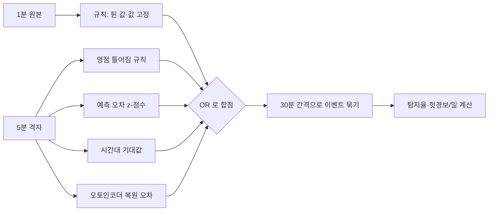

# 🚨 4. 과제 4 이상 탐지

센서 값이 "이상하다"는 것을 컴퓨터가 스스로 알아채게 만드는 과제입니다. 센서가 고장 난 경우와 냉방·환기 같은 설비가 멈춘 경우를 구분해서 잡고, 헛경보를 얼마나 적게 내는지까지 따졌습니다.

> 📖 읽는 순서: 1부(요약 → 비유 → 용어 → 고장 종류 → 탐지기 4가지 → 평가 방법 → 결과 → 실제 운영 조정) → 2부(코드) → 자주 하는 실수 → 예상 질문

# 1부. 처음 보는 사람을 위한 설명

## 1. 한 문장으로 요약하면

> 합성 데이터 마지막 주에 일부러 심어 둔 고장 15건을 정답으로 놓고, 규칙 탐지기와 모델 탐지기(오토인코더·예측 오차·시간대 기대값)를 비교한 결과, **규칙 + 예측 오차** 조합이 탐지율 80%, 하루당 헛경보 1.0회로 기준(탐지율 80% 이상, 헛경보 하루 1회 이하)을 만족해 채택했습니다. 실제 보드 서비스에서는 회의 시작을 고장으로 오인한 경보 9건과 냉방 중 평탄한 온도를 "값 고정"으로 오인한 2건을 보고, 조건을 "30분 연속"과 "온도·습도 120분"으로 고쳤습니다.

## 2. 건물 경비원에 비유해 보기

| 비유 | 이 과제에서는 | 정식 이름 |
| --- | --- | --- |
| 경비원이 순찰하며 이상한 것을 찾음 | 매 주기마다 센서 값을 검사 | 이상 탐지 (anomaly detection) |
| "문이 갑자기 열렸다 닫힘" 같은 뻔한 이상 | 한 칸만 확 튀었다 돌아오는 값 | 튄 값 (spike) |
| 시계가 멈춰 있음 | 같은 값이 한 시간 넘게 그대로 | 값 고정 (stuck) |
| 체중계 영점이 어긋남 | CO₂ 센서가 서서히 높게 읽음 | 영점 틀어짐 (drift) |
| 에어컨·환풍기가 몰래 꺼짐 | 냉방 정지, 환기 정지 | 설비 고장 |
| 경비 수칙 ("새벽 3시에 불 켜져 있으면 신고") | 정해진 숫자 기준으로 판단 | 규칙 기반 탐지기 |
| "평소 이 시간엔 이 정도였는데?" 하는 감 | 요일·시간대별 평소 값과 비교 | 시간대 기대값 (프로필) 탐지기 |
| "지금쯤 이렇게 됐어야 하는데" 하는 예상 | GRU 예측값과 실제값의 차이 | 예측 오차 (잔차) 탐지기 |
| 정상 모습을 외워 두고 다르면 의심 | 정상 1시간 창을 복원하도록 학습 | 오토인코더 |
| 고양이 지나간 걸로 신고 | 정상인데 경보가 울림 | 헛경보 (false alarm) |
| 같은 일로 매분 전화하지 않기 | 연속 경보를 한 사건으로 묶음 | 이벤트 단위 평가 |
| 신고 기준을 너무 예민하게/둔하게 | 경보를 울리는 점수 기준 | 임계값 (threshold) |
| 경비원 여러 명을 같이 세움 | 탐지기 여러 개를 OR 로 합침 | 탐지기 조합 |

## 3. 용어 사전

| 용어 | 쉬운 뜻 | 이 과제에서는 |
| --- | --- | --- |
| 이상 (anomaly) | 평소와 다른 값이나 모양 | 센서 고장 3종 + 설비 고장 2종 |
| 합성 데이터 | 프로그램으로 만든 가짜 데이터 | 5주치를 만들고 마지막 주에 고장 15건을 심음 |
| 정답 (label) | 실제로 고장이었는지 아닌지 | `faults.csv` (종류·공간·항목·시작·끝) |
| 학습/검증/평가 기간 | 배우는 기간, 기준 정하는 기간, 시험 기간 | 1~3주 학습, 4주 임계값 결정, 5주 평가 |
| 중앙값 (median) | 줄 세웠을 때 가운데 값 | 튄 값 검사에서 "직전 10분 중앙값"과 비교 |
| 잔차 (residual) | 실제값 − 예측값 | 15분 전에 한 예측과 지금 실제의 차이 |
| z-점수 (z-score) | 평소 흔들림 대비 몇 배나 벗어났는지 | 잔차 ÷ 평소 잔차의 표준편차 |
| 표준편차 | 값이 평균에서 얼마나 퍼져 있는지 | 검증 주 정상 잔차의 퍼짐 |
| MAD | 중앙값에서 얼마나 떨어져 있는지의 중앙값 (튀는 값에 덜 흔들리는 퍼짐) | 시간대 기대값의 퍼짐 |
| 한쪽 검정 | 한 방향(높을 때)만 보는 것 | 설비 고장·영점 틀어짐은 값을 올리므로 "예상보다 높음"만 봄 |
| 연속 조건 | 몇 칸 연속으로 넘어야 경보 | 평가 15분(3칸), 서비스 30분(6칸) |
| 오토인코더 | 입력을 압축했다가 다시 복원하는 신경망 | 복원이 잘 안 되면 "평소와 다르다" |
| 복원 오차 | 원본과 복원본의 차이 | 오토인코더 이상 점수 |
| 탐지율 (recall) | 실제 고장 중 잡아낸 비율 | 15건 중 몇 건 |
| 헛경보/일 | 고장이 아닌데 울린 경보가 하루 몇 번 | 4개 공간 합, 7일로 나눔 |
| 탐지 지연 | 고장 시작부터 첫 경보까지 걸린 시간 | 중앙값(분)으로 비교 |
| 이벤트 | 연속된 경보를 묶은 한 덩어리 | 30분 이내 간격이면 같은 이벤트 |

## 4. 왜 이상 탐지가 필요한가

1. 예측(과제 3)과 상태 판단(과제 5)은 센서 값이 맞다는 전제로 동작합니다. 센서가 틀리면 그 위의 모든 판단이 같이 틀립니다.
2. 설비가 멈춰도 사람이 바로 알기 어렵습니다. 냉방이 꺼져도 온도는 천천히 오르기 때문에, 값 하나만 보면 "정상 범위"입니다.
3. 그래서 두 가지를 잡아야 합니다.
   - **센서 고장**: 센서가 거짓말을 함 (튄 값, 값 고정, 영점 틀어짐)
   - **설비 고장**: 센서는 맞는데 방 상태가 평소와 다름 (냉방 정지, 환기 정지)
4. 헛경보가 많으면 담당자가 알림을 꺼 버립니다. 그래서 "많이 잡기"와 "헛경보 줄이기"를 동시에 따졌습니다.

## 5. 고장 종류 (합성 데이터에 심은 15건)

| 고장 | 건수 | 어떻게 생겼나 (합성 코드 기준) | 센서/설비 |
| --- | ---: | --- | --- |
| 튄 값 | 6 | 1분짜리 한 칸만 CO₂ +500~1200ppm(또는 크게 감소), 온도 +6~12℃ | 센서 |
| 값 고정 | 3 | 1~4시간 같은 값이 계속됨 | 센서 |
| 영점 틀어짐 | 2 | 6~12시간에 걸쳐 CO₂ 가 250~400ppm 서서히 높아짐 | 센서 |
| 냉방 정지 | 2 | 사용 중 시간대(9~12시, 13~17시)에 냉방이 꺼짐 → 온도 상승 | 설비 |
| 환기 정지 | 2 | 사람이 있을 때 CO₂ 상승 폭이 약 1.8배 | 설비 |

## 6. 탐지기 네 가지

### 6-1. 규칙 기반 탐지기
- **튄 값**: 직전 10분 중앙값과의 차이가 CO₂ 300ppm, 온도 3℃, 습도 15% 이상이고, **바로 다음 값이 제자리로 돌아오면** 튄 값입니다.
  - "다음 값이 돌아와야 한다"는 조건은 나중에 추가했습니다. 처음에는 쉬는 시간 창문을 열어 CO₂ 가 진짜로 급락하는 것도 고장으로 오인했습니다. 진짜 변화는 다음 값도 그대로이기 때문에 이 조건으로 구분됩니다. 대신 판단이 1분 늦어집니다.
- **값 고정**: 같은 값이 CO₂ 60분, 온도·습도 120분 이상 계속되면 경보입니다.
- **영점 틀어짐 전용**: 밤(20~07시)에 일정상 1.5시간 이상 빈 방인데, CO₂ 가 1시간 동안 25ppm 이상 오르고 외기(약 420ppm)보다 80ppm 넘게 높으면 경보입니다. 빈 방의 CO₂ 는 환기로 내려가야 정상이기 때문입니다.

### 6-2. 예측 오차(잔차) 탐지기
1. 과제 3 의 GRU 가 "15분 뒤 CO₂·온도"를 예측합니다.
2. 15분이 지나면 실제값과 비교해 잔차를 구합니다.
3. 잔차를 검증 주(정상)의 잔차 표준편차로 나눠 **z-점수**로 만듭니다. "평소 오차보다 몇 배 크게 틀렸나"입니다.
4. 음수는 0으로 자릅니다(한쪽). 환기 정지·냉방 정지·영점 틀어짐은 모두 값을 **올리기** 때문입니다.
5. 평가에서는 3칸(15분) 연속 넘어야 경보입니다. 서비스에서는 나중에 6칸(30분)으로 늘렸습니다(아래 9장).

### 6-3. 시간대 기대값(프로필) 탐지기
1. 학습 3주에서 "요일 × 하루 중 5분 칸"마다 중앙값과 퍼짐(MAD)을 계산합니다. 요일마다 시간표가 달라서 요일별로 따로 봅니다.
2. 지금 값이 그 시간대 평소 값보다 퍼짐의 몇 배 높은지 점수를 냅니다.
3. **온도는 냉방 운영 시간(평일 8:30~18:30)에만**, **CO₂ 는 밤에만** 봅니다. 꺼진 시간의 온도는 날씨 따라 자연히 달라지고, 낮의 CO₂ 는 인원 따라 들쭉날쭉하기 때문입니다.
4. 30분(6칸) 연속 높으면 경보입니다.

### 6-4. 오토인코더
1. 정상 1시간 창(12칸 × CO₂·온도·습도 = 36개 숫자)에 시간대·일정·공간 정보를 붙여 입력합니다.
2. 신경망이 이것을 6개 숫자로 압축했다가 다시 36개로 복원하도록 학습합니다.
3. 정상만 보고 배웠기 때문에, 평소와 다른 모양이 들어오면 복원이 잘 안 됩니다. 복원 오차가 크면 이상입니다.
4. 항목별 복원 오차 중 가장 큰 것을 "원인 항목"으로 지목합니다.

### 6-5. 임계값 정하는 법
- 정상인 검증 주(4주차)에서 **공간당 하루 0.2회(4개 공간 합 0.8회) 이하** 헛경보가 나는 가장 낮은 값을 고릅니다.
- 낮을수록 많이 잡지만 헛경보가 늘고, 높을수록 그 반대입니다. 오토인코더 임계값을 0.5배로 낮추면 탐지율 40%·헛경보 3.1회, 2배로 올리면 6.7%·0회였습니다.



> 🎤 **Q. 규칙만 쓰면 안 되나요?**
> 규칙만 쓰면 헛경보는 0회지만 탐지율이 66.7%(10/15)에 그칩니다. 규칙은 냉방 정지 0/2, 환기 정지 0/2 로 설비 고장을 하나도 못 잡았습니다. 설비 고장은 값 하나하나는 정상 범위라서 고정 숫자로는 안 보이고, "이 시간·이 상황이면 이 정도여야 한다"는 기대값과 비교해야 보입니다. 그래서 예측 오차를 더한 조합을 채택했습니다.

## 7. 평가 방법: 이벤트 단위

1. **이벤트로 묶기**: 경보 시각들 사이 간격이 30분 이하이면 하나의 경보 이벤트로 묶습니다. 같은 고장에 매분 울린 것을 여러 번으로 세지 않기 위해서입니다.
2. **탐지 판정**: 고장 구간(시작~끝+30분 여유)과 겹치는 경보 이벤트가 하나라도 있으면 그 고장은 "탐지"입니다.
3. **헛경보**: 어떤 고장과도 겹치지 않는 경보 이벤트입니다.
4. **하루당 헛경보**: 헛경보 수를 평가 기간 7일로 나눕니다(4개 공간 합).
5. **탐지 지연**: 고장 시작부터 첫 경보까지 걸린 분의 중앙값입니다.

## 8. 결과

### 8-1. 탐지기별 성적

| 탐지기 | 탐지 | 탐지율(%) | 탐지 지연 중앙값(분) | 헛경보 수 | 하루당 헛경보 |
| --- | --- | ---: | ---: | ---: | ---: |
| 규칙 | 10/15 | 66.7 | 29.5 | 0 | 0 |
| 오토인코더 | 3/15 | 20 | 250 | 4 | 0.6 |
| 예측 오차 | 4/15 | 26.7 | 131 | 7 | 1 |
| 시간대 기대값 | 5/15 | 33.3 | 40 | 9 | 1.3 |
| 모델(AE+예측+기대값) | 6/15 | 40 | 42.5 | 17 | 2.4 |
| 결합(전체) | 13/15 | 86.7 | 20 | 17 | 2.4 |

### 8-2. 고장 종류별 (탐지/전체)

| 고장 | 규칙 | 오토인코더 | 예측 오차 | 시간대 기대값 | 결합(전체) |
| --- | --- | --- | --- | --- | --- |
| 값 고정 | 3/3 | 1/3 | 1/3 | 1/3 | 3/3 |
| 냉방 정지 | 0/2 | 1/2 | 1/2 | 2/2 | 2/2 |
| 영점 틀어짐 | 2/2 | 1/2 | 1/2 | 2/2 | 2/2 |
| 튄 값 | 5/6 | 0/6 | 0/6 | 0/6 | 5/6 |
| 환기 정지 | 0/2 | 0/2 | 1/2 | 0/2 | 1/2 |

해석:
- **규칙은 센서 고장**(튄 값 5/6, 값 고정 3/3, 영점 틀어짐 2/2)을, **모델은 설비 고장**(냉방·환기 정지)을 잡습니다. 서로 못 잡는 것을 보완합니다.
- 모델은 튄 값을 하나도 못 잡았습니다. 1분짜리 한 칸이 5분 평균에 묻히기 때문입니다.
- 값 고정은 정상 범위 안에서 멈추면 복원 오차가 작아 모델이 이상으로 보지 않습니다.
- 빈 방에서 환기가 멈추면 CO₂ 가 오르지 않아 탐지할 수 없습니다. 사람이 없으니 당장 탐지할 필요도 낮고, 다음 사용 때 잡힙니다.

### 8-3. 조합 비교 (주요 줄)

| 조합 | 탐지율(%) | 하루당 헛경보 | 기준 충족 |
| --- | ---: | ---: | --- |
| **규칙 + 예측 오차** | **80** | **1** | ✅ |
| 규칙 + 예측 오차 + 시간대 기대값 | 86.7 | 2 | |
| 규칙 + 오토인코더 + 예측 오차 + 시간대 기대값 | 86.7 | 2.4 | |
| 규칙 + 시간대 기대값 | 80 | 1.3 | |
| 규칙 + 오토인코더 + 예측 오차 | 80 | 1.4 | |
| 규칙 + 오토인코더 | 73.3 | 0.6 | |
| 규칙 | 66.7 | 0 | |

- 15가지 조합을 모두 계산했고, 기준을 지키는 조합은 **규칙 + 예측 오차** 하나였습니다.
- 다 합치면 86.7%로 더 많이 잡지만 헛경보가 하루 2.4회로 늘어 운영자가 알림을 끄게 됩니다. 그래서 "헛경보 기준을 지키는 조합 중 탐지율이 가장 높은 것"을 골랐습니다.
- 채택 조합의 헛경보 1.0회는 기준에 딱 걸치는 수준입니다. 그래서 실제 운영에서는 경보를 묶어 보내고 확인 결과로 임계값을 계속 조정해야 합니다.

> 🎤 **Q. 탐지율이 더 높은 "전체 결합"을 왜 안 썼나요?**
> 전체 결합은 탐지율 86.7%로 가장 높지만 하루 헛경보가 2.4회입니다. 기준은 하루 1회 이하였고, 헛경보가 많으면 담당자가 알림을 무시하게 되어 진짜 고장도 놓칩니다. 규칙 + 예측 오차는 80%, 1.0회로 두 기준을 모두 지키는 유일한 조합이었습니다. 그래서 "많이 잡기"보다 "믿을 수 있는 경보"를 택했습니다.

## 9. 실제 운영에서 고친 것 (2026-10-21, 보드 B 서비스)

실데이터에는 고장 정답이 없습니다. 그래서 서비스가 10:50~15:50(약 5시간) 동안 실제로 낸 경보를 하나씩 직접 확인했습니다.

| 경보 | 건수 | 확인 결과 | 조정 |
| --- | ---: | --- | --- |
| 회의실 "예상보다 높음" | 9 | 회의 시작으로 CO₂ 가 오른 정상 변화. 일정 정보가 없어 모델이 미리 모름. "3주기 연속" 조건이 1분 단위로 세어져 실제로는 5분 칸 1개만 넘어도 울렸음 | 5분 칸 6개(30분) 연속일 때만 경보 |
| 사무실 "온도 값 고정" | 2 | 냉방이 21.9℃ 로 묶어 둬 0.1℃ 해상도 값이 1시간 그대로 → 정상 | 온도·습도 120분(2시간), CO₂ 60분 |
| 데이터 끊김 | 7 | 14:03·14:11 보드 재부팅 → 진짜 끊김 | 유지 |
| 1,000ppm 초과 예상 | 10 | 사무실·실습실 CO₂ 상승 → 유효한 사전 경보 | 유지 |

- 조정 후 합성 데이터 평가를 다시 돌려도 **탐지율 80%·헛경보 하루 1.0회**로 기준을 그대로 만족했습니다(값 고정 3/3 유지).
- 교훈: 합성 데이터에서 정한 규칙도 실제 센서의 해상도·사용 패턴을 만나면 헛경보를 냅니다. 경보마다 확인 결과를 남겨 계속 조정해야 합니다.
- 내 수집기 실데이터(10-20 17:50 ~ 10-21 15:55)에 규칙 탐지기를 돌렸을 때는 규칙 경보가 없었습니다(튄 값·값 고정 없음).

> 🎤 **Q. 실데이터에는 정답이 없는데 어떻게 평가하나요?**
> 합성 데이터는 고장을 직접 심었으니 정답이 있지만, 실데이터는 없습니다. 그래서 서비스가 5시간 동안 낸 경보를 직접 하나씩 확인했고, 회의실 9건과 사무실 2건이 헛경보였습니다. 앞으로는 경보마다 담당자가 진짜/헛경보를 기록해 정답을 쌓고, 센서를 가리는 식으로 일부러 고장을 만들어 시험하는 방법을 제안했습니다.

## 10. 운영 제안
- 강의실: 결합 탐지기, 경보는 시설 담당자에게 보냅니다(냉방·환기 정지는 수업 중 바로 조치 필요).
- 회의실·라운지: 사용 중일 때만 설비 경보, 센서 경보(고정·틀어짐)는 하루 한 번 모아서 알립니다.
- 같은 고장은 30분 단위로 묶어 한 번만 알리고, 1시간 지나도 계속되면 다시 알립니다.

---

# 2부. 실제 코드와 설정

## 1. 규칙 탐지기 — `inference/tsinf/anomaly.py`

```python
STUCK_MIN = {"co2": 60, "temperature": 120, "humidity": 120}   # ← 값 고정 기준(분). 실데이터 확인 후 온도·습도를 120분으로 늘림


def rule_alarms(raw: pd.DataFrame, spike_thr=None, stuck_min=None) -> pd.DataFrame:
    ...
    spike_thr = spike_thr or {"co2": 300.0, "temperature": 3.0, "humidity": 15.0}   # ← 튄 값 기준
    out = pd.DataFrame(index=raw.index)
    for m in raw.columns:                                       # ← 항목(co2, temperature, humidity)마다
        x = raw[m]
        med = x.shift(1).rolling(10, min_periods=3).median()    # ← 직전 10분 중앙값 (지금 값은 빼고)
        thr = spike_thr.get(m, np.inf)
        out[f"rule_spike_{m}"] = ((x - med).abs() >= thr) & ((x.shift(-1) - med).abs() < thr / 2)   # ← 크게 튀었고, 다음 값은 제자리로 돌아옴
        run_id = (x != x.shift()).cumsum()                      # ← 값이 바뀔 때마다 번호가 1씩 올라감 = 같은 값 덩어리 번호
        run_len = x.groupby(run_id).cumcount() + 1              # ← 같은 값이 몇 분째 이어지는지
        lim = (stuck_min or STUCK_MIN).get(m, 60) if isinstance(stuck_min or STUCK_MIN, dict) else stuck_min
        out[f"rule_stuck_{m}"] = (run_len >= lim) & x.notna()  # ← 기준 시간 이상 같으면 값 고정
    return out.fillna(False)
```

## 2. 영점 틀어짐 전용 규칙 — `inference/tsinf/anomaly.py`

```python
def drift_alarm(grid_space, occupied_plan, c_out=420.0, min_empty_h=1.5, rise_ppm=25.0):
    co2 = grid_space["co2"]
    hour = co2.index.hour
    night = (hour >= 20) | (hour < 7)          # ← 밤 시간만 (낮에는 일정 밖 사용이 있을 수 있어서)
    empty = (occupied_plan.rolling(int(min_empty_h * 12), min_periods=1).max() == 0) & night   # ← 1.5시간 동안 일정상 아무도 없음
    rising = (co2 - co2.shift(12)) >= rise_ppm # ← 1시간(12칸) 전보다 25ppm 이상 올랐음
    above = co2 > c_out + 80                   # ← 외기(420)보다 80ppm 넘게 높음
    return (empty & rising & above).fillna(False)   # ← 셋 다 맞으면 "센서가 틀어지는 중"
```

## 3. 시간대 기대값 — `inference/tsinf/anomaly.py`

```python
def profile_fit(gs, train_mask) -> dict:
    key = _profile_key(gs.index)                               # ← (요일, 5분 칸) 번호
    tr = gs[train_mask]
    med = tr.groupby(key[train_mask]).median()                 # ← 칸마다 평소 값(중앙값)
    mad = (tr - med.reindex(key[train_mask]).values).abs().groupby(key[train_mask]).median()   # ← 칸마다 평소 퍼짐(MAD)
    floor = {"co2": 60.0, "temperature": 0.3, "humidity": 2.0}  # ← 학습이 3주뿐이라 퍼짐이 너무 작게 잡히지 않도록 바닥값
    ...

def _profile_key(index):
    return (index.dayofweek * 1000 + index.hour * 12 + index.minute // 5).to_numpy()   # ← 월요일 9:05 같은 칸 번호

def profile_score(gs, prof):
    ...
    return (gs[med.columns] - med) / (1.4826 * mad)            # ← (실제 − 평소) ÷ 퍼짐. 1.4826 은 MAD 를 표준편차 크기로 바꾸는 상수
```

## 4. 오토인코더 — `inference/tsinf/anomaly.py`

```python
class AE(_Module):
    def __init__(self, n_in, n_cond, bottleneck=6):
        super().__init__()
        self.enc = nn.Sequential(nn.Linear(n_in + n_cond, 64), nn.ReLU(), nn.Linear(64, bottleneck))   # ← 압축: 36개+조건 → 6개
        self.dec = nn.Sequential(nn.Linear(bottleneck + n_cond, 64), nn.ReLU(), nn.Linear(64, n_in))   # ← 복원: 6개+조건 → 36개

    def forward(self, x, c):
        return self.dec(torch.cat([self.enc(torch.cat([x, c], 1)), c], 1))   # ← 시간대·일정(c)을 양쪽에 붙여 "이 시간엔 이런 모양"을 배우게 함
...
def ae_scores(m, X, C, W):
    with torch.no_grad():
        r = m(torch.from_numpy(X), torch.from_numpy(C)).numpy()   # ← 복원 결과
    e = (r - X) ** 2                                               # ← 원본과의 차이 제곱
    per_metric = e.reshape(len(X), W, 3).mean(axis=1)              # ← 항목별 오차 (원인 항목 지목용)
    return e.mean(axis=1), per_metric                              # ← 창 전체 이상 점수, 항목별 점수
```

## 5. 예측 오차 탐지기 (평가용) — `inference/task4_anomaly.py`

```python
        pred = fc.predict(gru, sub)[:, 2, :]                          # ← GRU 예측 중 3번째 칸 = 15분 뒤
        tgt_time = pd.DatetimeIndex(sub["time"]) + pd.Timedelta(minutes=15)
        actual = np.stack([gs["co2"].reindex(tgt_time).to_numpy(), gs["temperature"].reindex(tgt_time).to_numpy()], 1)   # ← 15분 뒤 실제값
        res = (actual - pred) / sub["sd"]                              # ← 잔차(정규화 단위)
        ...
        rs = resid[vmask].std()                                       # ← 검증 주(정상) 잔차의 표준편차
        zres = (resid / rs).clip(lower=0).max(axis=1)                 # ← z-점수, 음수는 0 (예상보다 높을 때만), CO₂·온도 중 큰 쪽
        sustained = zres.rolling(3).min()                             # ← 3칸(15분) 연속으로 높아야 큰 값이 남음
        sv2 = sustained[va].dropna()
        thr2 = pick_threshold(sv2, 7, ...)                            # ← 검증 주 헛경보 기준으로 임계값 고르기
        fr_alarm = (sustained > thr2) & te                            # ← 평가 주 경보
```

임계값 고르기:

```python
FA_TARGET_PER_SPACE_DAY = 0.2       # ← 공간 4개 → 하루 0.8회 이하 목표

def pick_threshold(val_scores, days, cands):
    for thr in sorted(cands):                                         # ← 낮은 후보부터
        if len(an.to_events(val_scores > thr)) / days <= FA_TARGET_PER_SPACE_DAY:
            return float(thr)                                         # ← 정상 주 헛경보가 기준 이하가 되는 첫(가장 낮은) 값
    return float(max(cands))
```

## 6. 예측 오차 탐지기 (서비스용) — `inference/service/infer.py`

```python
                # ---------- 예측 오차 (15분 전에 한 예측 vs 지금 실제), 한쪽(예상보다 높음)
                h = self.history.setdefault(sp, [])                    # ← 공간별로 최근 예측을 기억
                past = [p for p in h if p["base_time"] == latest_t - pd.Timedelta(minutes=15)]   # ← 15분 전에 만든 예측 찾기
                new_step = not h or h[-1]["base_time"] != latest_t    # ← 새 5분 칸이 생겼을 때만 (매분 세지 않도록)
                if past and new_step:
                    p = past[-1]
                    r = np.array([(base["co2"] - p["co2"][2]) / sd["co2"], (base["temperature"] - p["temperature"][2]) / sd["temperature"]])   # ← 실제 − 15분 전 예측
                    rs = np.array([self.meta["resid_sd_15min_norm"]["co2"], self.meta["resid_sd_15min_norm"]["temperature"]])   # ← 학습 때 잰 평소 잔차 퍼짐
                    zz = np.clip(r / rs, 0, None)                      # ← z-점수, 높을 때만
                    ...
                    # 5분 칸 기준 6칸(30분) 연속으로 예상보다 높아야 경보 (회의 시작처럼 잠깐 오르는 건 무시)
                    self.resid_run[sp] = self.resid_run.get(sp, 0) + 1 if zz.max() > 4.0 else 0   # ← z 가 4 넘으면 연속 횟수 +1, 아니면 0으로
...
        model_alarm = self.resid_run.get(sp, 0) >= 6            # ← 6칸(30분) 연속이면 모델 경보
```

- `new_step` 조건이 "회의실 9건" 문제를 고친 핵심입니다. 서비스는 1분마다 돌지만 5분 칸은 5분에 한 번 바뀝니다. 예전에는 같은 5분 칸을 1분마다 다시 세서 "3주기 연속"이 사실상 5분 칸 1개였습니다.

## 7. 이벤트 묶기와 평가 — `inference/tsinf/anomaly.py`

```python
def to_events(alarm, merge_gap="30min", min_len=1):
    t = alarm[alarm].index                         # ← 경보가 켜진 시각들
    ...
    for x in t[1:]:
        if x - e <= gap:                           # ← 직전 경보와 30분 이내면 같은 이벤트로 이어 붙임
            e = x
        else:
            ev.append((s, e)); s = e = x           # ← 아니면 새 이벤트 시작
    ...

def evaluate(events, faults, t0, t1, margin="30min"):
    ...
    for f in faults.itertuples():                  # ← 고장 하나씩
        for k, (s, e) in enumerate(events.get(f.space, [])):
            if s <= f.end + mg and e >= f.start:   # ← 고장 구간(+30분 여유)과 겹치면
                used[f.space][k] = True            # ← 이 경보는 "쓸모 있었음"
                hit = True                         # ← 이 고장은 탐지됨
    ...
    days = (t1 - t0 + pd.Timedelta(minutes=5)).total_seconds() / 86400    # ← 평가 기간 7일
    fa = sum(1 for sp, u in used.items() for x in u if not x)            # ← 어떤 고장과도 안 겹친 경보 = 헛경보
```

## 8. 실행 명령

```bash
cd ~/projects/suyeon-timeseries-inference/inference      # ← 추론 쪽 폴더로 이동
.venv/bin/python task4_anomaly.py --data data/synth      # ← 합성 데이터로 탐지기 4종 학습·평가, reports/task4_report.md 생성
.venv/bin/python task_own.py --db data/sensors_boardB.db # ← 내 수집기 데이터에 규칙 탐지기 실행 (과제 3·5·6 평가도 같이)
```

- 첫 줄: 작업 폴더로 이동합니다.
- 둘째 줄: 1~3주로 학습, 4주로 임계값 결정, 5주로 평가해 성적표·조합 비교표를 씁니다. 과제 3 GRU(`models/forecast_meta.json`)가 먼저 있어야 합니다.
- 셋째 줄: 보드 B 에서 받은 실데이터로 규칙 탐지기를 돌립니다. 정답이 없으니 경보 목록을 사람이 확인합니다.

## 자주 하는 실수

| 실수 | 일어나는 일 | 막는 법 |
| --- | --- | --- |
| 튄 값을 "직전과 크게 다름"으로만 판단 | 쉬는 시간 창문 개방(CO₂ 진짜 급락)을 고장으로 오인 | "다음 값이 제자리로 돌아와야" 튄 값으로 봄 |
| 5분 칸 기준 연속 조건을 1분 주기로 셈 | 회의실 회의 시작에 "예상보다 높음" 9번 | 새 5분 칸일 때만 세고, 6칸(30분) 연속 |
| 값 고정 기준을 모든 항목 60분으로 | 냉방 중 0.1℃ 해상도 온도가 1시간 그대로 → 헛경보 2번 | 온도·습도 120분, CO₂ 60분 |
| 탐지율만 보고 조합 선택 | 전체 결합 86.7%지만 헛경보 2.4회/일 → 알림 무시 | 헛경보 기준을 먼저 지키고 그 안에서 탐지율 최대 |
| 경보를 매분 따로 셈 | 같은 고장 하나가 헛경보 수십 개로 부풀려짐 | 30분 간격으로 이벤트 묶기 |
| 임계값을 평가 주에서 정함 | 시험 답을 보고 기준을 정한 셈 → 성적이 부풀려짐 | 정상인 검증 주(4주)에서만 정함 |
| 양쪽(높음·낮음) 다 봄 | 헛경보만 늘어남 | 설비 고장은 값을 올리므로 한쪽만 |

## 예상 질문 모음

**Q. 센서 고장과 설비 고장은 어떻게 다른가요?**
센서 고장은 센서가 틀린 값을 내는 것으로, 튄 값·값 고정·영점 틀어짐이 있습니다. 설비 고장은 센서는 맞는데 냉방이나 환기가 멈춰서 방 상태가 평소와 달라지는 것입니다. 센서 고장은 규칙으로 잘 잡혔고(튄 값 5/6, 값 고정 3/3, 영점 틀어짐 2/2), 설비 고장은 예측 오차·시간대 기대값 같은 모델로만 잡혔습니다.

**Q. 예측 오차 탐지기는 어떤 원리인가요?**
과제 3 의 GRU 가 15분 뒤 값을 예측해 두고, 15분 뒤 실제값과 비교합니다. 그 차이를 평소 차이의 크기로 나눈 z-점수가 크게, 그리고 여러 칸 연속으로 높으면 경보입니다. 환기가 멈추면 CO₂ 가 예상보다 빨리 오르기 때문에 이 방법으로 보입니다. 서비스에서는 z 가 4 넘는 5분 칸이 6개(30분) 연속일 때 울립니다.

**Q. 왜 "예상보다 높을 때"만 보나요?**
환기 정지, 냉방 정지, 영점 틀어짐은 모두 값을 올립니다. 낮은 쪽까지 보면 잡을 고장은 늘지 않고 헛경보만 늘어납니다. 그래서 z-점수의 음수는 0으로 잘라 한쪽만 봤습니다.

**Q. 오토인코더 성적이 왜 낮았나요?**
오토인코더는 3/15(20%)만 잡았고 탐지 지연도 250분이었습니다. 정상 범위 안에서 멈춘 값은 복원이 잘 되어 이상으로 안 보이고, 1분짜리 튄 값은 5분 평균에 묻힙니다. 임계값을 0.5배로 낮추면 40%까지 잡지만 헛경보가 하루 3.1회로 늘어났습니다.

**Q. 탐지율과 헛경보/일은 어떻게 계산했나요?**
연속 경보를 30분 간격 기준으로 하나의 이벤트로 묶었습니다. 고장 15건 중 경보 이벤트와 겹친 고장 수가 탐지율이고, 어떤 고장과도 겹치지 않은 이벤트가 헛경보입니다. 헛경보 수를 평가 기간 7일로 나눠 하루당 헛경보를 구했고, 채택 조합은 탐지율 80%, 하루 1.0회였습니다.

**Q. 임계값은 어떻게 정했나요?**
고장이 없는 검증 주(4주차)에서 공간당 하루 0.2회, 4개 공간 합 0.8회 이하의 헛경보가 나는 가장 낮은 값을 골랐습니다. 평가 주에서 정하면 시험 답을 보고 기준을 맞춘 셈이 되기 때문입니다.

**Q. 실제 서비스에서 어떤 문제가 있었고 어떻게 고쳤나요?**
5시간 운영 중 회의실에서 회의가 시작될 때마다 "예상보다 높음"이 9번 울렸습니다. 일정 정보가 없어 모델이 회의를 몰랐고, 연속 조건이 1분 단위로 세어져 사실상 5분 칸 1개만 넘어도 울렸습니다. 5분 칸 6개(30분) 연속으로 바꿨고, 냉방 중 평탄한 온도 2건은 온도·습도 고정 기준을 120분으로 늘려 해결했습니다. 고친 뒤에도 합성 평가 기준(80%, 1.0회)은 그대로 만족했습니다.

**Q. 빈 방에서 환기가 멈추면 못 잡나요?**
네, 못 잡습니다. 사람이 없으면 CO₂ 가 오르지 않아 센서로는 차이가 안 보입니다. 다만 사람이 없으니 당장 위험하지 않고, 다음에 사람이 들어오면 CO₂ 가 평소보다 빨리 올라 그때 잡힙니다.
