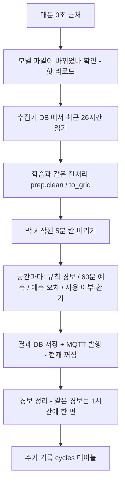

# 🛰️ 8. 과제 8 상시 추론 서비스

지금까지 만든 예측·이상 탐지·상태 추정을 "실험"에서 "매분 스스로 돌아가는 서비스"로 바꾼 과제입니다. 보드 B 에서 `ts-inference` 라는 이름으로 12시간 동안 713번 돌았고 한 번도 실패하지 않았습니다.

> 📖 읽는 순서: 1부(비유·용어 → 서비스와 systemd → 매분 한 주기 → 같은 전처리 → 경보 → API·MQTT → 12시간 결과 → 심화 제어 시뮬레이션) → 2부(실제 코드·명령) → 자주 하는 실수 → 예상 질문

# 1부. 처음 보는 사람을 위한 설명

## 1. 한 문장으로 요약하면

> 보드 B 의 `ts-inference` 서비스가 매분 수집기 DB 를 읽어 학습 때와 똑같은 전처리를 거친 뒤 공간마다 60분 예측·이상 여부·사용 여부를 계산하고, 그 결과를 HTTP 조회 API(포트 8080)로 제공합니다. 12시간(10-21 16:14 ~ 10-22 04:13) 동안 713주기 실패 0, 평균 처리 0.95초였고, 수집기를 멈춘 시험과 실제 보드 재부팅 때 '데이터 끊김' 경보가 정확히 나왔으며 헛경보는 0건이었습니다. MQTT 발행 기능은 만들어 두었지만 공용 브로커라 팀 확인 전까지 꺼 두었습니다.

## 2. 일기예보 방송국에 비유해 보기

| 비유 | 이 과제에서는 | 정식 이름 |
| --- | --- | --- |
| 24시간 문 여는 방송국 | 꺼지지 않고 계속 도는 프로그램 | 서비스 / 데몬 |
| 방송국 관리인(꺼지면 다시 켬) | 리눅스가 프로그램을 관리 | systemd (`Restart=always`) |
| 건물 전기 들어오면 자동 개국 | 보드 켜지면 자동 시작 | `systemctl enable` |
| 매분 정시 뉴스 | 1분마다 계산 한 번 | 주기(cycle), `interval_sec: 60` |
| 기상 관측소 기록 | 수집기가 쌓은 센서값 | 수집기 DB (`sensors.db`) |
| 학습 때와 같은 관측 방법 | 같은 정제·5분 평균 | `tsinf/prep.py` 공유 |
| 아직 집계 중인 5분 | 1~2분치만 들어온 칸 | 막 시작된 5분 칸 (안 씀) |
| 예보관 교체(방송 중단 없이) | 모델 파일만 바꾸면 다음 주기부터 새 모델 | 핫 리로드 |
| 긴급 속보 | "곧 1,000ppm 넘음", "데이터 끊김" | 경보(alarm) |
| 같은 속보를 매분 반복하지 않음 | 1시간에 한 번만 다시 보냄 | 중복 억제 (`ALARM_REPEAT_SEC = 3600`) |
| 전화로 물어보는 기상대 | "회의실 30분 뒤 CO₂는?" | HTTP 조회 API |
| 라디오 방송(듣는 사람에게 밀어줌) | 구독자에게 결과를 보내기 | MQTT 발행 |
| 게시판에 최신 예보 붙여 두기 | 새로 온 구독자도 최신값을 바로 받음 | retain |
| "방송국이 꺼졌습니다" 자동 안내 | 서비스가 죽으면 브로커가 대신 알림 | LWT (Last Will) |

## 3. 용어 사전

| 용어 | 쉬운 뜻 | 이 과제에서는 |
| --- | --- | --- |
| 서비스(service) | 사람이 실행하지 않아도 계속 도는 프로그램 | `ts-inference` (추론), `ts-collector` (수집) |
| 데몬(daemon) | 서비스와 같은 뜻, 뒤에서 조용히 도는 프로그램 | 화면 없이 보드에서 계속 실행 |
| systemd | 리눅스에서 서비스를 켜고 끄고 다시 살리는 관리자 | `deploy/ts-inference.service` 파일로 등록 |
| `Restart=always` | 죽으면 무조건 다시 켬 | `RestartSec=5` → 5초 뒤 재시작 |
| `enable` | 부팅할 때 자동으로 켜기 | 재부팅 후 사람 개입 없이 복구 |
| 주기(cycle) | 한 번의 "읽기 → 계산 → 저장" | 매분 0초 근처, 12시간에 713회 |
| 전처리 | 원본 데이터를 모델이 먹기 좋게 다듬기 | 중복 제거 → 시계 보정 → 범위 밖 제거 → 5분 평균 → 공간 평균 → 짧은 결측 보간 |
| 5분 칸(bin) | 5분 동안의 값을 평균낸 한 칸 | 예측 입력은 5분 칸 24개(2시간) |
| ONNX Runtime | 모델 실행 프로그램(과제 7) | `service_gru.onnx` 를 CPU 로 실행 |
| 핫 리로드 | 서비스를 끄지 않고 새 모델로 바꾸기 | 파일 수정 시각이 바뀌면 다시 읽음 |
| 경보(alarm) | 사람이 봐야 할 일 | data_gap, model_residual, ventilation_soon 등 |
| data_gap | 데이터가 안 들어옴 | 수집기 전체 3분 넘게 수신 없음 / 공간별 평소 주기의 3배(최소 15분) |
| residual(예측 오차) | 예측과 실제의 차이 | 15분 전 예측보다 계속 높으면 설비 이상 의심 |
| HTTP API | 주소로 물어보면 JSON 으로 답하는 창구 | `http://보드:8080/spaces/meeting/forecast?minutes=30` |
| curl | 터미널에서 웹 주소를 호출하는 명령 | API 시험에 사용 |
| JSON | 이름:값 쌍으로 된 데이터 형식 | 모든 결과의 형식 |
| MQTT | 가벼운 메시지 전달 방식(발행·구독) | 브로커 `<교육장-MQTT-브로커>:1883` |
| retain | 브로커가 마지막 메시지를 보관 | 새 구독자도 최신 결과를 즉시 받음 |
| LWT(Last Will and Testament) | 접속이 끊기면 브로커가 대신 보내는 유언 메시지 | `team5b/inference/_status` 에 `{"online": false}` |
| SQLite | 파일 하나짜리 작은 데이터베이스 | 결과·주기 기록·경보를 `results.db` 에 저장 |

## 4. 서비스는 왜 필요하고 systemd 는 무엇을 하나

1. 과제 2~7 은 사람이 명령을 쳐야 도는 "실험"이었습니다. 운영진·다른 팀 대시보드·로컬 LLM 에이전트·냉난방 제어는 **매분 최신 판단**이 필요합니다.
2. 그래서 프로그램을 **서비스(데몬)**로 만듭니다. 사람이 로그인하지 않아도, 터미널을 닫아도 계속 돕니다.
3. systemd 가 관리인 역할을 합니다.
   - `Restart=always`, `RestartSec=5`: 프로그램이 죽으면 5초 뒤 다시 켭니다.
   - `WantedBy=multi-user.target` + `enable`: 보드가 부팅하면 자동으로 켭니다.
   - `After=network-online.target ts-collector.service`: 네트워크와 수집기가 먼저 켜진 뒤 시작합니다.
4. 실제로 **10-21 18:54 보드가 재부팅**됐을 때(팀 공용 보드, 원인 미상) 수집기와 추론 서비스 모두 사람 손 없이 다시 켜졌습니다.

## 5. 매분 한 주기에 일어나는 일 (`Engine.run`)



1. **모델 확인**: `service_gru.onnx` 의 수정 시각이 바뀌었으면 새로 읽습니다.
2. **데이터 읽기**: 수집기 DB 에서 최근 26시간(예측 2시간 + 정규화용 24시간 + 여유)을 읽습니다.
3. **전처리**: 학습 때 쓴 `tsinf/prep.py` 를 그대로 호출합니다.
4. **덜 찬 칸 제거**: `now.floor("5min")` 보다 앞선 칸만 씁니다.
5. **공간마다 계산**: 한 공간이 실패해도 `try/except` 로 다른 공간은 계속 계산합니다.
6. **저장·발행·경보**: 결과를 SQLite 에 저장하고, 경보는 중복을 걸러 기록합니다.
7. **실패해도 다음 주기는 정상**: `cycle()` 전체가 `try/except` 로 감싸져 있어 예외가 나도 기록만 하고 다음 분에 다시 돕니다.

## 6. 학습과 같은 전처리, 그리고 덜 찬 칸을 쓰지 않는 이유

**같은 전처리를 써야 하는 이유**

1. 모델은 학습 때 본 모양의 데이터만 잘 다룹니다.
2. 예를 들어 학습은 5분 평균값으로 했는데 서비스가 1분 원본을 넣으면 잡음이 커져, 모델이 엉뚱한 변화량을 예측합니다. 오류 메시지 없이 **조용히 틀어지는 것**이 가장 무섭습니다.
3. 그래서 학습 코드와 서비스 코드가 **같은 파일**(`tsinf/prep.py`)을 씁니다: 재전송 중복 제거 → 게이트웨이 시계 보정 → 범위 밖 제거 → 기기별 5분 평균 → 공간 평균 → 15분 이하 결측 보간.

**막 시작된 5분 칸(부분 칸)을 쓰지 않는 이유**

1. 예: 지금이 10:07 이면 10:05~10:10 칸에는 2분치만 들어 있습니다.
2. 센서 주기가 1·2·10분으로 제각각이라, 2분치만 있으면 어떤 센서는 값이 있고 어떤 센서는 없습니다. 평균이 한쪽으로 치우칩니다.
3. 그래서 다 찬 칸(10:00~10:05)까지만 씁니다. 결과 JSON 의 `time` 이 "마지막으로 다 찬 5분 칸의 시작"인 이유입니다.

## 7. 모델 교체와 핫 리로드

1. 처음에는 합성 데이터로 학습한 범용 GRU 를 올렸습니다.
2. 실데이터 검증에서 이 모델이 '현재값 유지'보다 크게 나빴습니다(77.1 vs 33.4ppm).
3. 그래서 **교육장 실데이터(9/27~)로 학습한 GRU 로 교체**했습니다(30.6ppm).
4. 이때 서비스를 끄지 않아도 되도록 `_load()` 가 매 주기 파일 수정 시각(`mtime`)을 비교해, 바뀌었으면 새 모델을 읽게 했습니다. 앞으로 매주 재학습한 모델을 **무중단으로** 바꿀 수 있습니다.
5. 모델이 바뀌면 이전 예측 기록(`history`)을 지웁니다. 옛 모델의 예측과 새 모델의 실제값을 비교하면 엉뚱한 예측 오차 경보가 날 수 있기 때문입니다.

## 8. 경보의 종류와 조건

| 경보 kind | 언제 나나 | 권장 조치 |
| --- | --- | --- |
| `data_gap` | 수집기 전체가 180초 넘게 아무것도 못 받음 → "수집기·브로커·네트워크 확인" / 또는 이 공간만 평소 주기의 3배(최소 15분) 넘게 조용함 → 센서·게이트웨이 | 수집기·게이트웨이 확인 |
| `model_residual` | 15분 전 예측보다 실제가 계속 높음(z 4 초과)이 5분 칸 6개(30분) 연속 | 환기·냉방 정지 의심, 설비 확인 |
| `ventilation_soon` | 과제 5 분류 모델이 "30분 안 1,000ppm 초과" 가능성 높다고 판단, 지금은 1,000 미만 | 환기 |
| `co2_over_1000_forecast` | 60분 예측에서 1,000ppm 을 넘는 칸이 있음 (예: 25분 뒤) | 미리 환기 |
| `stuck` / `spike` / `out_of_range` | 값 고정 / 튄 값 / 범위 밖 | 센서 확인 |

**왜 공간마다 기준이 다른가**: 회의실 센서는 약 10분 주기로 보내서, 10분 조용한 것은 정상입니다. 그래서 공간별 평소 주기를 계산해 그 3배(최소 15분)를 기준으로 삼습니다.

**왜 '30분 연속'인가**: 실데이터 운영 점검(과제 4)에서 회의 시작으로 CO₂ 가 오른 정상 변화를 '예상보다 높음'으로 9번 오인했습니다. 일정 정보가 없어 모델이 회의 시작을 미리 모르기 때문입니다. 그래서 5분 칸 6개(30분) 연속일 때만 울리게 바꿨습니다.

**중복 억제(1시간)**: 같은 고장에 매분 경보를 보내면 받는 사람이 알림에 지쳐 결국 무시합니다(알림 피로). 그래서 (공간, 종류, 항목)이 같은 경보는 1시간(3600초)에 한 번만 "보냄"으로 표시하고, 나머지는 기록만 합니다.

> 🎤 **Q. 같은 고장에 대해 매분 경보를 보내면 어떻게 되고, 언제 다시 보내야 하나요?**
> 매분 보내면 1시간에 60번 같은 알림이 와서 사람이 알림 자체를 꺼 버립니다. 그래서 공간·종류·항목이 같은 경보는 1시간에 한 번만 보내고, 사이에 나온 것은 DB 에 기록만 합니다. 12시간 동안 실제로 보낸 경보는 10건뿐이었는데, 수집기 정지 시험과 보드 재부팅 2번 × 5개 공간이었습니다.

## 9. 결과를 내보내는 두 가지 방법

### 9-1. HTTP 조회 API (지금 켜져 있음)

필요할 때 "물어보는" 방식입니다. 보드 B 의 8080 포트, Tailscale 망 안에서 접속합니다.

| 요청 | 답 |
| --- | --- |
| `GET /health` | `ok`, 마지막 주기 후 몇 초, 가동 시간, MQTT 연결 여부. 마지막 주기가 3분(180초) 넘게 없으면 503 |
| `GET /spaces` | 공간별 요약 목록 (최신값, 사용 여부, 이상 여부, 몇 분 뒤 1,000ppm) |
| `GET /spaces/<slug 또는 이름>` | 한 공간의 최신 결과 전체 |
| `GET /spaces/<slug>/forecast?minutes=30` | N분 뒤 CO₂·온도 (5분 단위로 반올림, 5~60분) |
| `GET /alarms?hours=12` | 최근 실제로 보낸 경보 목록 |
| `GET /log/summary?hours=12` | 주기 수·성공·실패·처리 시간(평균·p95·최대)·최대 공백 |

공간 slug: 실습실 `lab`, 사무실 `office`, 회의실 `meeting`, 사무실 밖 `office_outside`, 복도 `corridor`. 사무실 밖·복도는 CO₂ 센서가 없어 최신값·이상만 나옵니다.

### 9-2. MQTT 발행 (설계 완료, 지금은 꺼짐)

구독자에게 "밀어 주는" 방식입니다.

| 토픽 | 내용 | 주기 |
| --- | --- | --- |
| `team5b/inference/<slug>` | 공간 최신 결과 전체 | 매분 |
| `team5b/inference/<slug>/alarm` | 경보 한 건 (1시간에 한 번) | 발생 시 |
| `team5b/inference/_status` | 서비스 상태. 죽으면 브로커가 `{"online": false}` (LWT) | 매분 |

- **retain**: 브로커가 마지막 메시지를 보관해, 새로 구독한 대시보드도 1분을 기다리지 않고 최신값을 바로 받습니다. 과제의 "새로 접속한 구독자도 최신값을 바로 받을 수 있어야 한다"를 만족하는 설계입니다.
- **LWT**: 서비스가 갑자기 죽어 접속이 끊기면 브로커가 미리 맡겨 둔 `{"online": false}` 를 대신 발행합니다. 받는 쪽이 "결과가 안 오는 게 서비스 다운 때문"이라는 걸 압니다.
- **왜 꺼 두었나**: `service/config.yaml` 에 `enabled: false  # 공용 브로커에 발행하려면 true (팀 확인 후)` 로 되어 있습니다. `<교육장-MQTT-브로커>` 은 교육용 **공용** 브로커이고 공용 계정이라, 팀 확인 없이 매분 retain 메시지를 올리지 않기로 했습니다. 그래서 `/health` 결과에 `"mqtt": false` 가 나옵니다. **발행 기능은 코드로 있지만 실제 발행은 시험하지 않았다**고 솔직히 말해야 합니다.

## 10. 12시간 가동 결과

| 항목 | 결과 | 출처 |
| --- | --- | --- |
| 기간 | 10-21 16:14 ~ 10-22 04:13 (11.98시간) | `service_12h_summary.json` |
| 주기 | **713회, 성공 713, 실패 0** | 〃 |
| 처리 시간 | 평균 953.3ms(0.95초) / p95 1,437.8ms / 최대 1,785.7ms | 〃 |
| 오류 | 0 | 〃 |
| 주기 사이 최대 공백 | 475.6초(약 8분) = 18:54 보드 재부팅 | 〃 |
| 보낸 경보 | data_gap 10건 | 〃, `service_12h_alarms.json` |

**해석**

1. 매분 마감에 비해 처리 시간이 1초 안팎이라 여유가 충분합니다. 그중 모델 계산은 0.22ms 수준(과제 7)이고, 나머지는 대부분 DB 읽기·전처리 시간입니다.
2. 713회는 12시간 × 60 = 720회보다 7회 적은데, 재부팅으로 약 8분 비었기 때문입니다. 서비스 자체가 실패한 주기는 0입니다.
3. 재부팅 공백은 "서비스가 멈춘 것"이 아니라 "보드가 꺼진 것"이고, 부팅 후 systemd 가 자동으로 켰습니다.

**장애 시험 (`reports/gap_test.log`, 보드 cron 으로 자동 실행)**

| 시각 | 일 | 결과 |
| --- | --- | --- |
| 17:56:01 | 정지 전 | 5개 공간 모두 `anomaly= False` |
| 17:56:01 | 수집기 일시정지 (`kill -STOP`) | |
| 17:59:30 | '데이터 끊김' 경보 5개 공간 | "수집기 전체 수신 없음 219초" (기준 180초) |
| 18:00:01 | 정지 4분 후 | 5개 공간 모두 `anomaly= True` |
| 18:06:02 | 정지 10분 후 → 수집기 재개 (`kill -CONT`) | 아직 True |
| 18:08:32 | 재개 2.5분 후 | 5개 공간 모두 `anomaly= False`, 정상 복귀 |

- 시험 내내 `/health` 는 `"ok": true` 였습니다. 데이터가 끊겨도 **서비스는 계속 돌면서 끊긴 사실을 알렸다**는 뜻입니다.
- 18:56 재부팅 직후에도 같은 경보가 정확히 나왔습니다("수집기 전체 수신 없음 231초").
- 12시간 경보 10건 = 이 2번 × 5개 공간뿐이라 **헛경보 0**입니다.
- `kill -STOP` 은 프로세스를 "일시정지"만 하므로 systemd 가 죽었다고 보고 다시 켜지 않습니다. sudo 없이 정확히 10분 끊김을 만들 수 있는 방법입니다.

> 🎤 **Q. 12시간 동안 정말 한 번도 안 멈췄나요? 재부팅은요?**
> 서비스가 계산에 실패한 주기는 713번 중 0번이고 평균 0.95초 걸렸습니다. 다만 18:54 에 팀 공용 보드가 재부팅돼서 약 8분(476초) 비었습니다. 이건 서비스 문제가 아니라 보드가 꺼진 것이고, systemd 의 enable·Restart 설정 덕분에 부팅 후 사람 손 없이 다시 켜졌습니다. 재부팅 직후 '데이터 끊김' 경보도 정확히 나왔습니다.

## 11. 심화(B): 예측으로 환기를 미리 하면 얼마나 좋아질까

과제의 심화 문제는 "예측 결과로 환기 규칙을 만들고, 지난 1주에 적용하면 1,000ppm 초과 시간이 얼마나 줄었을지 추정"입니다. `task8_control.py` 로 시뮬레이션했습니다.

**조건**: 합성 5주차(같은 재실·일정·날씨), 물리 모델(CO₂ 질량 수지) 재계산, 환기 강화 = 환기 횟수 +4회/h × 15분, 판단 주기 5분, 예측 = 과제 3 GRU(일정 포함)

| 방식 | 1,000ppm 초과(분/주) | 1,500ppm 초과(분/주) | 환기 강화(분/주) | 초과 시간 감소율 |
| --- | ---: | ---: | ---: | ---: |
| 기존 (제어 없음) | 2,738 | 107 | 0 | 0% |
| 반응형 (넘으면 환기 = 지금 현장 방식) | 288 | 0 | 1,350 | 89.5% |
| 예측형 (30분 앞 예측으로 미리 환기) | **159** | 0 | 2,410 | **94.2%** |

**해석**

1. 지금 방식(넘고 나서 환기)보다 예측형이 1,000ppm 초과 시간을 **288 → 159분/주**로 거의 절반 줄입니다.
2. 대신 환기 강화 시간이 **1,350 → 2,410분/주**로 늘어납니다. 예측이 틀린 만큼(헛경보) 미리 환기하기 때문이고, 그만큼 냉난방 에너지가 샙니다. 둘 사이의 균형을 봐야 합니다.
3. 30분 앞이 아니라 15분 앞으로 줄이면 환기 시간은 줄고 초과 시간은 조금 늘 것으로 봅니다(측정 아님, 보고서 의견).
4. **한계**: 합성 데이터의 물리 모델 위 추정입니다. 실제 창문 효과(외기 온도·바람)와 사람이 반응하는 지연은 반영하지 않았습니다.

---

# 2부. 실제 코드와 설정

## 1. systemd 등록 파일 — `inference/deploy/ts-inference.service`

```ini
[Unit]
Description=Timeseries inference service (assignment 8)
Wants=network-online.target ts-collector.service        # ← 네트워크·수집기도 같이 켜지길 원함
After=network-online.target ts-collector.service        # ← 그것들이 켜진 다음에 시작

[Service]
Type=simple
User=__USER__                                           # ← 설치 스크립트가 suyeon 으로 채움
WorkingDirectory=__DIR__                                # ← ~/ts-inference
ExecStart=__DIR__/.venv/bin/python -m service.run --config service/config.yaml   # ← 실제 실행 명령
Restart=always                                          # ← 죽으면 항상 다시 켬
RestartSec=5                                            # ← 5초 기다렸다가
StartLimitIntervalSec=0                                 # ← 재시작 횟수 제한 없음
Environment=PYTHONUNBUFFERED=1                          # ← 로그를 바로바로 출력

[Install]
WantedBy=multi-user.target                              # ← 부팅하면 자동 시작 (enable 과 함께)
```

설치·확인 명령 (보드에서):

- `cd ~/ts-inference && bash deploy/install_service.sh` → 가상환경을 만들고 패키지를 깔고, 위 파일을 `/etc/systemd/system/` 에 복사한 뒤 `enable --now` 로 등록·시작합니다(sudo 비밀번호를 물을 수 있음).
- `systemctl status ts-inference` → 서비스가 active (running) 인지 봅니다.
- `journalctl -u ts-inference -n 20` → 최근 로그 20줄을 봅니다("주기 완료: 공간 5개, ...ms").
- `sudo systemctl restart ts-inference` → 설정을 바꾼 뒤 다시 켭니다.

## 2. 설정 — `inference/service/config.yaml`

```yaml
collector_db: ../ts-collector/data/sensors.db     # ← 수집기(과제 1) DB (읽기만 함)
results_db: data/service/results.db               # ← 서비스 결과·주기 기록·경보
model_dir: models
env_file: ../ts-collector/.env                    # ← MQTT 아이디/비밀번호는 .env 에 둔다 (값은 문서에 쓰지 않음)
interval_sec: 60                                  # ← 매분
http_port: 8080
mqtt:
  enabled: false                 # ← 공용 브로커에 발행하려면 true (팀 확인 후)
  host: <교육장-MQTT-브로커>
  port: 1883
  prefix: team5b/inference       # ← team5b/inference/<공간>, .../<공간>/alarm, .../_status
```

## 3. 모델 핫 리로드 — `inference/service/infer.py`

```python
def _load(self):
    """모델 파일이 바뀌면 다시 읽는다 (재학습한 모델을 서비스 재시작 없이 교체)."""
    path = os.path.join(self.model_dir, "service_gru.onnx")
    mt = os.path.getmtime(path)                       # ← 파일이 마지막으로 바뀐 시각
    if mt != self._mtime:                             # ← 지난번과 다르면 = 새 모델
        self.sess = ort.InferenceSession(path, providers=["CPUExecutionProvider"])  # ← ONNX Runtime 으로 다시 열기
        self.meta = json.load(open(os.path.join(self.model_dir, "service_meta.json"), encoding="utf-8"))
        self._mtime = mt
        self.history.clear()                          # ← 옛 모델의 예측 기록은 버림
```

## 4. 한 주기: 같은 전처리와 덜 찬 칸 제거 — `inference/service/infer.py`

```python
def run(self, db_path: str, now: Optional[pd.Timestamp] = None) -> dict:
    t_start = time.time()
    self._load()                                                   # ← 매 주기 모델 교체 확인
    now = now or pd.Timestamp.now(tz=prep.TZ)
    raw = prep.load_readings(db_path, since=(now - pd.Timedelta(hours=26)).timestamp())  # ← 최근 26시간만 읽음
    ...
    df, cst = prep.clean(raw)                                      # ← 학습과 같은 정제 함수
    grid_all = prep.to_grid(df)                                    # ← 학습과 같은 5분 칸 만들기
    # 막 시작된 5분 칸은 1~2분치만 들어 있어 평균이 치우친다 → 다 찬 칸까지만 쓴다
    cutoff = now.floor("5min")                                     # ← 예: 10:07 → 10:05
    grid = grid_all[grid_all.index < cutoff]                       # ← 10:05 칸(덜 참)은 빼고 10:00 칸까지
    ...
    collector_age = now.timestamp() - float(raw["recv_ts"].max())  # ← 수집기가 마지막으로 받은 뒤 몇 초
    ...
    for sp in spaces:
        try:
            out["spaces"][sp] = self._space(sp, grid, raw1, raw, ...)
        except Exception as e:     # 한 공간이 실패해도 다른 공간은 계속
            out["errors"].append(f"{sp}: {type(e).__name__}: {e}")
```

## 5. 데이터 끊김 경보 — `inference/service/infer.py`

```python
gap_limit = max(900.0, 3 * interval)                       # ← 공간 평소 주기의 3배, 최소 15분(900초)
if collector_age > 180:                                    # ← 수집기 전체가 3분 넘게 조용함
    rules.append({"type": "data_gap", "metric": None,
                  "detail": f"수집기 전체 수신 없음 {collector_age:.0f}초 (수집기·브로커·네트워크 확인)"})
elif age is None or age > gap_limit:                       # ← 이 공간만 조용함 → 센서·게이트웨이 문제
    rules.append({"type": "data_gap", "metric": None,
                  "detail": f"이 공간 마지막 수신 {age if age is not None else '-'}초 전 (평소 주기 {interval:.0f}초)"})
```

## 6. 예측과 "몇 분 뒤 1,000ppm" — `inference/service/infer.py`

```python
L = self.meta["lookback"]                                       # ← 입력 길이 24칸(2시간)
win = gs[list(prep.METRICS)].iloc[-L:]
if len(win) == L and not win.isna().any().any() and win.index[-1] == latest_t:   # ← 2시간에 빈 칸이 없을 때만 예측
    hist = gs[gs.index >= latest_t - pd.Timedelta(hours=24)]
    mu = hist.mean()                                            # ← 공간별 최근 24시간 평균으로 정규화
    ...
    dz = self.sess.run(None, {"x_seq": x, ...})[0][0]           # ← ONNX Runtime 으로 변화량 12칸 예측
    base = win.iloc[-1]
    co2_f = (base["co2"] + dz[:, 0] * sd["co2"]).round(1)       # ← 지금 값 + 변화량 = 5분~60분 뒤 CO₂
    ...
    if base["co2"] < 1000:
        over = np.where(co2_f >= 1000)[0]
        res["alerts"]["co2_over_1000_in_min"] = int((over[0] + 1) * 5) if len(over) else None  # ← 처음 넘는 칸 → "25분 뒤"
else:
    res["forecast"]["reason"] = "최근 2시간에 빈 칸이 있어 예측 생략"   # ← 억지로 예측하지 않고 이유를 남김
```

## 7. 예측 오차 경보 (30분 연속) — `inference/service/infer.py`

```python
past = [p for p in h if p["base_time"] == latest_t - pd.Timedelta(minutes=15)]  # ← 15분 전에 했던 예측
...
r = np.array([(base["co2"] - p["co2"][2]) / sd["co2"], ...])   # ← 그 예측의 15분 뒤 값(3번째 칸) vs 지금 실제
zz = np.clip(r / rs, 0, None)                                   # ← 예상보다 '높은' 쪽만 봄
# 5분 칸 기준 6칸(30분) 연속으로 예상보다 높아야 경보 (회의 시작처럼 잠깐 오르는 건 무시)
self.resid_run[sp] = self.resid_run.get(sp, 0) + 1 if zz.max() > 4.0 else 0
...
model_alarm = self.resid_run.get(sp, 0) >= 6                    # ← 6칸 연속이면 설비 이상 의심
```

## 8. 매분 루프와 실패 처리 — `inference/service/run.py`

```python
def cycle(self):
    t0 = time.time()
    try:
        out = self.engine.run(self.cfg["collector_db"])        # ← 한 주기 계산
        for sp, res in out["spaces"].items():
            self.store.x("INSERT OR REPLACE INTO latest(...) VALUES (?,?,?,?)", ...)  # ← 공간별 최신 결과 저장
            self._publish(f"{prefix}/{res['slug']}", res)      # ← MQTT 발행 (꺼져 있으면 아무것도 안 함)
            self._alarms(sp, res, prefix)
        ...
        self.store.x("INSERT INTO cycles VALUES (?,?,?,?,?)", (t0, 1, dur, ...))   # ← 성공 기록
    except Exception as e:
        log.exception("주기 실패 (다음 주기에 다시 시도)")      # ← 죽지 않고 기록만
        self.store.x("INSERT INTO cycles VALUES (?,?,?,?,?)", (t0, 0, ...))       # ← 실패 기록

def loop(self):
    interval = self.cfg.get("interval_sec", 60)
    while not self.stop_flag.is_set():
        start = time.time()
        self.cycle()
        # 매분 0초 근처에 맞춰 돈다
        self.stop_flag.wait(max(1.0, interval - (time.time() - start) % interval))  # ← 계산에 걸린 시간만큼 빼고 기다림
```

## 9. 경보 중복 억제 — `inference/service/run.py`

```python
ALARM_REPEAT_SEC = 3600          # 같은 경보는 1시간 안에 다시 보내지 않음
...
for kind, metric, detail in items:
    key = (sp, kind, metric)                                         # ← 공간·종류·항목이 같으면 같은 경보
    sent = 0
    if now - self.last_alarm.get(key, 0) >= ALARM_REPEAT_SEC:        # ← 마지막으로 보낸 지 1시간 지났을 때만
        self.last_alarm[key] = now
        sent = 1
        self._publish(f"{prefix}/{res['slug']}/alarm", {...})        # ← 경보 토픽으로 발행
    self.store.x("INSERT INTO alarms VALUES (?,?,?,?,?,?)", (now, sp, kind, metric, detail, sent))  # ← 보냈든 안 보냈든 기록
```

## 10. MQTT: retain 과 LWT — `inference/service/run.py`

```python
c = mqtt.Client(callback_api_version=mqtt.CallbackAPIVersion.VERSION2,
                client_id=m.get("client_id", "team5b-inference"), clean_session=True)
if os.environ.get("MQTT_USERNAME"):                              # ← 계정은 .env 에서 읽음
    c.username_pw_set(os.environ["MQTT_USERNAME"], os.environ.get("MQTT_PASSWORD"))
status_topic = f"{m['prefix']}/_status"
c.will_set(status_topic, json.dumps({"online": False}), qos=1, retain=True)    # ← LWT: 서비스가 죽으면 브로커가 대신 알림
c.reconnect_delay_set(1, 10)                                     # ← 끊기면 1~10초 간격으로 재접속
...
def _publish(self, topic, payload):
    if self.mqtt is None:                                        # ← enabled: false 면 여기서 끝 (지금 상태)
        return
    self.mqtt.publish(topic, json.dumps(payload, ...), qos=1, retain=True)    # ← retain: 새 구독자도 최신값 즉시
```

## 11. HTTP API 사용 예 (curl)

보드 안에서는 `localhost`, 맥북에서는 Tailscale 주소(<보드B-Tailscale-IP>)로 접속합니다.

- `curl -s localhost:8080/health` → 서비스가 살아 있는지 봅니다. 예: `{"ok": true, "last_cycle_age_sec": 33.1, "uptime_sec": 7293, "mqtt": false}` (gap_test.log 실제 값). 마지막 주기가 180초 넘게 없으면 503 을 돌려줍니다.
- `curl -s localhost:8080/spaces` → 다섯 공간의 최신값·사용 여부·이상 여부·"몇 분 뒤 1,000ppm" 요약 목록을 봅니다.
- `curl -s localhost:8080/spaces/meeting` → 회의실 결과 전체(예측 12칸, 경보, 상태, 이상)를 봅니다. `meeting` 대신 한글 `회의실` 도 됩니다.
- `curl -s "localhost:8080/spaces/meeting/forecast?minutes=30"` → "회의실 30분 뒤 CO₂는?"에 대한 답입니다. 형식: `{"minutes": 30, "co2": ..., "temperature": ..., "time": "...", "base_time": "..."}`. 주소에 `?` 가 있어 따옴표로 감쌉니다. 분은 5분 단위로 반올림되고 5~60분 사이로 맞춰집니다.
- `curl -s "localhost:8080/alarms?hours=12"` → 최근 12시간 동안 실제로 보낸 경보 목록입니다.
- `curl -s "localhost:8080/log/summary?hours=12"` → 12시간 가동 기록 요약입니다. `service_12h_summary.json` 이 이 결과를 저장한 것입니다.
- `curl -s <보드B-Tailscale-IP>:8080/spaces` → 맥북에서 Tailscale 로 보드 B 의 API 를 부릅니다.

예측이 불가능할 때(최근 2시간에 빈 칸): `/forecast` 는 503 과 `{"error": "예측 불가", "reason": "최근 2시간에 빈 칸이 있어 예측 생략"}` 을 돌려줍니다. 없는 공간이면 404 와 가능한 slug 목록을 줍니다.

## 12. 장애 시험 스크립트 — `inference/tools/gap_test.sh`

```bash
PID=$(systemctl show -p MainPID --value ts-collector)   # ← 수집기 프로세스 번호
snap "정지 전"                                           # ← /health 와 /spaces 결과를 로그에 남김
kill -STOP "$PID"                                        # ← 수집기 일시정지 (죽이지 않음 → systemd 가 재시작 안 함)
sleep 240; snap "정지 4분 후"
sleep 360; snap "정지 10분 후"
kill -CONT "$PID"                                        # ← 수집기 재개
sleep 150; snap "재개 2.5분 후"
curl -s "localhost:8080/alarms?hours=1"                 # ← 그 사이 나온 경보 목록
```

## 13. 결과 형식 문서 — `inference/docs/interface.md`

다른 팀이 이 문서만 보고 쓸 수 있게 만든 문서입니다(과제 확인 기준 "토픽·필드·단위·예시"). 들어 있는 것:

1. 공간 목록과 slug, 측정 항목
2. MQTT 토픽 3종, retain·QoS1·LWT 설명, 구독 예 (`mosquitto_sub ... -t 'team5b/inference/#' -v`, 아이디·비밀번호 자리는 `<ID>`, `<PW>`)
3. HTTP API 6종과 응답 예
4. 공간 결과 JSON 전체 예시와 필드별 주석(단위 ppm·°C·%)
5. 경보 JSON 예시와 kind 별 뜻·권장 조치
6. 계산 방식 요약(같은 전처리, 실데이터 학습 GRU, 일정 정보 없음, 성능은 합성 데이터 기준)

## 자주 하는 실수

| 실수 | 일어나는 일 | 막는 법 |
| --- | --- | --- |
| 서비스용 전처리를 따로 새로 짬 | 학습과 분포가 달라 예측이 조용히 틀어짐 | 학습·서비스 모두 `tsinf/prep.py` 사용 |
| 막 시작된 5분 칸까지 사용 | 1~2분치 평균이라 값이 치우침 | `now.floor("5min")` 이전 칸만 |
| 합성 데이터 학습 모델을 그대로 올림 | 실데이터에서 '현재값 유지'보다 크게 나쁨(77 vs 33ppm) | 실데이터(9/27~) 학습 GRU 로 교체 |
| 모델 바꿀 때마다 서비스 재시작 | 그동안 결과가 끊김 | 파일 수정 시각을 보고 핫 리로드 |
| 경보를 '3주기 연속'으로 셌는데 1분 주기라 사실상 5분 칸 1개 | 회의 시작을 '예상보다 높음'으로 9번 오인 | 5분 칸 6개(30분) 연속 조건 |
| 같은 경보를 매분 보냄 | 알림 피로, 사람이 무시 | 1시간에 한 번만 보냄 |
| 회의실(10분 주기 센서)에 짧은 끊김 기준 적용 | 정상인데 끊김 경보 | 공간별 평소 주기의 3배(최소 15분) |
| 수집기를 `kill -9` 로 멈춰 시험 | systemd 가 5초 뒤 다시 켜 10분 끊김이 안 만들어짐 | `kill -STOP` / `kill -CONT` 로 일시정지 |
| 공용 브로커에 확인 없이 retain 발행 | 다른 팀 토픽 공간에 매분 메시지가 남음 | `enabled: false`, 팀 확인 후 켬 |
| 비밀번호를 설정 파일·문서에 씀 | 공용 계정 노출 | `.env` 에 두고 환경변수로 읽음 |

## 예상 질문 모음

**Q. 서비스(데몬)와 그냥 파이썬 스크립트 실행은 뭐가 다른가요?**
스크립트는 사람이 터미널에서 실행하고, 터미널을 닫거나 오류가 나면 끝납니다. 서비스는 systemd 가 관리해서 보드가 켜지면 자동으로 시작하고, 죽으면 5초 뒤 다시 켭니다. 실제로 10-21 18:54 보드가 재부팅됐을 때 사람 손 없이 다시 켜져 이어서 동작했습니다.

**Q. 서비스와 학습의 전처리가 다르면 어떤 일이 생기나요?**
모델은 학습 때 본 모양의 데이터만 잘 다룹니다. 학습은 5분 평균으로 했는데 서비스가 1분 원본을 넣으면 잡음이 커져 엉뚱한 변화량을 예측합니다. 오류도 안 나고 조용히 틀어져서 더 위험합니다. 그래서 학습과 서비스가 같은 `tsinf/prep.py` 코드를 씁니다.

**Q. 막 시작된 5분 칸을 써도 되나요?**
안 됩니다. 10:07 이면 10:05 칸에는 2분치만 있고, 센서 주기가 1·2·10분으로 달라 어떤 센서는 아직 값이 없습니다. 그래서 평균이 치우칩니다. 서비스는 `now.floor("5min")` 이전, 다 찬 칸까지만 씁니다.

**Q. 수집기가 멈추면 어떻게 되나요?**
서비스는 계속 돌면서 끊긴 사실을 알립니다. 시험에서 17:56 수집기를 일시정지하자 17:59:30 에 5개 공간 모두 '데이터 끊김' 경보가 나왔습니다(수신 없음 219초, 기준 180초). 18:06 재개하고 2.5분 뒤 경보가 풀려 정상으로 돌아왔고, 그동안 `/health` 는 계속 ok 였습니다.

**Q. "회의실 30분 뒤 CO₂는?"을 어떻게 물어보나요?**
`curl -s "localhost:8080/spaces/meeting/forecast?minutes=30"` 으로 부릅니다. 매분 계산해 둔 60분 예측(5분 간격 12칸) 중 30분 칸을 꺼내 CO₂·온도·기준 시각을 JSON 으로 돌려줍니다. 최근 2시간에 빈 칸이 있으면 억지로 예측하지 않고 503 과 이유를 돌려줍니다.

**Q. MQTT 는 왜 꺼져 있나요? 그러면 과제를 못 한 건가요?**
발행 코드(retain, LWT, 토픽 설계)와 형식 문서는 완성했지만, `<교육장-MQTT-브로커>` 은 교육용 공용 브로커이고 공용 계정이라 팀 확인 전까지 `enabled: false` 로 두었습니다. 그래서 지금은 HTTP API 로만 제공하고, `/health` 에도 `"mqtt": false` 로 나옵니다. 실제 발행은 시험하지 않았다는 점을 솔직히 말씀드립니다. 설정 한 줄을 true 로 바꾸고 재시작하면 켜집니다.

**Q. retain 과 LWT 는 왜 필요한가요?**
retain 이 없으면 새로 구독한 대시보드는 다음 발행(최대 1분)까지 빈 화면입니다. retain 이면 브로커가 마지막 결과를 보관했다가 바로 줍니다. LWT 는 서비스가 갑자기 죽으면 브로커가 미리 맡겨 둔 `{"online": false}` 를 대신 발행해서, 받는 쪽이 "결과가 안 오는 이유가 서비스 다운"이라는 걸 알게 합니다.

**Q. 12시간 동안 헛경보가 0이라는 건 어떻게 확인했나요?**
12시간 동안 실제로 보낸 경보는 data_gap 10건이었습니다. 이 10건은 17:59 수집기 정지 시험과 18:56 보드 재부팅, 두 번 × 5개 공간이고, 두 번 모두 실제로 데이터가 끊긴 때라 정확한 경보입니다. 그래서 헛경보 0입니다. 다만 이 기간에 CO₂ 가 1,000ppm 을 넘을 일이 없어 환기 경보는 시험되지 않았습니다.

**Q. 예측으로 미리 환기하면 정말 좋아지나요?**
합성 5주차 1주를 물리 모델로 다시 돌려 보니, 넘고 나서 환기하는 지금 방식은 1,000ppm 초과가 288분/주, 30분 앞 예측으로 미리 환기하면 159분/주였습니다. 대신 환기 강화 시간이 1,350분에서 2,410분으로 늘어 냉난방 에너지 손실이 생깁니다. 합성 데이터 위 추정이라 실제 창문 효과나 사람 반응 지연은 반영하지 않았습니다.
